# Module 1: Open the environment and understand the mission

**Estimated time:** 30 minutes

In this module, you collect your workshop credentials, connect to your
workshop virtual machine (VM) and download the workshop files to it, sign in
to GitHub Copilot in Visual Studio Code, and open your **Dev** environment.
You then inspect the business data and record the authority boundary that
the rest of the workshop builds on.

You will complete four parts:

1. [Retrieve your workshop credentials](#part-1-retrieve-your-workshop-credentials)
2. [Connect to the workshop VM](#part-2-connect-to-the-workshop-vm) and
   [download the workshop files](#download-the-workshop-files)
3. [Configure GitHub in Visual Studio Code](#part-3-configure-github-in-visual-studio-code)
4. [Open and verify the development environment](#part-4-open-and-verify-the-development-environment)

## What the facilitator provides

The facilitator provides only infrastructure, data, connections, the app shell,
the Pipeline, and the low-level carrier adapter. You will create the page,
Workflows, Business Skill, agents, and Computer Use tool.

Each participant receives:

- a Microsoft Entra workshop account and a Temporary Access Pass (TAP) or
  workshop password,
- a workshop VM with Visual Studio Code and the workshop tools installed,
- a GitHub account that signs in through the workshop identity provider,
- three Power Platform environments: **Dev**, **Test**, and **Prod**,
- the workshop mailbox used by the intake flow in Module 3.

> [!CAUTION]
> Your workshop credentials are personal to you. Never share them, and never
> include them in screenshots, lab notes, GitHub issues, commits, or chat
> messages.

## Part 1: Retrieve your workshop credentials

1. Open the credential provider application communicated by the speakers in
   a browser on your own device.
2. On **Get your credentials**, enter:
   - **First name**
   - **Last name**
   - **Company email** — use the email address you registered with. Use the
     same address if you return later; it is how the page finds your
     assigned lab.
   - **Workshop you are attending** — select this workshop from the list.
3. Select **Get my credentials**.

   If you already requested credentials, select
   **Already received credentials? Look them up**, enter the same
   **Company email**, and then select **Show my credentials**.

4. Confirm that the page shows **Your credentials are ready** or
   **Welcome back — here are your credentials**, followed by your name and
   workshop. If the page shows an error or says the workshop is fully
   assigned, ask a proctor for help.

   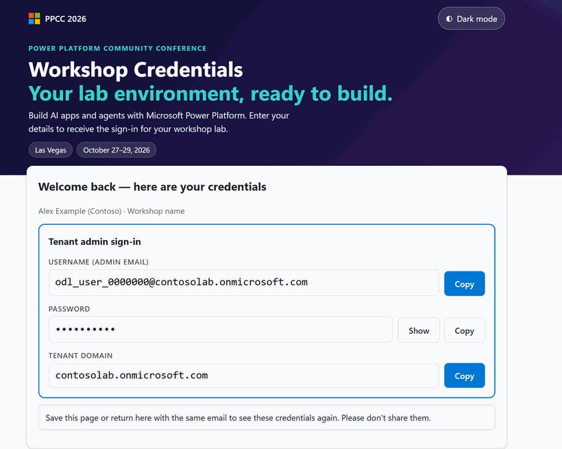

   *The Workshop Credentials page after a successful lookup. The example
   values are fictional; your page shows your own assigned values.*

5. Identify the credentials you need later in this workshop:

   | You need | Where it appears on the page | Used in |
   | --- | --- | --- |
   | Microsoft Entra workshop account | **Tenant admin sign-in** > **Username (Admin email)** | Parts 3 and 4, all later modules |
   | Temporary Access Pass or workshop password | **Tenant admin sign-in** > **Password** (select **Show** or **Copy**) | Parts 3 and 4 |
   | Tenant domain | **Tenant admin sign-in** > **Tenant domain** | Confirming you are in the right tenant |
   | Lab VM address | **Lab VM sign-in** > **Lab VM DNS Name** | Part 2 |
   | Lab VM username and password | **Lab VM sign-in** > **Lab VM Username** and **Lab VM Password** | Part 2 |
   | GitHub username or email, when provided | **GitHub account** > **GitHub Username** or **GitHub User Email** | Part 3 |

   The **Additional test users** section is only needed for exercises in
   which you test as another user. Use the **Tenant admin sign-in** account
   unless a module tells you otherwise.

6. Keep this page open in a browser tab on your own device. You will copy
   values from it in the following parts.

> [!IMPORTANT]
> Use **Copy** instead of retyping values where you can, and paste them only
> into the sign-in prompt that asks for them. Don't paste credentials into
> lab notes, Copilot prompts, Teams, or any other chat.

## Part 2: Connect to the workshop VM

Connect to your workshop VM with Remote Desktop Protocol (RDP). The VM has
the tools and the local repository checkout that later modules use.

> [!NOTE]
> This guide covers Remote Desktop only. If you can't use Remote Desktop from
> your device, ask a proctor for an alternative.

### Connect with Remote Desktop

1. On your credentials page, locate the **Lab VM sign-in** card and its
   **Lab VM DNS Name**, **Lab VM Username**, and **Lab VM Password** values.
   The DNS name ends with `.cloudapp.azure.com`.
2. Open a Remote Desktop client:
   - **Windows:** Select **Start**, enter `Remote Desktop Connection`, and
     open the app. You can also run `mstsc`.
   - **macOS:** Open **Windows App** (formerly Microsoft Remote Desktop) and
     add a new PC.
3. In **Computer** (or **PC name** on macOS), paste the **Lab VM DNS Name**,
   and then select **Connect**.
4. When Windows asks for credentials, select **More choices** >
   **Use a different account**. Enter the **Lab VM Username** and
   **Lab VM Password**, and then select **OK**.

   If your device adds a company domain to the username, enter the username
   as `.\` followed by the **Lab VM Username**.

5. A certificate or identity warning, such as
   **The identity of the remote computer cannot be verified**, is expected
   for workshop VMs. Before you continue, confirm that you entered your own
   **Lab VM DNS Name** from the credentials page. Then select **Yes**.

   Don't select **Don't ask me again for connections to this computer** on a
   shared or public device.

6. Wait for the Windows desktop to load. If Windows shows privacy or network
   prompts, accept the defaults.
7. Confirm that the session is responsive: open the **Start** menu and
   confirm that **Visual Studio Code** is listed.

Keep the Remote Desktop session open. Complete the rest of the workshop
inside the VM unless an instruction tells you otherwise.

### Download the workshop files

Later modules use prompts and files from this repository. Download a copy to
the VM and store it in `C:\github\ppcc26-apps-automations-agents`.

1. On the workshop VM, open a browser and go to
   <https://github.com/microsoft/ppcc26-apps-automations-agents>.
2. Select **Code**, and then select **Download ZIP**. You don't need to sign
   in to GitHub to download.

   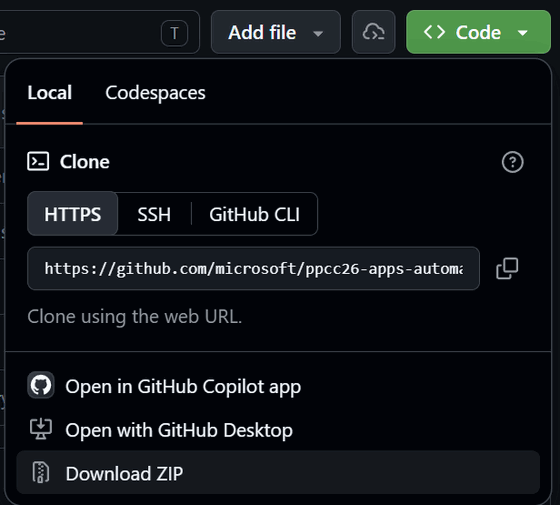

   *Download the repository as a ZIP file from the Code menu.*

3. Create the destination folder. Open **File Explorer**, select
   **This PC** > **Local Disk (C:)**, and check whether a `github` folder
   exists. If it doesn't, select **New** > **Folder**, and name it `github`.
4. When the download completes, go to **Downloads** in File Explorer.
5. Right-click `ppcc26-apps-automations-agents-main.zip`, and then select
   **Extract All**.
6. In **Files will be extracted to this folder**, enter `C:\github`, and then
   select **Extract**.
7. In File Explorer, go to `C:\github`. Rename the extracted
   `ppcc26-apps-automations-agents-main` folder to
   `ppcc26-apps-automations-agents`.
8. Open `C:\github\ppcc26-apps-automations-agents` and confirm that it
   directly contains the `labs`, `setup`, and `solutions` folders.

   If you see another `ppcc26-apps-automations-agents-main` folder inside
   instead, move its contents up one level so that `labs` is directly under
   `C:\github\ppcc26-apps-automations-agents`.

## Part 3: Configure GitHub in Visual Studio Code

Sign in to GitHub Copilot in Visual Studio Code on the VM. Your GitHub account
signs in through the workshop single sign-on (SSO) provider, so you use your
Microsoft Entra workshop account rather than a GitHub password.

1. On the workshop VM, open **Visual Studio Code**.
2. In the status bar at the lower right of the window, select the
   **GitHub Copilot** icon (1), and then select **Use AI Features** (2).

   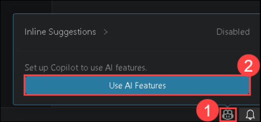

   *The GitHub Copilot menu in the Visual Studio Code status bar.*

3. On **Sign in to use GitHub Copilot**, select **Continue with GitHub**.
   A browser window opens.

   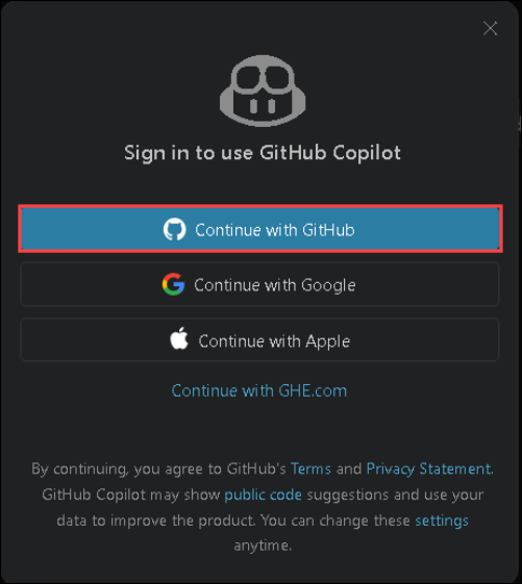

   *Choose GitHub as the sign-in provider.*

4. On **Sign in to GitHub**, enter the **GitHub Username** from your
   credentials page in **Username or email address** (1). Leave
   **Password** empty.
5. Select **Sign in with your identity provider** (2).

   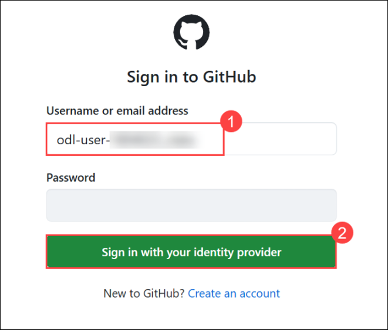

   *Workshop GitHub accounts sign in through the identity provider, not a
   GitHub password.*

6. On **Single sign-on to CloudLabs Organizations**, select **Continue**.

   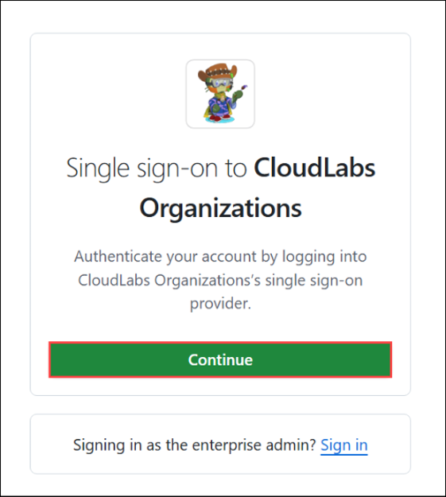

   *The CloudLabs Organizations single sign-on page.*

7. On the Microsoft **Sign in** page, enter your Microsoft Entra workshop
   account (**Username (Admin email)** from your credentials page) (1), and
   then select **Next** (2).

   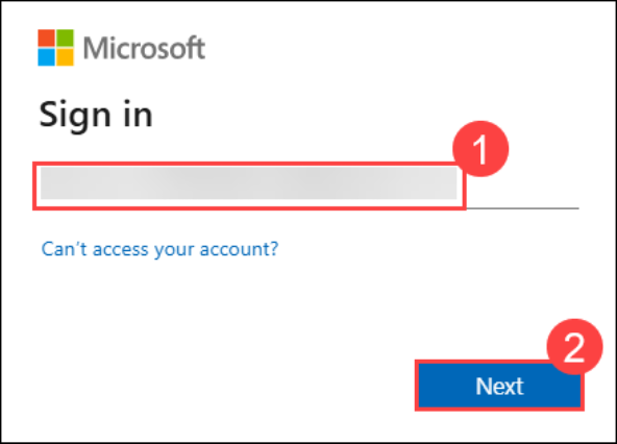

   *Sign in with your Microsoft Entra workshop account.*

8. On **Enter Temporary Access Pass**, enter the **Password** value from your
   credentials page (1), and then select **Sign in** (2).

   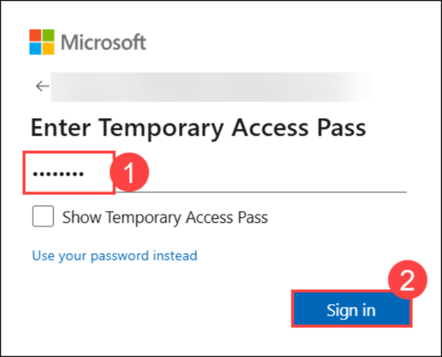

   *Enter your Temporary Access Pass. Keep Show Temporary Access Pass cleared.*

9. On **Stay signed in?**, select **No**.

   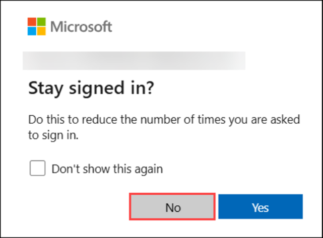

   *Select No so the workshop session isn't remembered on the VM.*

10. Back in the browser, on **Authorize Visual Studio Code**, confirm that
    **Signed in as** shows your workshop GitHub username, and then select
    **Continue**.

    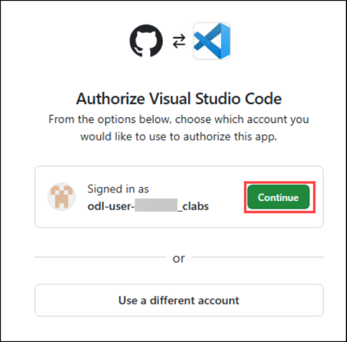

    *Authorize Visual Studio Code to use your workshop GitHub account.*

11. If the browser asks to open Visual Studio Code, select **Open**.
12. Return to Visual Studio Code. Confirm that the **Accounts** menu (person
    icon in the Activity Bar) lists your workshop GitHub account, and that
    the **Chat** view accepts a prompt without asking you to sign in.

## Part 4: Open and verify the development environment

Each participant has three environments. You build in **Dev** during this
workshop.

| Environment | Name | Type | Purpose |
| --- | --- | --- | --- |
| Dev | `Dev-USER-<number>` | Developer | Where you build and test in every module. |
| Test | `Test-USER-<number>` | Sandbox | Reserved for deployment; don't edit it. |
| Prod | `Prod-USER-<number>` | Production | Reserved for deployment; don't edit it. |

`<number>` is the same number that appears in your Microsoft Entra workshop
account (`odl_user_<number>@...`). For example, the fictional account
`odl_user_0000000@contosolab.onmicrosoft.com` would own `Dev-USER-0000000`,
`Test-USER-0000000`, and `Prod-USER-0000000`.

### Find your environments in the Power Platform admin center

1. On the workshop VM, open a browser and go to
   <https://admin.powerplatform.microsoft.com>.
2. Sign in with your Microsoft Entra workshop account and your Temporary
   Access Pass. If you're asked **Stay signed in?**, select **No**.
3. In the Power Platform admin center (PPAC), select **Manage** in the left
   navigation, and then select **Environments**. If an **Explore Power
   Platform Inventory** tip appears, close it.
4. Confirm that the list includes your three environments:
   `Dev-USER-<number>`, `Test-USER-<number>`, and `Prod-USER-<number>`.
   If the list is long, enter your number in **Search**.

   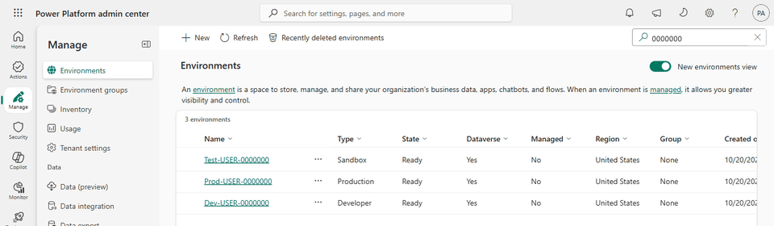

   *Each participant's Dev, Test, and Prod environments share the same
   number.*

5. Note the full name of your **Dev** environment. You select it in Power
   Apps next.

### Open the DEV app shell

1. Go to <https://make.preview.powerapps.com>.
2. Sign in with the workshop account if prompted.
3. In the upper-right suite header, select the environment button.
4. In **Select environment**, enter your number in **Search**.
5. Under **Build apps with Dataverse**, select your
   **Dev-USER-&lt;number&gt;** environment. Don't select **Test** or
   **Prod**.
6. Confirm the header reads **Environment Dev-USER-&lt;number&gt;** with your
   number.

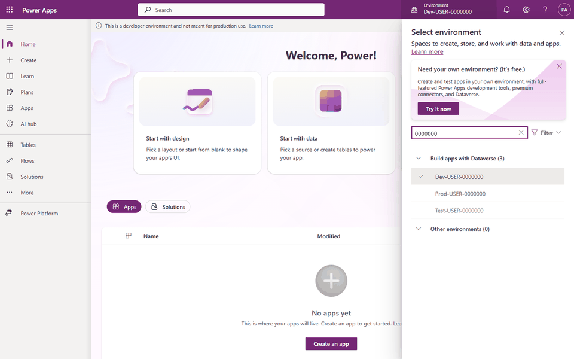

*Select your Dev environment. The header confirms the active environment.*

7. Select **Apps**.
8. Find **PPCC Agentic Operations Control Tower**. If it isn't under
   **My apps**, select **All**.

> [!NOTE]
> If you don't see any apps in the list, publish the solution: select
> **Solutions**, open **PPCC Agentic Operations Control Tower**, and then
> select **Publish all customizations**. When publishing completes, select
> **Apps** again.

9. Select **Play**. If Play is hidden, select the app's **...** menu, then
   select **Play**.
10. Confirm the header reads **PPCC Agentic Operations Control Tower**.

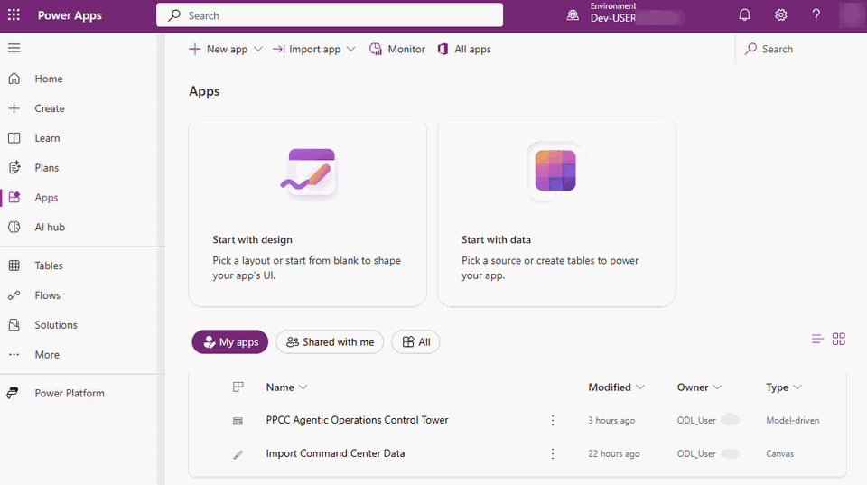

*The prepared Control Tower app in your Dev environment.*

## Inspect the business data

1. In the app's left navigation, select **Order Details**.
2. Use the view search/filter to find product
   **Northwind Traders Clam Chowder**.
3. Locate these three order lines. Only **Quantity** and **Unit Price**
   appear in the app; you calculate the exposure yourself.

   | Order | Quantity | Unit Price |
   | --- | ---: | ---: |
   | `0915` | `50` | `9.65` |
   | `0920` | `30` | `9.65` |
   | `0935` | `10` | `9.65` |

4. For each order line, calculate its exposure:

   ```text
   Exposure = Quantity × Unit Price
   ```

   Write the three results in your lab notes.

5. Add the three exposures to get the total exposure for Clam Chowder.
6. Confirm your total is `USD 868.50`, and record it in your lab notes. If
   your total differs, recheck each line before you continue.
7. Select **Purchase Orders**.
8. Confirm there is no participant-created Purchase Order whose number begins
   with `CL`.

## Understand the authority boundary

Write these three lines in your lab notes:

1. **The system may prepare:** detect the delay, calculate impact, apply policy,
   rank work, and draft communications.
2. **A person must decide:** approve, reject, or request revision for one exact
   recovery action.
3. **The system may execute after approval:** update Dataverse, register the
   carrier contact with Computer Use, write CP7 evidence, and resolve the case.

## Troubleshooting

| Symptom | What to try |
| --- | --- |
| The credentials page can't find you | Use the same **Company email** you registered with. If it still fails, or the workshop shows as fully assigned, ask a proctor. Don't request a second set of credentials. |
| Sign-in rejects your Temporary Access Pass | Select **Copy** on the credentials page and paste again; TAP values are case-sensitive and can contain symbols. A TAP can expire. If it was rejected twice, ask a proctor for a new one. |
| You're signed in with a different account | Open an InPrivate or Incognito window, or select your account picture and sign out, and then sign in again with the workshop account. |
| Remote Desktop can't reach the VM | Check that you pasted the full **Lab VM DNS Name**. Some company or venue networks block RDP; try another network or ask a proctor. |
| Remote Desktop rejects the VM password | Enter the username as `.\` followed by the **Lab VM Username**, and paste the **Lab VM Password** again. |
| The Remote Desktop session freezes or disconnects | Reconnect with the same DNS name and credentials. Your session and open apps are usually preserved. |
| GitHub asks for a password | Leave **Password** empty and select **Sign in with your identity provider**. |
| GitHub authorization doesn't return to Visual Studio Code | In Visual Studio Code, open the **Accounts** menu and sign in to GitHub again. If the browser shows a device code, copy it into Visual Studio Code. |
| Copilot says your account has no access | Confirm that **Signed in as** on **Authorize Visual Studio Code** showed your workshop GitHub username, not a personal account. Sign out of other GitHub accounts in Visual Studio Code and repeat Part 3. |
| You can't see your environments | Confirm you're signed in with the workshop account and that the tenant matches your **Tenant domain**. Search for your number instead of scrolling. |
| The Apps list is empty in Dev | Select **Solutions**, open **PPCC Agentic Operations Control Tower**, select **Publish all customizations**, and then return to **Apps**. If the list is still empty, ask a proctor. |
| `C:\github` doesn't exist or you can't create it | Open **PowerShell** on the VM and run `New-Item -ItemType Directory -Path C:\github -Force`. If access is denied, ask a proctor. |
| You opened the wrong environment | Select the environment button again and choose `Dev-USER-<number>`. Undo nothing in Test or Prod; tell a proctor if you changed anything there. |

## Checkpoint

You are ready to build when:

- you can retrieve your credentials again from the credentials page,
- your Remote Desktop session to the workshop VM is open,
- `C:\github\ppcc26-apps-automations-agents\labs` exists on the VM,
- Visual Studio Code is signed in to GitHub Copilot with your workshop
  account,
- you can identify your `Dev-USER-<number>`, `Test-USER-<number>`, and
  `Prod-USER-<number>` environments,
- the DEV environment is correct,
- PPCC Agentic Operations Control Tower opens,
- orders 0915, 0920, and 0935 contain Clam Chowder,
- the calculated total is `USD 868.50`,
- no participant `CL` Purchase Order exists.

If the data does not match, stop. Ask the facilitator to restore the
`participant-start` checkpoint; do not edit Northwind baseline data manually.
