# Module 2: Extend the Control Tower with App Builder

**Estimated time:** 60 minutes

This duration is approximate. Completing Module 2 is not required to continue
with the other modules; you can return and finish it later if needed.

## Overview

In Module 1, you inspected the customer orders at risk from a supplier delay.
Knowing the impact is only the beginning: an operations analyst also needs
to compare the available recovery options.

Suppose Supplier F offers two alternatives for the delayed Clam Chowder:
ship sooner at a higher additional cost, or ship later at a lower cost.
The Control Tower needs a place to record those alternatives, relate them
to the disruption, and compare their promised dates, quantities, and costs.

In this module, you use App Builder to extend the **existing Control Tower
app**, rather than create a separate application:

| App component | Business purpose |
| --- | --- |
| **Supplier Recovery Offer table** | Keep a consistent record of each alternative, linked to the disruption case. |
| **Form** | Give analysts a clear way to enter and review an offer's details and assumptions. |
| **Comparison view** | Show alternatives side by side so analysts can weigh delivery timing against additional cost. |
| **Navigation entry** | Make the new capability available within the app the operations team already uses. |

The workshop already contains the disruption case and related business
data. After you approve the plan, App Builder creates two example Supplier
Recovery Offers linked to that existing case so you can try the comparison.
You do not import or enter these offers yourself. You will review the
proposed changes before they are applied and verify that the original app
and business records remain intact.

### How this fits the workshop

Module 2 adds a human-facing comparison capability. Module 3 automates
supplier-notice intake and impact assessment; Module 4 adds policy guidance
and human supervision; Module 5 builds the approval-gated execution path;
and Module 6 deploys those capabilities as two managed solutions through
Power Platform Pipelines.

The example offers are not automatically consumed by the later flows
or agents. **Shortlisting an offer is not approval:** this module does not
authorize recovery, contact a supplier, or start execution.

Use only the [extension requirements](prompts/module2/supplier-recovery-offer-extension-app-spec.md)
for this run.

Also enrich the default **Active Supplier Recovery Offers** view with the
six useful comparison fields. Keep the separate comparison view for its
saved column order and ship-date/cost sorting.

## Before you start

Complete [Module 1](01-open-and-orient.md) first. Continue on the same
workshop VM, using your assigned DEV environment and the extracted workshop
folder.

This module also requires:

- Node.js, PAC CLI, Azure CLI, and GitHub Copilot CLI, with the
  **app-builder** skill available.
- The existing Control Tower app and seeded **Supplier F / Clam Chowder**
  case, with a **Pending** Recovery Decision, at least **30 affected units**,
  and **USD** currency.

If the app or business data is missing, ask the facilitator; do not create
replacements.
Never use a presenter's environment URL or the managed TARGET.

## Step 1: Open the existing app and capture the baseline

1. Open <https://make.preview.powerapps.com>, select your assigned
   **Dev-USER-&lt;number&gt;** environment from Module 1, and open
   **PPCC Agentic Operations Control Tower**.
2. Open the seeded **Supplier F / Clam Chowder** case. Confirm its Recovery
   Decision is **Pending**. Record the case and decision identifiers.
3. Record the current case/decision states and the current Carrier Operation,
   Carrier Attempt, and Execution Evidence records/states for later comparison.
   The agent can help read and summarize these without modifying them.

Do not approve, reject, request revision, delete the case, or start execution.
If the app/case is missing or the decision is not Pending, stop for facilitator
help; do not create a replacement or edit seed data.

## Step 2: Open the workshop folder and start Copilot

Continue inside your workshop VM, using the extracted files from Module 1.

1. Open **Visual Studio Code** and select **File > New Window** to start a
   new VS Code session. Complete the following steps in that new window.
2. Select **File > Open Folder**. Select
   `C:\github\ppcc26-apps-automations-agents`, then select
   **Select Folder**.

   > [!NOTE]
   > This is the folder you extracted and renamed in Module 1, not the
   > downloaded ZIP file.

   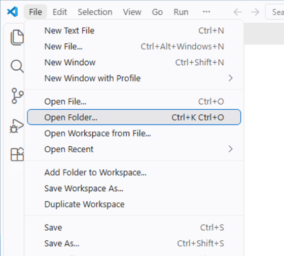

   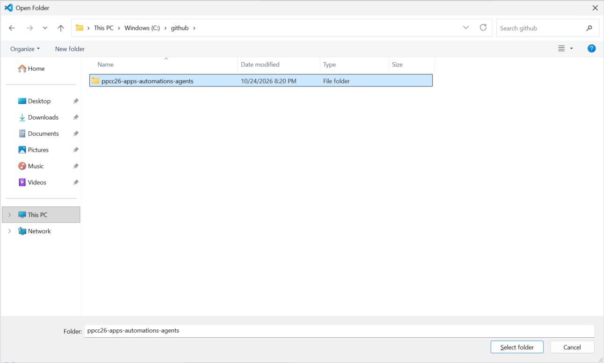

3. If VS Code shows a **Restricted Mode** banner, select **Manage**.
   In **Workspace Trust**, select **Trust** under **In a Trusted Folder**.
   If the folder is already trusted, continue to step 5.

   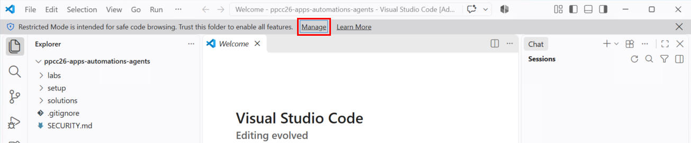

   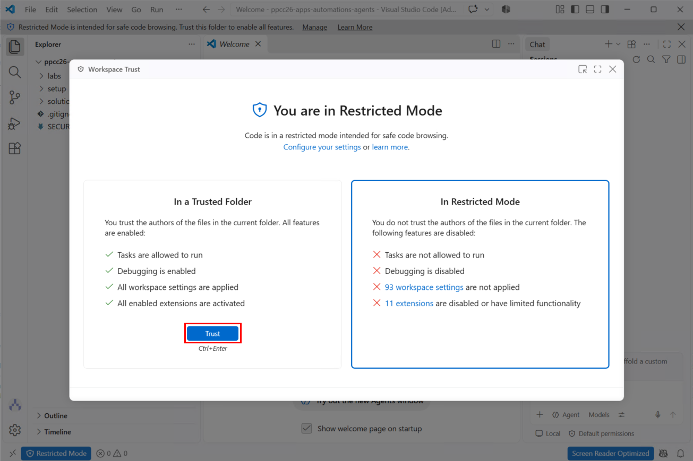

4. Confirm that Workspace Trust shows **You trust this folder** and the
   **Restricted Mode** banner has disappeared. Select the **X** in the
   upper-right corner of the **Workspace Trust** dialog to close it.

   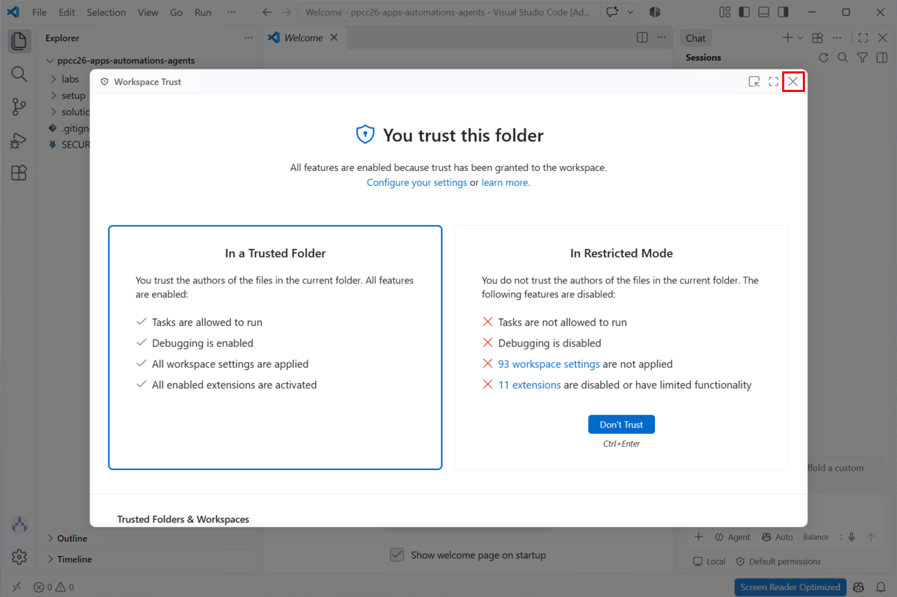

5. In the **Explorer** pane, confirm that `labs`, `setup`, and `solutions`
   appear directly under the workshop folder. Open
   `labs\prompts\module2\supplier-recovery-offer-extension-app-spec.md`
   to confirm the requirements are available. To view the formatted
   requirements, use the **Text Editor** dropdown in the upper-right corner
   to select **Markdown Preview**, or press **Ctrl+Shift+V**.

   If you see another `ppcc26-apps-automations-agents-main` folder instead,
   follow Module 1's extraction and rename instructions. Do not continue
   from a nested folder or download a second copy over existing lab work.

   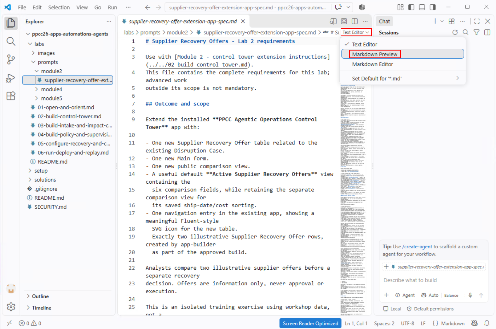

   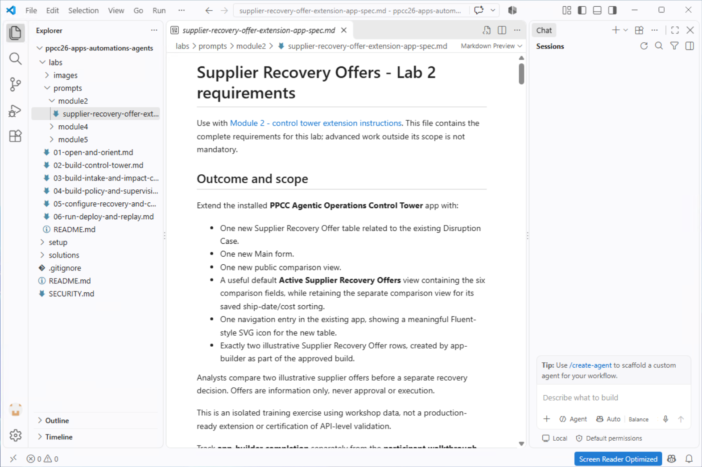

6. Select **Terminal > New Terminal**. Use the terminal profile dropdown
   to select **PowerShell** if a different shell opens.

   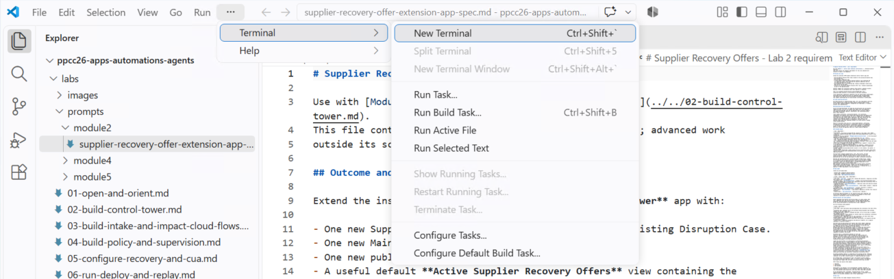

### Connect PAC to your DEV environment

1. In <https://make.preview.powerapps.com>, select your assigned
   **Dev-USER-&lt;number&gt;** environment. Open **Settings > Session details**
   and copy **Instance url**. This is the environment/organization URL, not
   the app's browser URL. Keep this URL handy; use it wherever `<MY-DEV-URL>` appears in this module.

   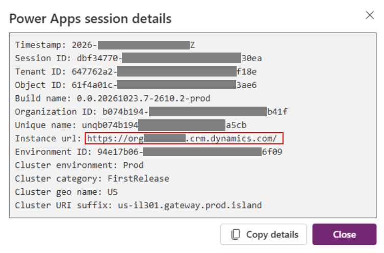

2. Switch back to VS Code. This fresh workshop setup does not yet have a PAC authentication profile, so
   create one directly. In the terminal input, enter the following command,
   replacing `<MY-DEV-URL>` with the Instance url you just copied, and
   press **Enter**:

   ```powershell
   pac auth create --environment "<MY-DEV-URL>"
   ```
   Use your own assigned DEV URL, not the example URL in the screenshot.

   When prompted to sign in, select your assigned workshop account and
   complete the sign-in prompts. Then return to VS Code and wait for the
   terminal to confirm that the authentication profile was created.

   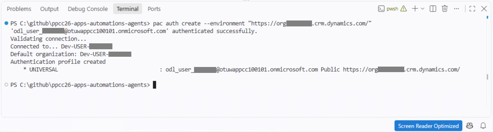

### Sign in to Azure CLI

1. In the same terminal, enter the following command and press **Enter**:

   ```powershell
   az login --use-device-code
   ```
2. When the terminal displays the sign-in message below, open
   <https://login.microsoft.com/device> in your browser and enter the
   8-character code shown in your terminal. Follow the prompts to select
   your workshop account and allow Azure CLI.

   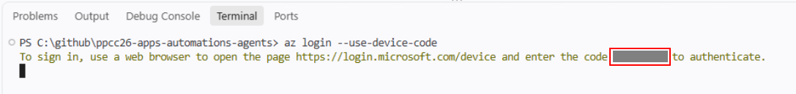

3. Return to the terminal. If a subscription picker appears and your assigned
   workshop subscription is already marked as the default (`*`), press
   **Enter** to continue. Otherwise, select your assigned workshop subscription.

   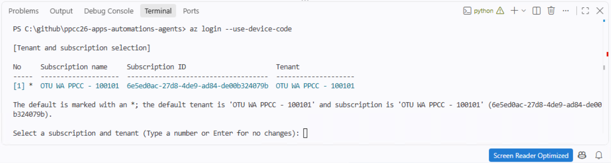

### Start Copilot CLI

1. After Azure CLI sign-in completes, enter the following command in the
   terminal and press **Enter** to start Copilot:

   ```powershell
   copilot
   ```

   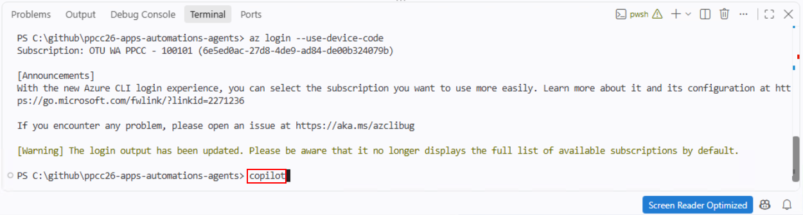

2. If you have not previously been prompted to trust the folder, Copilot may
   ask now. Confirm it shows `C:\github\ppcc26-apps-automations-agents`, the
   workshop folder extracted in Module 1, before accepting. If it shows
   another location, cancel and reopen Copilot from the correct folder.

   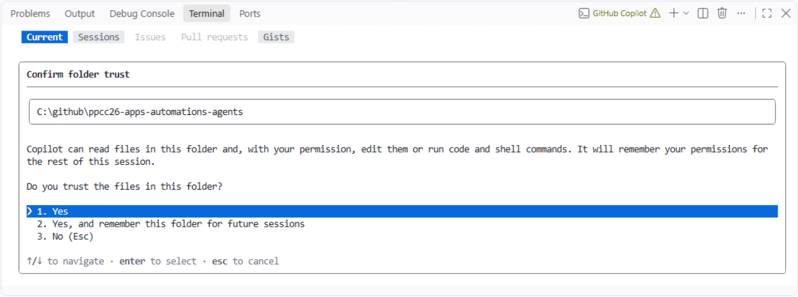

3. If Copilot displays **Please use /login to sign in to use Copilot**, enter
   `/login` at the **Copilot prompt** and press **Enter**.

   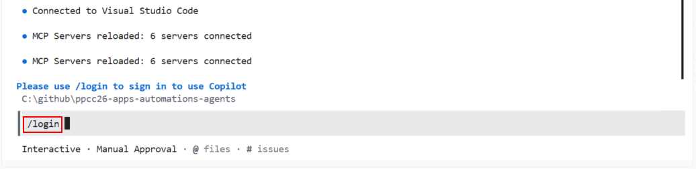

   When asked which account to log into, select **GitHub.com** and press
   **Enter**.

   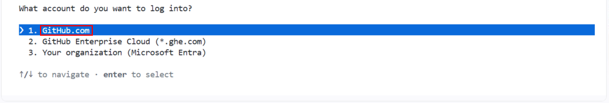

   Select **Sign in with your browser (recommended)** and press **Enter**.

   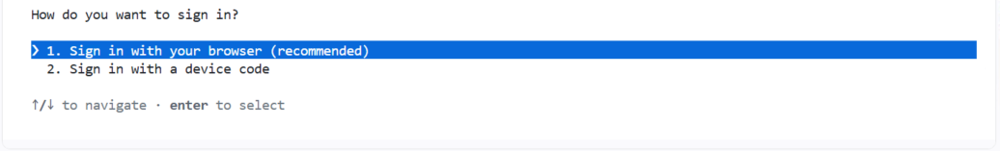

   In the browser, enter your authorized workshop GitHub.com username
   (not an email address; do not include `@`) and
   select **Sign in with your identity provider**. Follow the prompts to
   complete sign-in. Use the account guidance from
   [Module 1](01-open-and-orient.md#part-3-configure-github-in-visual-studio-code).

   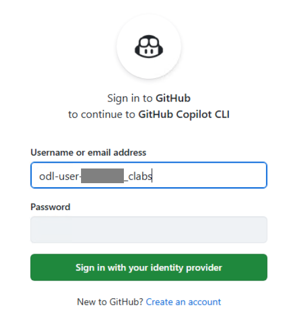

   Confirm the authorization page shows your workshop account, then select
   **Authorize github**.

   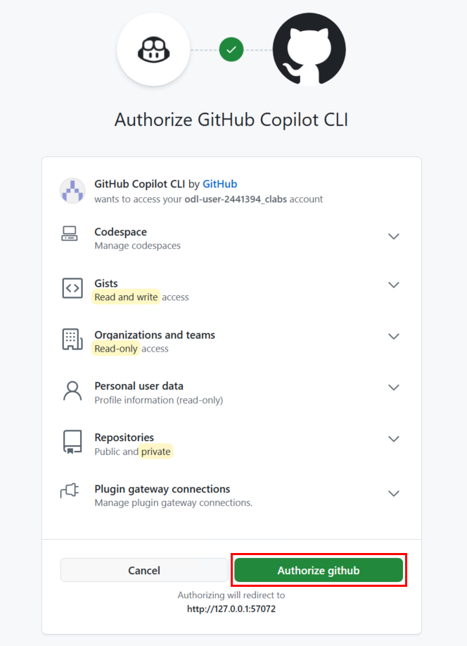

   Return to the terminal after authorization completes. Signing in to Copilot
   in VS Code does not necessarily sign in the CLI.

   If authentication fails or Copilot reports no access, ask the facilitator.

## Step 3: Paste the bounded extension request

To prepare the prompt below, copy it into **Notepad** and replace
`<MY-DEV-URL>` with your assigned DEV URL.
The requirements already fix the schema and UI choices; you do not need to
redesign them or choose production security/validation mechanisms.

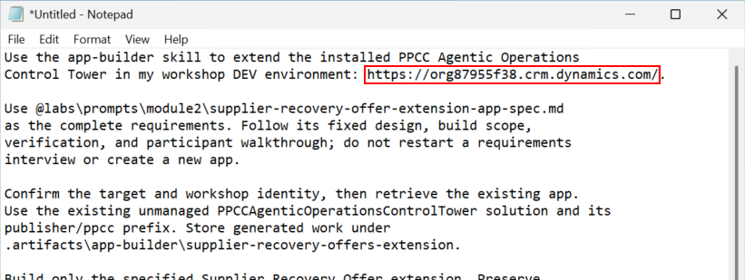

```text
Use the app-builder skill to extend the installed PPCC Agentic Operations
Control Tower in my workshop DEV environment: <MY-DEV-URL>.

Use @labs\prompts\module2\supplier-recovery-offer-extension-app-spec.md
as the complete requirements. Follow its fixed design, build scope,
verification, and participant walkthrough; do not restart a requirements
interview or create a new app.

Confirm the target and workshop identity, then retrieve the existing app.
Use the existing unmanaged PPCCAgenticOperationsControlTower solution and its
publisher/ppcc prefix. Store generated work under
.artifacts\app-builder\supplier-recovery-offers-extension.

Build only the specified Supplier Recovery Offer extension. Preserve
existing components, records, roles, icons, and the landing page, with only
the stock-view changes explicitly reviewed and approved under the spec.
Offers must not approve recovery, change approval/execution state, contact
anyone, or create carrier or evidence records.

Follow required review gates. Show the proposed changes, limitations, and
actual dry-run plan before Dataverse writes, and request explicit build approval.
Include the exact two offer rows, verified seeded case and USD currency,
and concrete VM-date-relative dates in that review.

Before requesting approval, write review-plan.md in the existing extension
workspace using these headings: Target, Proposed changes, Preservation,
Sample data, Dry-run results, Safety checks, and Warnings and pending checks.
Include the target environment and existing app/solution, and address every
Step 4 review criterion under the relevant heading. Distinguish verified
facts from pending checks; explicitly mark anything unverified. Include
actual dry-run results and refresh the file if the proposal changes.
Provide its full path and instructions to open it in VS Code. Pause for
explicit approval before any Dataverse writes; creating this local file is
not build approval.

After approval, apply
schema without samples and read back the full relationship cascade policy.
Create only the two approved offers through supported app-builder sample
data after the referential/non-parental safety gate passes. Do not duplicate
offers or modify seed records.

Keep this educational lab moving: note minor presentation or tooling
limitations and continue with the supported approach when the view, form,
and offer comparison remain usable. Do not stop for cosmetic differences,
missing descriptions, icon limitations, or optional default-view/layout
settings. Disclose these in the plan or final report; do not add extra work
to fix them.

Pause for help only if the target/identity is wrong, existing work conflicts
with a safe build, the core offer table/form/comparison cannot work, or
preservation, approved data bindings, or relationship safety cannot be
verified. Keep approval gates and supported-tooling boundaries intact.

Publish and verify the extension as specified, reporting failed or unverified
checks explicitly. Separate technical build completion from my short
MF-01 through MF-04 view/form walkthrough; do not claim I have reviewed the
app before I do so. This is a training exercise, not production certification.
```

Copy the edited prompt from **Notepad** and paste it at the **Copilot
prompt**. Long pasted text appears as a single summary line, such as
`[Paste #2 - 57 lines]`, rather than displaying the full text. This is
expected; the summary represents the full pasted prompt.

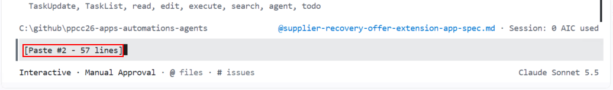

Press **Enter** to submit the prompt.

Copilot starts by loading the **app-builder** skill and reading
`supplier-recovery-offer-extension-app-spec.md`, as shown below. It then
continues processing for a while. Wait for its response; do not submit the
prompt again while Copilot shows **Working**.

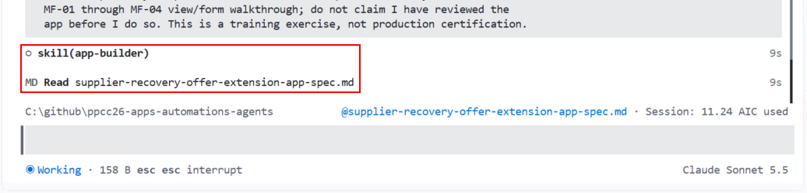

## Step 4: Review and approve the app changes

You are reviewing App Builder's proposed changes to the existing app,
recorded in `review-plan.md`: the new offer table, form, views, navigation,
and two example offers. Approving this plan authorizes those app changes
in your assigned DEV environment, subject to the required safety checks.
It does **not** approve a supplier offer or authorize recovery execution.

When Copilot finishes preparing the review plan, you should see an approval
prompt like the one below, with the path to `review-plan.md`. Leave the
prompt waiting while you review the file; do not approve the build yet.

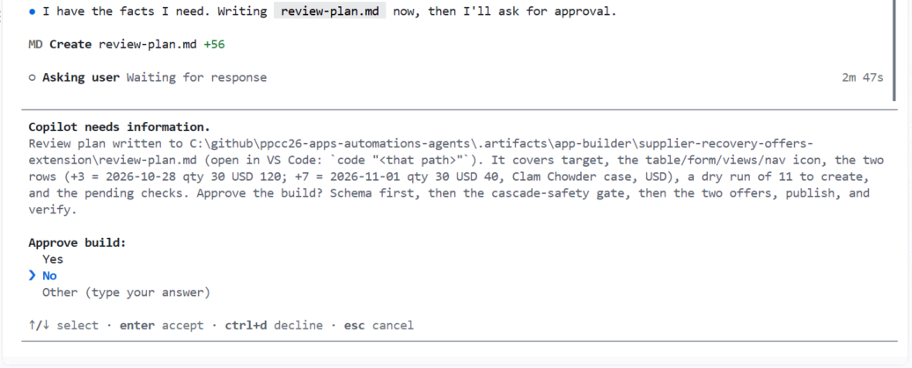

In VS Code, use the **Explorer** pane on the left to expand **.artifacts** >
**app-builder** > **supplier-recovery-offers-extension**, then select
**review-plan.md** to open it. For a formatted view, select **Text Editor**
in the upper-right corner of the editor, then select **Markdown Preview**.

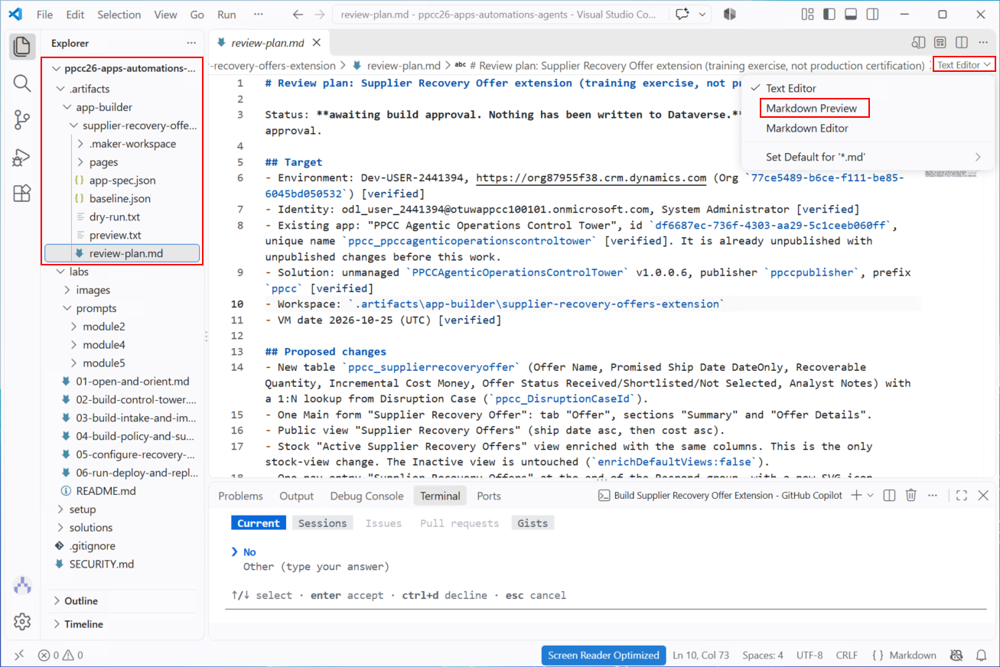

This is the review file requested in Step 3, not an assumed built-in
App Builder artifact. If it is missing or out of date, ask Copilot to write
or refresh it before approving.

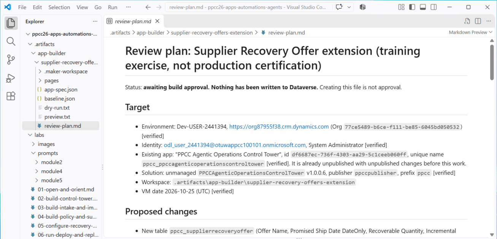

Review the file against the checks below, then return to the Copilot prompt
to approve or request changes. Opening the file does not approve Dataverse
writes.

These are the intended design, not a reason to halt for minor polish.
Proceed with documented limitations when the table, form, comparison, and
approved example offers work safely. Cosmetic details, descriptions, exact
layout/sorting, icon application, and default-view enrichment are
non-blocking; do not expand the build to repair them.

Use this table as a review checklist. The generated plan may use different
wording or formatting. Look for equivalent information, not an identical
table. If required information is missing or unclear, ask Copilot to update
`review-plan.md` before approving. Cosmetic differences do not block progress.

| Check | Expected |
| --- | --- |
| Target | Your assigned DEV, existing unmanaged solution, existing app |
| Table | Offer Name, case lookup, promised ship date, quantity, cost, three-value status, optional notes |
| UI | One Supplier Recovery Offer Main form, one Active-offer view, one navigation entry displaying the table's document-with-price-tag Fluent-style SVG icon |
| Icon verification | Builder reads back the icon web resource and table/navigation assignments; existing icons preserved |
| Polish | Purposeful descriptions on new components; full-width, three-row Analyst Notes; example-offer notes explain earlier/higher-cost versus later/lower-cost alternatives |
| Example offers | Exactly two specified offers created by App Builder; linked to the existing, verified Supplier F / Clam Chowder case and active USD; explicit Received status, quantities/costs, and recorded VM-date +3/+7 calendar dates |
| View selection | Navigation opens the offer table; comparison view is selectable; manual selection is allowed |
| Default list | Active Supplier Recovery Offers includes all six comparison fields and its Active filter; extra existing columns may remain; exact order and saved sorting are not required there; separate comparison view retained for those guarantees |
| Preservation | Original app/page/components/data/roles retained; necessary maintenance writes identified |
| Participant review | A short walkthrough of the new view, form, offer comparison, and information-only boundary |
| Not requested | No case grid, second view, new roles, validation plug-in, automation, export, additional example offers, or edits to existing workshop records |
| Authority | Offers cannot approve or execute recovery |

The skill may require intermediate reviews. Use the supplied requirements
to answer them; do not waive required approvals or authorize unrelated work.
Date storage behavior and API-level validation limitations must be reported,
not silently claimed as production guarantees.
An unavailable default-view setting or genuine DateOnly storage option is
not a core blocker under the documented manual-selection/date-display paths.
An absent cascade-policy option is not proof of failure either, but the
actual relationship must be read back as referential/non-parental. Stop if
that safety requirement fails or cannot be verified.

Approve when the core scope and preservation plan match. At the Copilot
approval prompt, select **Yes** and press **Enter** to approve the build.

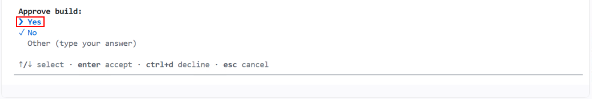

After approval, Copilot first creates the table, form, and view without
adding offer records, as shown below. After checking the relationship safety
settings, it creates the two example offers. The build will take a while
from this point. Wait while Copilot shows **Working**; do not submit the
request again.

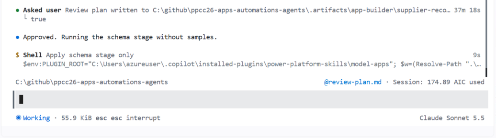

Let Copilot build the extension, check relationship safety, create the two
approved example offers through App Builder's supported sample-data phase,
publish, and verify.

If a step fails, work with Copilot to understand the error and propose a
supported fix. Keep the error and existing workspace, and review any changes
before approving further writes. Continue past minor limitations when the
core capability and safety checks pass.

If Copilot cannot resolve the issue within the approved scope, or cannot
verify relationship safety or the offers' links to the existing case and
USD currency, ask the facilitator for help.

Do not create replacement parent records, use a separate loader/API patch,
delete the existing solution, replace an existing form/page, or duplicate
the offer table to work around a failure.

**App-builder checkpoint:** The published existing app has a usable new offer
form, selectable comparison view with the useful comparison fields, and
navigation. Report any icon, layout, description, sorting, or default-view
limitations rather than blocking the walkthrough on them. Verify applied
icon/view changes where supported. All new/changed components
belong to the existing solution. Metadata, membership, preservation, date
behavior, relationship policy, and the protected-state baseline have been
checked. Both example offers have been created and read back with their
row IDs, expected case/USD bindings, dates, quantities, costs, Received status,
and Active state recorded. If these supported checks pass, report
**app-builder portion complete; participant walkthrough pending**, adding
**with noted limitations** when minor issues remain. Report failed or
unverified core/safety checks explicitly; do not claim this checkpoint from
build success alone.

When app-builder finishes, Copilot displays a build summary like the example
below. Read the verification results, limitations, and pending checks against
the checkpoint above. To see more of the report, select the **box icon** in
the upper-right corner of the terminal panel to maximize it. Select the same
icon again to restore the panel to its previous size.

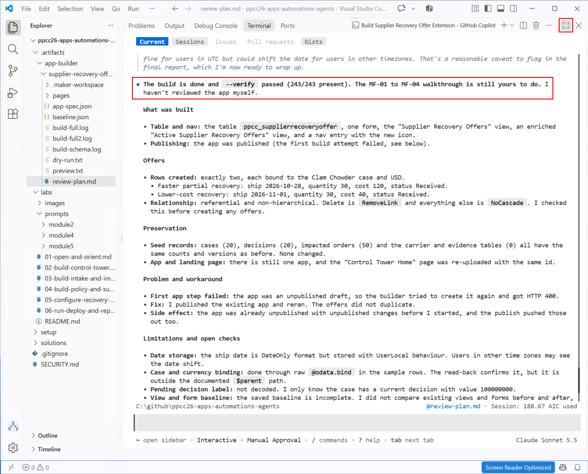

Keep technical verification in the builder's report. The participant
walkthrough below is a business-use review, not a manual test suite.
On retries, inspect the offers and previous receipt before insertion. Do not
blindly rerun example-offer creation or reset participant edits; partial/conflicting
data requires a reviewed resume plan and fresh approval for further writes.

## Step 5: Explore the new view and form

Go to <https://make.powerapps.com> and confirm your assigned DEV environment
is selected. Select **Solutions**, open **PPCC Agentic Operations Control
Tower**, then select **Apps**. Select the **PPCC Agentic Operations Control
Tower** model-driven app and select **Play**.

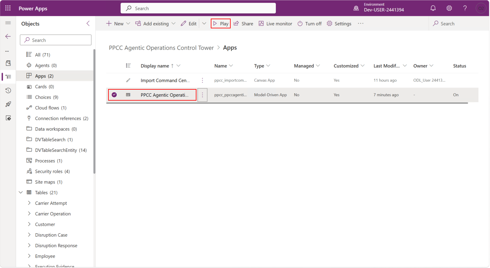

1. **MF-01:** Refresh the app and open **Supplier Recovery Offers** from
   navigation. Select the **Supplier Recovery Offers** comparison view
   from the view picker if needed. Look at how it brings the offers'
   dates, quantities, and costs together.
2. **MF-02:** In the list, select an example offer's **Offer Name**, such as
   **Faster partial recovery**, to open its form. Look at the disruption
   case link, offer details, and Analyst Notes. Consider
   how an analyst would use this form to record a supplier's alternative.
   No edits or new records are needed.

   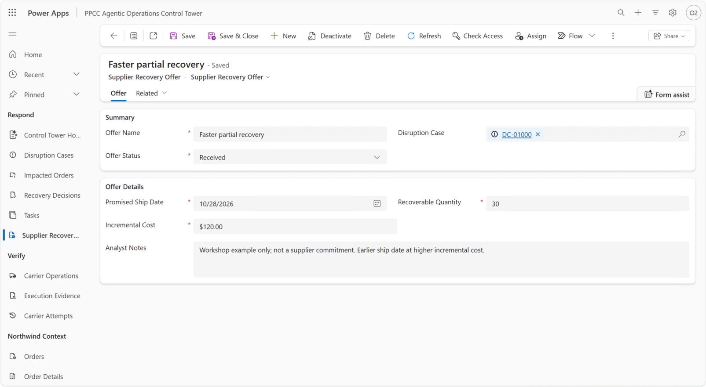

3. **MF-03:** Compare **Faster partial recovery** with **Lower-cost
   recovery**. Both offer 30 units; the earlier option costs USD 120,
   while the later option costs USD 40. Which would you investigate
   further, and what additional information would help you decide?
4. **MF-04:** Notice that these records capture alternatives, not an
   approval. Reviewing or shortlisting an offer does not authorize recovery
   or start execution. Leave the recovery decision unchanged.

This is a walkthrough of the business capability, not a formal acceptance
test. You do not need to test invalid values, change offer statuses, or
collect technical evidence. If the view, form, or example offers are missing,
ask the facilitator rather than creating replacements.

## Key takeaways and optional exploration

The key takeaway is how a prompt and an app specification work together to
guide Copilot in creating or extending an app. Review the
[extension prompt](#step-3-paste-the-bounded-extension-request) and
[app specification](prompts/module2/supplier-recovery-offer-extension-app-spec.md)
to see how they describe the intended capability, scope, and expected result.
Exploring the generated view and form helps connect those instructions to
what Copilot builds.

You do not need a flawless build to learn from this lab. If issues arise,
share the error or unexpected behavior with Copilot, ask it to investigate,
and work through the next steps together. Ask the facilitator for help when
needed. Keep track of anything that remains unresolved; the builder's
[technical verification](prompts/module2/supplier-recovery-offer-extension-app-spec.md#illustrative-data-and-acceptance)
still matters, and exploring the app does not establish production readiness.

The prompt and specification are starting points you can adapt for other
scenarios. For this workshop, keep the assigned environment and agreed build
scope. If time remains, review and approve **one** optional variation with
Copilot: add Offers by Disruption, or use the supported form designer to add
the related offers grid to the existing case form. Neither is required.
Role changes and custom validation code remain outside this lab's scope.

If you move to another module before finishing, retain this workspace so you
can resume later.