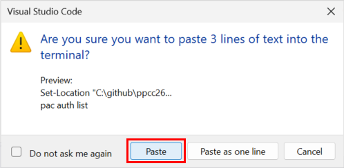
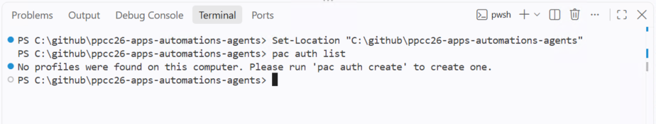
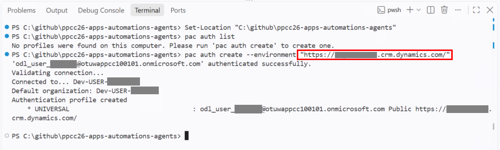
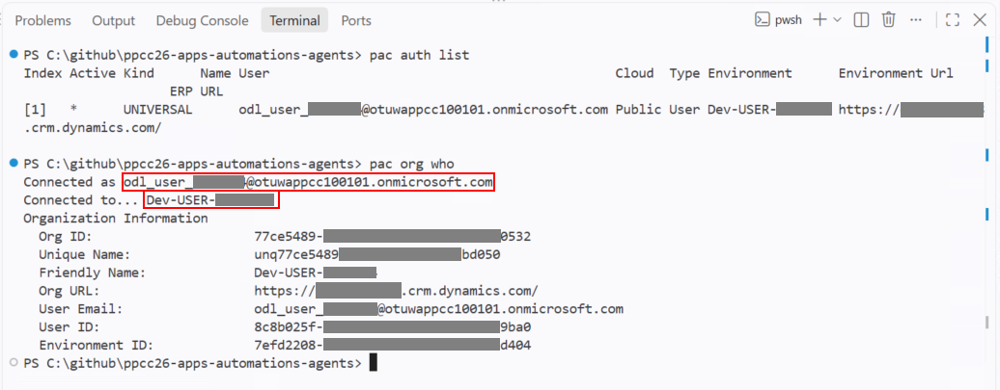
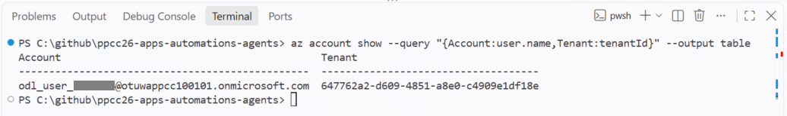
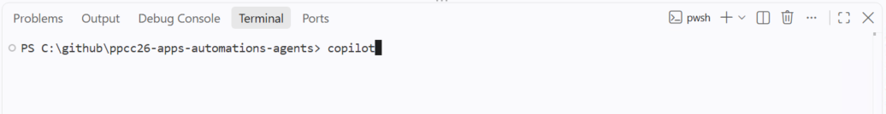
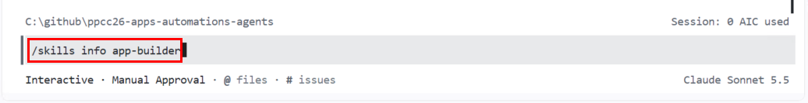
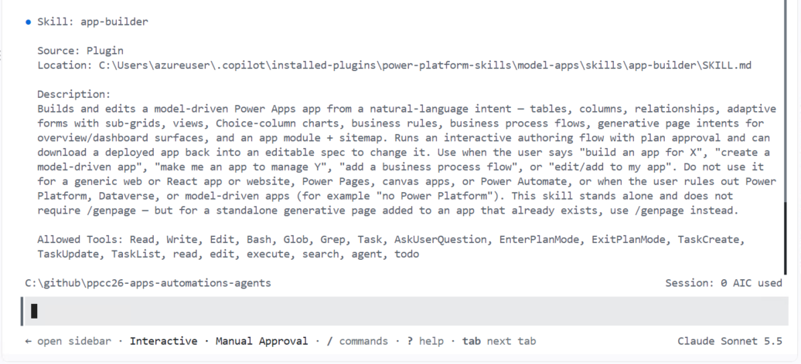
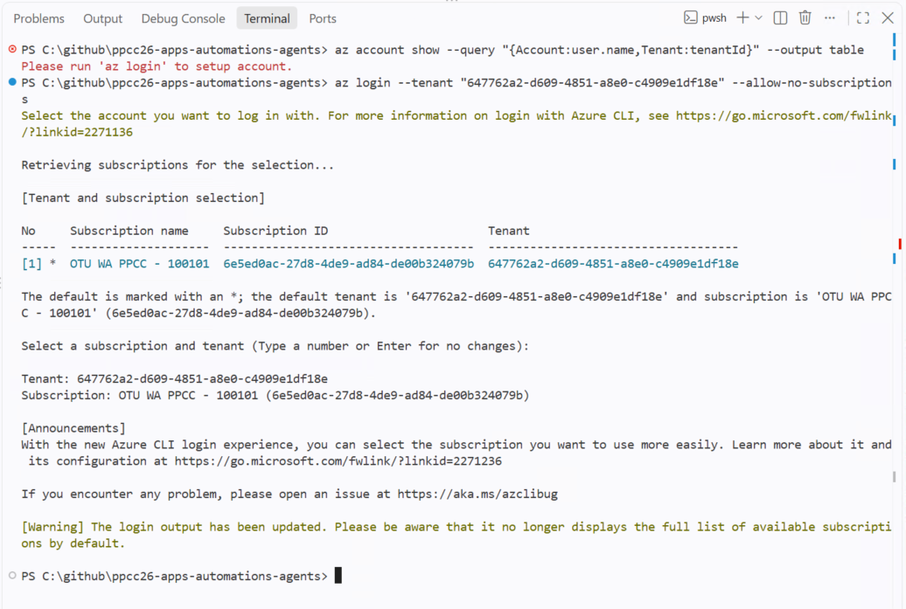

# Module 2: Extend the Control Tower with App Builder

**Estimated time:** 35-40 minutes, after VM setup.

This duration is approximate. Completing Module 2 is not required to continue
with the other modules; you can return and finish it later if needed.

## Overview

In Module 1, you inspected the customer orders at risk from a supplier delay.
Knowing the impact is only the beginning: an operations analyst also needs
to compare the available recovery options.

Suppose Supplier F offers two alternatives for the delayed Clam Chowder:
ship sooner at a higher additional cost, or ship later at a lower cost.
The Control Tower needs a place to record those alternatives, relate them
to the disruption, and compare their promised dates, quantities, and costs.

In this module, you use App Builder to extend the **existing Control Tower
app**, rather than create a separate application:

| App component | Business purpose |
| --- | --- |
| **Supplier Recovery Offer table** | Keep a consistent record of each alternative, linked to the disruption case. |
| **Form** | Give analysts a clear way to enter and review an offer's details and assumptions. |
| **Comparison view** | Show alternatives side by side so analysts can weigh delivery timing against additional cost. |
| **Navigation entry** | Make the new capability available within the app the operations team already uses. |

App Builder creates two illustrative offers so you can immediately try the
comparison. You will review the proposed changes before they are applied
and verify that the original app and business records remain intact.

### How this fits the workshop

Module 2 adds a human-facing comparison capability. Module 3 automates
supplier-notice intake and impact assessment; Module 4 adds policy guidance
and human supervision; Module 5 builds the approval-gated execution path;
and Module 6 brings those capabilities together through approval,
deployment, and verified recovery.

The illustrative offers are not automatically consumed by the later flows
or agents. **Shortlisting an offer is not approval:** this module does not
authorize recovery, contact a supplier, or start execution.

Use only the [extension requirements](prompts/module2/supplier-recovery-offer-extension-app-spec.md)
for this run.

Also enrich the default **Active Supplier Recovery Offers** view with the
six useful comparison fields. Keep the separate comparison view for its
saved column order and ship-date/cost sorting.

## Before you start

Complete [Module 1](01-open-and-orient.md) first. Continue on the same
workshop VM, using your assigned DEV environment and the extracted workshop
folder.

This module also requires:

- Node.js, PAC CLI, Azure CLI, and GitHub Copilot CLI, with the
  **app-builder** skill available.
- The existing Control Tower app and seeded **Supplier F / Clam Chowder**
  case, with a **Pending** Recovery Decision, at least **30 affected units**,
  and **USD** currency.

> [!NOTE]
> If any tools are missing, see [Repair missing tools](#repair-missing-tools)
> at the end of this module before starting the exercise.

If the app or business data is missing, ask the facilitator; do not create
replacements.
Never use a presenter's environment URL or the managed TARGET.

## Step 1: Open the existing app and capture the baseline

1. Open <https://make.preview.powerapps.com>, select your assigned
   **Dev-USER-&lt;number&gt;** environment from Module 1, and open
   **PPCC Agentic Operations Control Tower**.
2. Open the seeded **Supplier F / Clam Chowder** case. Confirm its Recovery
   Decision is **Pending**. Record the case and decision identifiers.
3. Record the current case/decision states and the current Carrier Operation,
   Carrier Attempt, and Execution Evidence records/states for later comparison.
   The agent can help read and summarize these without modifying them.

Do not approve, reject, request revision, delete the case, or start execution.
If the app/case is missing or the decision is not Pending, stop for facilitator
help; do not create a replacement or edit seed data.

## Step 2: Open the workshop folder and start Copilot

Continue inside your workshop VM, using the extracted files from Module 1.

1. Open **Visual Studio Code** and select **File > New Window** to start a
   new VS Code session. Complete the following steps in that new window.
2. Select **File > Open Folder**. Select
   `C:\github\ppcc26-apps-automations-agents`, then select
   **Select Folder**.

   > [!NOTE]
   > This is the folder you extracted and renamed in Module 1, not the
   > downloaded ZIP file.

   

3. If VS Code shows a **Restricted Mode** banner, select **Manage**.
   In **Workspace Trust**, select **Trust** under **In a Trusted Folder**.
   If the folder is already trusted, continue to step 5.

   

   

4. Confirm that Workspace Trust shows **You trust this folder** and the
   **Restricted Mode** banner has disappeared. Select the **X** in the
   upper-right corner of the **Workspace Trust** dialog to close it.

   

5. In the **Explorer** pane, confirm that `labs`, `setup`, and `solutions`
   appear directly under the workshop folder. Open
   `labs\prompts\module2\supplier-recovery-offer-extension-app-spec.md`
   to confirm the requirements are available.

   If you see another `ppcc26-apps-automations-agents-main` folder instead,
   follow Module 1's extraction and rename instructions. Do not continue
   from a nested folder or download a second copy over existing lab work.

   

6. Select **Terminal > New Terminal**. Use the terminal profile dropdown
   to select **PowerShell** if a different shell opens.

   

7. In that PowerShell terminal, run:

   ```powershell
   Set-Location "C:\github\ppcc26-apps-automations-agents"
   pac auth list
   ```

   If VS Code asks you to confirm pasting multiple lines into the terminal,
   select **Paste**.

   

   

### Connect PAC to your DEV environment

In <https://make.preview.powerapps.com>, select your assigned
**Dev-USER-&lt;number&gt;** environment. Open **Settings > Session details**
and copy **Instance url**. This is the environment/organization URL, not
the app's browser URL. Keep it for `<MY-DEV-URL>` in Step 3.

If the portal shows the wrong environment, use the environment button to
select your assigned DEV as described in
[Module 1](01-open-and-orient.md#open-the-dev-app-shell), then copy its
Instance url again. If your DEV is missing, inaccessible, or appears
incorrectly assigned, confirm your workshop account and tenant using
Module 1, then ask a proctor to verify your environment assignment/access
before continuing. Do not use another environment as a substitute.
If you changed anything in Test or Prod, tell the proctor; do not try to
undo it yourself.

In the `pac auth list` output, look for a profile using that DEV URL and
your workshop account. If one exists, select its index:

```powershell
pac auth select --index <PROFILE-INDEX>
```

Replace `<PROFILE-INDEX>` with the index from the list. If no matching
profile exists, create one instead:

```powershell
pac auth create --environment "<INSTANCE-URL>"
```

Replace `<INSTANCE-URL>` with the copied Instance url and follow the sign-in
prompts using your Microsoft Entra workshop account. Do not use another
participant's environment, the presenter's environment, or TARGET.



Verify the active profile and connection:

```powershell
pac auth list
pac org who
```



Confirm the active profile and `pac org who` identify your workshop account
and assigned DEV. If PAC shows the wrong DEV, use the profile selection or
creation steps above with the verified Instance url, then rerun both checks.
If the target/account still does not match, or authentication fails, stop
for facilitator help before continuing. If you already started generating
app files against another environment, do not reuse that workspace for
your assigned DEV; ask the facilitator to help you start a fresh,
separately named workspace.

### Verify Azure and start Copilot

In the same terminal, check Azure CLI's account:

```powershell
az account show --query "{Account:user.name,Tenant:tenantId}" --output table
```



If you are not signed in, follow [Repair Azure sign-in](#repair-azure-sign-in)
at the end of this module, then rerun this check.

Confirm PAC shows the assigned DEV URL and Azure CLI uses your workshop
identity/tenant. The agent will also verify the actual Dataverse identity.
If they do not match, stop for facilitator help.

Start Copilot only after these checks:

```powershell
copilot
```



On first launch, Copilot may ask whether you trust the folder. Confirm it
shows `C:\github\ppcc26-apps-automations-agents`, the workshop folder
extracted in Module 1, before accepting. If it shows another location,
cancel and reopen Copilot from the correct folder.

If prompted to sign in, enter `/login` at the **Copilot prompt** and follow
the instructions using your authorized workshop GitHub.com account. Use the
account guidance from
[Module 1](01-open-and-orient.md#part-3-configure-github-in-visual-studio-code).
Signing in to Copilot in VS Code does not necessarily sign in the CLI.


If authentication fails or Copilot reports no access, ask the facilitator.
Folder trust does not replace the explicit build approval requested later.

At the **Copilot prompt**, enter `/skills info app-builder` to show the
**app-builder** skill's details directly and confirm it is available.
It is provided by the **model-apps** plugin. If you installed
the plugin during preparation, restart Copilot before checking. If
app-builder remains missing after restart, ask the facilitator to verify
the model-apps plugin installation; see
[Repair missing tools](#repair-missing-tools). Do not continue to Step 3
with a different skill.





After reviewing the skill's details, paste the Step 3 prompt at the normal
Copilot prompt. If a skills panel is open, press **Esc** to close it first.
You do not need to launch the skill from a list. Do not start a new-app
workflow.

## Step 3: Paste the bounded extension request

To prepare the prompt below, copy it into **Notepad** and replace
`<MY-DEV-URL>` with your assigned DEV URL.
The requirements already fix the schema and UI choices; you do not need to
redesign them or choose production security/validation mechanisms.


```text
Use the app-builder skill to extend the installed PPCC Agentic Operations
Control Tower in my workshop DEV environment: <MY-DEV-URL>.

Use @labs\prompts\module2\supplier-recovery-offer-extension-app-spec.md
as the complete requirements. Follow its fixed design, build scope,
verification, and participant walkthrough; do not restart a requirements
interview or create a new app.

Confirm the target and workshop identity, then retrieve the existing app.
Use the existing unmanaged PPCCAgenticOperationsControlTower solution and its
publisher/ppcc prefix. Store generated work under
.artifacts\app-builder\supplier-recovery-offers-extension.

Build only the specified Supplier Recovery Offer extension. Preserve
existing components, records, roles, icons, and the landing page, with only
the stock-view changes explicitly reviewed and approved under the spec.
Offers must not approve recovery, change approval/execution state, contact
anyone, or create carrier or evidence records.

Follow required review gates. Show the proposed changes, limitations, and
actual dry-run plan before Dataverse writes, and request explicit build approval.
Include the exact two offer rows, verified seeded case and USD currency,
and concrete VM-date-relative dates in that review.

Before requesting approval, write review-plan.md in the existing extension
workspace using these headings: Target, Proposed changes, Preservation,
Sample data, Dry-run results, Safety checks, and Warnings and pending checks.
Include the target environment and existing app/solution, and address every
Step 4 review criterion under the relevant heading. Distinguish verified
facts from pending checks; explicitly mark anything unverified. Include
actual dry-run results and refresh the file if the proposal changes.
Provide its full path and instructions to open it in VS Code. Pause for
explicit approval before any Dataverse writes; creating this local file is
not build approval.

After approval, apply
schema without samples and read back the full relationship cascade policy.
Create only the two approved offers through supported app-builder sample
data after the referential/non-parental safety gate passes. Do not duplicate
offers or modify seed records.

Keep this educational lab moving: note minor presentation or tooling
limitations and continue with the supported approach when the view, form,
and offer comparison remain usable. Do not stop for cosmetic differences,
missing descriptions, icon limitations, or optional default-view/layout
settings. Disclose these in the plan or final report; do not add extra work
to fix them.

Pause for help only if the target/identity is wrong, existing work conflicts
with a safe build, the core offer table/form/comparison cannot work, or
preservation, approved data bindings, or relationship safety cannot be
verified. Keep approval gates and supported-tooling boundaries intact.

Publish and verify the extension as specified, reporting failed or unverified
checks explicitly. Separate technical build completion from my short
MF-01 through MF-04 view/form walkthrough; do not claim I have reviewed the
app before I do so. This is a training exercise, not production certification.
```

Copy the edited prompt from **Notepad** and paste it at the **Copilot
prompt**. Long pasted text appears as a single summary line, such as
`[Paste #2 - 57 lines]`, rather than displaying the full text. This is
expected; the summary represents the full pasted prompt.


Press **Enter** to submit the prompt.

Copilot starts by loading the **app-builder** skill and reading
`supplier-recovery-offer-extension-app-spec.md`, as shown below. It then
continues processing for a while. Wait for its response; do not submit the
prompt again while Copilot shows **Working**.


Keep the existing workspace if a run fails. See
[Resume an interrupted run](#resume-an-interrupted-run) only if you need
recovery guidance; for a fresh run, continue to Step 4.
Do not rerun against another environment using the same downloaded app
files; use a fresh, separately named workspace for each environment.

## Step 4: Review and approve

When Copilot finishes preparing the review plan, you should see an approval
prompt like the one below, with the path to `review-plan.md`. Leave the
prompt waiting while you review the file; do not approve the build yet.


In VS Code, use the **Explorer** pane on the left to expand **.artifacts** >
**app-builder** > **supplier-recovery-offers-extension**, then select
**review-plan.md** to open it. For a formatted view, select **Text Editor**
in the upper-right corner of the editor, then select **Markdown Preview**.


This is the review file requested in Step 3, not an assumed built-in
App Builder artifact. If it is missing or out of date, ask Copilot to write
or refresh it before approving.


Review the file against the checks below, then return to the Copilot prompt
to approve or request changes. Opening the file does not approve Dataverse
writes.

These are the intended design, not a reason to halt for minor polish.
Proceed with documented limitations when the table, form, comparison, and
approved sample data work safely. Cosmetic details, descriptions, exact
layout/sorting, icon application, and default-view enrichment are
non-blocking; do not expand the build to repair them.

Use this table as a review checklist. The generated plan may use different
wording or formatting. Look for equivalent information, not an identical
table. If required information is missing or unclear, ask Copilot to update
`review-plan.md` before approving. Cosmetic differences do not block progress.

| Check | Expected |
| --- | --- |
| Target | Your assigned DEV, existing unmanaged solution, existing app |
| Table | Offer Name, case lookup, promised ship date, quantity, cost, three-value status, optional notes |
| UI | One Supplier Recovery Offer Main form, one Active-offer view, one navigation entry displaying the table's document-with-price-tag Fluent-style SVG icon |
| Icon verification | Builder reads back the icon web resource and table/navigation assignments; existing icons preserved |
| Polish | Purposeful descriptions on new components; full-width, three-row Analyst Notes; sample notes explain earlier/higher-cost versus later/lower-cost alternatives |
| Sample data | Exactly two specified offers; same verified seeded Supplier F / Clam Chowder case and active USD; explicit Received status, quantities/costs, and recorded VM-date +3/+7 calendar dates |
| View selection | Navigation opens the offer table; comparison view is selectable; manual selection is allowed |
| Default list | Active Supplier Recovery Offers includes all six comparison fields and its Active filter; extra existing columns may remain; exact order and saved sorting are not required there; separate comparison view retained for those guarantees |
| Preservation | Original app/page/components/data/roles retained; necessary maintenance writes identified |
| Participant review | A short walkthrough of the new view, form, offer comparison, and information-only boundary |
| Not requested | No case grid, second view, new roles, validation plug-in, automation, export, additional sample rows, or seed-record edits |
| Authority | Offers cannot approve or execute recovery |

The skill may require intermediate reviews. Use the supplied requirements
to answer them; do not waive required approvals or authorize unrelated work.
Date storage behavior and API-level validation limitations must be reported,
not silently claimed as production guarantees.
An unavailable default-view setting or genuine DateOnly storage option is
not a core blocker under the documented manual-selection/date-display paths.
An absent cascade-policy option is not proof of failure either, but the
actual relationship must be read back as referential/non-parental. Stop if
that safety requirement fails or cannot be verified.

Approve when the core scope and preservation plan match. At the Copilot
approval prompt, select **Yes** and press **Enter** to approve the build.


After approval, Copilot starts applying the schema without sample data, as
shown below. The build will take a while from this point. Wait while Copilot
shows **Working**; do not submit the request again.


Let the agent build,
verify the schema-only relationship safety gate, create the two approved
offers through app-builder's sample-data phase, publish, and verify.
Case/currency binding must use the supported sample-data path; if it cannot,
stop rather than creating parent records or using a separate loader/API patch.
If a core item is unsupported or fails, retain the error and workspace and
request a reviewed recovery plan using
[Resume an interrupted run](#resume-an-interrupted-run). Never delete the existing
solution, replace a form/page, or duplicate the offer table to get past a failure.

**App-builder checkpoint:** The published existing app has a usable new offer
form, selectable comparison view with the useful comparison fields, and
navigation. Report any icon, layout, description, sorting, or default-view
limitations rather than blocking the walkthrough on them. Verify applied
icon/view changes where supported. All new/changed components
belong to the existing solution. Metadata, membership, preservation, date
behavior, relationship policy, and the protected-state baseline have been
checked. Both illustrative offers have been created and read back with their
row IDs, expected case/USD bindings, dates, quantities, costs, Received status,
and Active state recorded. If these supported checks pass, report
**app-builder portion complete; participant walkthrough pending**, adding
**with noted limitations** when minor issues remain. Report failed or
unverified core/safety checks explicitly; do not claim this checkpoint from
build success alone.

When app-builder finishes, Copilot displays a build summary like the example
below. Read the verification results, limitations, and pending checks against
the checkpoint above. To see more of the report, select the **box icon** in
the upper-right corner of the terminal panel to maximize it. Select the same
icon again to restore the panel to its previous size.


Keep technical verification in the builder's report. The participant
walkthrough below is a business-use review, not a manual test suite.
On retries, inspect the offers and previous receipt before insertion. Do not
blindly rerun sample creation or reset participant edits; partial/conflicting
data requires a reviewed resume plan and fresh approval for further writes.

## Step 5: Explore the new view and form

Go to <https://make.powerapps.com> and confirm your assigned DEV environment
is selected. Select **Solutions**, open **PPCC Agentic Operations Control
Tower**, then select **Apps**. Select the **PPCC Agentic Operations Control
Tower** model-driven app and select **Play**.


1. **MF-01:** Refresh the app and open **Supplier Recovery Offers** from
   navigation. Select the **Supplier Recovery Offers** comparison view
   from the view picker if needed. Look at how it brings the offers'
   dates, quantities, and costs together.
2. **MF-02:** In the list, select a sample offer's **Offer Name**, such as
   **Faster partial recovery**, to open its form. Look at the disruption
   case link, offer details, and Analyst Notes. Consider
   how an analyst would use this form to record a supplier's alternative.
   No edits or new records are needed.

   

3. **MF-03:** Compare **Faster partial recovery** with **Lower-cost
   recovery**. Both offer 30 units; the earlier option costs USD 120,
   while the later option costs USD 40. Which would you investigate
   further, and what additional information would help you decide?
4. **MF-04:** Notice that these records capture alternatives, not an
   approval. Reviewing or shortlisting an offer does not authorize recovery
   or start execution. Leave the recovery decision unchanged.

This is a walkthrough of the business capability, not a formal acceptance
test. You do not need to test invalid values, change offer statuses, or
collect technical evidence. If the view, form, or sample offers are missing,
ask the facilitator rather than creating replacements.

## Completion and optional work

If you continue to another module before finishing, retain this module's
workspace so you can resume later.

The participant exercise is complete when you have explored the new view
and form, compared the two sample offers, and understood how the extension
supports an analyst without approving or executing recovery.
The builder remains responsible for its technical verification under the
[extension requirements](prompts/module2/supplier-recovery-offer-extension-app-spec.md#illustrative-data-and-acceptance).
Exploring the app is not production certification, and failed or unverified
build checks must still be reported.

If time remains, separately review and approve **one** optional task:
add Offers by Disruption, or use the supported form designer to add the
related offers grid to the existing case form. Neither is required to pass.
No role changes or custom validation code are part of this variant.

A facilitator-rehearsed default Main-form preference is also optional under
the simplified spec's preservation conditions; manual form selection remains
allowed. It is separate from default-view selection and adds no required
lab step. Presenter discussion of richer behaviors belongs outside the
participant build scope.

If the build cannot finish, the facilitator may provide an approved completed
full-solution checkpoint. Record that you used it: inspecting that result is
not the same as completing the agentic build. Still perform the offer
view/form walkthrough and discuss the offer tradeoff and approval boundary.

## Repair missing tools

Node.js is required to run the App Builder plugin's hooks and supporting
scripts.

If Node.js, PAC CLI, Azure CLI, GitHub Copilot CLI, or the **model-apps**
plugin that provides **app-builder** is missing, use the
[prerequisite setup script](../setup/Install-Prerequisites.ps1) before
starting the exercise. The script does **not** install Copilot CLI; if it is
missing, ask the facilitator to install it first so the script can configure
its plugins. PAC installation depends on the upstream installer and an
available .NET SDK; ask the facilitator for help if PAC remains missing.

On the workshop VM, open PowerShell and run:

```powershell
Set-Location "C:\github\ppcc26-apps-automations-agents"
.\setup\Install-Prerequisites.ps1
```

Follow the Azure sign-in prompt using your workshop account. If the script
fails or Windows blocks it, stop and ask the facilitator for help.
After installation, close all VS Code windows and reopen the workshop
folder so its terminals pick up the updated PATH. If you ran setup in a
standalone PowerShell window, close it and open a new one before checking
the tools or starting Copilot. Start a fresh Copilot session after plugin
installation. If app-builder is still absent from `/skills`, ask the
facilitator to verify that model-apps is installed and available to
Copilot before proceeding. Confirm the tools are available:

```powershell
node --version
pac help
az --version
copilot --version
```

Successful installation does not confirm PAC authentication, the assigned
DEV connection, or app-builder availability; verify those in Step 2.
If setup is still incomplete, ask the facilitator rather than installing or
upgrading tools or repairing the base solution during the build. The
[Microsoft Learn setup guide](https://learn.microsoft.com/en-us/power-apps/maker/model-driven-apps/model-driven-app-external-tools)
is a preparation reference.

## Repair Azure sign-in

Use this section only if Step 2 reports no Azure CLI login or sign-in fails
during setup. If Azure CLI is missing, first follow
[Repair missing tools](#repair-missing-tools).

To find your **workshop tenant ID**, open <https://make.powerapps.com> with
your workshop account and assigned DEV environment selected. Select
**Settings > Session details** and copy the value after **Tenant ID:**.
If you cannot find it, ask the facilitator. In the VS Code PowerShell
terminal, replace `<WORKSHOP-TENANT-ID>` with that value and run:

```powershell
az login --tenant "<WORKSHOP-TENANT-ID>" --allow-no-subscriptions
```

Sign in with the **Microsoft Entra workshop account** from
[Module 1](01-open-and-orient.md#part-1-retrieve-your-workshop-credentials),
not your GitHub account or VM sign-in account. If asked to choose an account
type, select **Work or school account**. The tenant ID is not the DEV
Instance url. If a subscription picker appears, use only the
facilitator-assigned workshop context; do not select another tenant to
get past an error. Dataverse access does not require an Azure subscription;
`--allow-no-subscriptions` permits sign-in to a tenant without one.



If the browser account picker does not appear or cannot open, ask the
facilitator whether device-code sign-in is permitted. Only if permitted,
run:

```powershell
az login --tenant "<WORKSHOP-TENANT-ID>" --use-device-code --allow-no-subscriptions
```

Open the URL Azure CLI prints, enter its code, and sign in with the same
workshop account. If device-code sign-in is blocked, stop for facilitator
help rather than trying to bypass the policy.

After either sign-in route, verify:

```powershell
az account show --query "{Account:user.name,Tenant:tenantId}" --output table
pac org who
```

Confirm Azure CLI shows the assigned workshop account and tenant and
matches PAC's workshop identity and DEV connection. If sign-in still fails
or the identities do not match, stop for facilitator help. Otherwise,
return to [Step 2: Verify Azure and start Copilot](#verify-azure-and-start-copilot).

## Resume an interrupted run

Use this section only if an earlier run stopped; it is not a step for a
fresh run. If planning stopped before writes, resume with the current
requirements rather than starting another app or table. If writes already
occurred, inspect the existing components and build receipts with the
facilitator before approving further changes.

Before resuming, back up the local files that will be refreshed under the
same lab's `.artifacts` directory; do not overwrite earlier evidence. Keep
the workspace's environment binding intact.

Paste this at the Copilot prompt, replacing `<MY-DEV-URL>`:

```text
Continue the existing Supplier Recovery Offers simplified planning run using
the app-builder skill and the updated simplified requirements:
@labs\prompts\module2\supplier-recovery-offer-extension-app-spec.md

Target my workshop DEV: <MY-DEV-URL>. Reconfirm the environment, prepared
administrator identity, existing app, unmanaged solution/version, and ppcc
publisher. Use the existing
.artifacts\app-builder\supplier-recovery-offers-extension workspace.

Preserve the previous plan, spec, and baseline before refreshing the existing
app download in that same workspace. If the offer table now exists, inspect
it and prior receipts before resuming. If existing work conflicts with a
safe build or the workspace is bound elsewhere, pause and present a reviewed
resume plan; do not overwrite or duplicate work.
Refresh the read-only preservation and business-state baseline.

Reapply only the simplified extension intent. Follow the spec's educational
issue-handling guidance: note minor limitations and continue when the core
capability and safety gates pass. Preserve the landing page,
existing components/navigation/data/roles, and identify maintenance writes.
Include the specified document-with-price-tag Fluent-style SVG table icon
and its navigation assignment; preserve all existing icons.
Carry forward the specified descriptions, readable Analyst Notes layout,
and sample-note tradeoffs without additional participant steps.
Include the two specified sample offers, resolved seeded case/USD bindings,
and concrete VM-date-relative dates in the revised review. Inspect existing
offers and receipts before planning insertion; do not duplicate rows or
reset any participant changes.
The earlier automatic-default-view blocker is now MF-01: include the named
comparison view and let me select it manually. Also enrich the existing
Active Supplier Recovery Offers view with the six comparison fields, keeping
its Active filter; exact order and saved sorting are not required there.
Retain the named comparison view for its saved column order and date/cost
sorting. Show this narrow exception to view preservation in the plan and
disclose any Inactive-view changes for explicit approval. Do not alter other
tables' views or remove the comparison view. Report actual date storage
and relationship policy; unsafe or unverifiable cascade behavior remains
a stop condition.

Regenerate lint, the full preview, the design document, and the actual
dry-run plan. Show them and the short MF-01 through MF-04 participant
walkthrough before writes.
Request explicit build approval. This continuation request is not approval
to apply or publish.

Only after approval, build, publish, and verify the supported extension.
First apply schema without samples and verify the relationship policy;
then create only the two approved offers through the supported app-builder
sample-data phase. Do not change roles, edit the case form, add automation,
export a solution, or change approval/execution state. Report app-builder
completion separately from the pending participant walkthrough.
```
