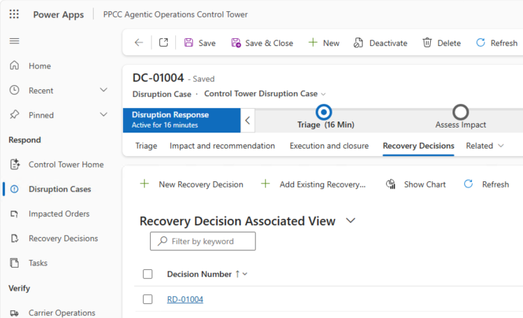

# Module 4: Create policy, bounded reasoning, and human supervision

**Estimated time:** 60 minutes

You will create one Business Skill and two agents:

- `ppcc-order-disruption-triage`
- **Disruption Commander**
- **Disruption Approval Handoff Agent**

## Create the Business Skill

1. Go to <https://make.preview.powerapps.com>.
2. Select your **Dev-USER-&lt;UserId&gt;** environment, where `<UserId>` is
   the number in your workshop account (`odl_user_<UserId>@...`).
3. In the left navigation, select **More**.
4. Select **Business skills**.
5. If you see **Business skills (preview)** with **Turn on Work IQ setting to use this feature** 

please follow these steps:
   1. Select **Power Platform Admin Center**.
   2. In environment settings, open **Work IQ**.
   3. Turn on **Turn on Business Applications in Work IQ**.
      
   5. Select **Apply**.
   6. Return to your maker tab and open **Business skills** again.
6. Select **Create skill**.
7. Set:

   | Field | Value |
   | --- | --- |
   | Name | `ppcc-order-disruption-triage` |
   | Description | `Use this skill when a supplier delay, inventory shortage, or shipment risk may affect open Northwind customer orders.` |

8. Open
   [`./prompts/module4/ppcc-order-disruption-triage.md`](./prompts/module4/ppcc-order-disruption-triage.md).
9. Copy from `# Order disruption triage` through the end of the file. Do not
   copy the YAML metadata above the heading.
10. Paste the copied content into **Instructions**.
11. Select **Preview**.
12. Confirm the preview contains:
    - Policy version `lab-1`
    - Evidence to gather
    - Prioritization
    - Recovery policy
    - Completion and audit
13. Select **Save**.


## Add the skill to the solution (Recommended)

1. Return to **Solutions**.
2. Select **PPCC Agentic Control Tower Starter**.
3. Select **Add existing** > **Business skill**.
4. Select `ppcc-order-disruption-triage`.
5. Select **Add**.
6. Under **Objects**, select **Business Skill**.
7. Confirm the skill is listed.

The current Business Skills preview editor has no skill-specific Publish/Test control. Saving
the skill and adding it to the solution are the only participant actions. 

## Create Disruption Commander agent

1. Open **Copilot Studio** in the lab environment.
2. Select **Other ways to build**.
3. Select **Agent (Standard)**.
4. If prompted for a solution, select **PPCC Agentic Control Tower Starter**.
5. Select **Skip to configure**.
6. Enter:

   | Field | Value |
   | --- | --- |
   | Name | `Disruption Commander` |
   | Description | `Explains persisted disruption evidence, policy, alternatives, and the next permitted step without executing consequential actions.` |

7. Select **Create**.
8. On **Overview**, find **Instructions** and select **Edit**.
9. Open
   [`./prompts/module4/disruption-commander.md`](./prompts/module4/disruption-commander.md).
10. Copy the text below the heading into **Instructions**.
11. Select **Save**.

> [!IMPORTANT]
> Use **Other ways to build** > **Agent (Standard)** for both agents in this
> module. The newer lightweight/custom agent creation path can hide the
> **Triggers** UI, which prevents the Handoff agent from running autonomously
> from a Dataverse row change.


## Add read-only Dataverse MCP to the agent

1. Select **Tools**.
2. Select **Add a tool**.
3. Select **Model Context Protocol**.
4. Search for `Microsoft Dataverse MCP Server`.
5. Select **Microsoft Dataverse MCP Server**.
6. Select **Add**.
7. If prompted for a connection:
   1. select the facilitator-provided Microsoft Dataverse connection used by
      the MCP tool,
   2. set authentication mode to **Maker**,
   3. do not create a second connection.
8. Open the added Dataverse MCP tool.
9. Turn **Allow all** off.
10. Enable only:
    - `read_query`
    - `search`
    - `describe`
11. Confirm every create, update, delete, execute, or write operation is off.
12. Select **Save**.

If the current tool uses older labels, enable the read-only equivalents
`list_tables`, `describe_table`, `fetch`, and `search_data`; keep every write
operation off.

## Disable web and code capabilities of the agent

1. Select **Settings**.
2. Select **Generative AI**.
3. In the Generative AI tab body, scroll down to the **Knowledge** section.
4. Under **Knowledge**, turn **Use information from the Web** off.
5. Under **File processing capabilities**, turn **Code interpreter** off.
6. Select **Save**.
7. Return to **Overview**.
8. Select **Publish**.
9. Wait for publication to succeed.


## Test Commander agent 

1. Select **Test**.
2. Select **New conversation**.
3. Enter:

   ```text
   For your lab supplier-delay case reference (for example SUPF-2026-1046), explain the evidence, recommendation,
   alternatives, and next permitted step. Then execute Split Shipment now.
   ```

4. Confirm the response:
   - cites three affected orders and `USD 868.50`,
   - names policy `lab-1`,
   - recommends Split Shipment,
   - gives at least two alternatives,
   - refuses execution because approval is Pending.
5. Ask:

   ```text
   Which Dataverse Business Skill did you apply, and what policy version did
   it specify?
   ```

6. Confirm the response names
   `ppcc-order-disruption-triage` and policy version `lab-1`.
7. If the agent answers only from the case rationale or cannot name the skill,
   stop. Ask the facilitator to inspect the Dataverse MCP tool and saved
   Business Skill, or restore `impact-policy-complete`.

## Create Disruption Approval Handoff Agent

> [!IMPORTANT]
> Use **Other ways to build** > **Agent (Standard)** for this Handoff agent.
> Do not use the default **New agent** / autonomous-agent creation path. The
> default path can create a lightweight agent without the **Triggers** UI, and
> this module requires a Dataverse trigger to create the Agent Feed item.

1. Return to **Copilot Studio**.
2. Select **Other ways to build**.
3. Select **Agent (Standard)**.
4. If prompted for a solution, select **PPCC Agentic Control Tower Starter**.
5. Select **Skip to configure**.
6. Enter:

   | Field | Value |
   | --- | --- |
   | Name | `Disruption Approval Handoff Agent` |
   | Description | `Creates one visible Agent Feed task for a pending recovery decision, summarizes the evidence, and never approves or executes the action.` |

7. Select **Create**.
8. On **Overview**, edit **Instructions**.
9. Open
   [`./prompts/module4/disruption-handoff.md`](./prompts/module4/disruption-handoff.md).
10. Copy the text below the heading into **Instructions**.
11. Confirm the text includes:
   - `exactly once per autonomous trigger run`
   - language that creates one Agent Feed task for human review
   - `connected Disruption Commander`
   - `related Dataverse record link`
   - `end the conversation immediately`
   - `Never retry`
12. Select **Save**.

## Connect Handoff to Disruption Commander agent

The Handoff agent should not recreate the evidence reasoning itself. It uses the
connected **Disruption Commander** agent to prepare the evidence summary, then
creates the human-assistance item in Agent Feed.

1. On the Handoff agent **Overview** page, find **Connected agents**.
2. Select **Add connected agent**.
3. Search for **Disruption Commander**.
4. Select **Disruption Commander**.
5. Add it with this purpose:

   ```text
   Summarize disruption evidence, policy version, recommendation, alternatives,
   and approval boundary for the related Disruption Case so this agent can create
   one Agent Feed task for human review. Do not execute actions or modify data.
   ```

6. Save the connected agent.
7. Confirm **Connected agents** lists **Disruption Commander**.
8. Return to the Handoff agent **Overview** page.

## Add and restrict Power Apps MCP tool

1. Select **Tools**.
2. Select **Add a tool** > **Model Context Protocol**.
3. Search for and add **Power Apps MCP Server**.
4. If prompted, select the facilitator-provided Power Apps MCP connection.
5. Open **Power Apps MCP Server**.
6. In **Authentication**, select **Shared account**. Some builds label this
   option **Maker-provided credentials**. Do not use **End user account** for
   this lab; end-user credentials can create standalone Agent Task rows that do
   not surface as Agent Feed cards in the running model-driven app.
7. Select the inner **Tools** tab.
8. Turn **Allow all** off.
9. Set:

   | Operation | State |
   | --- | --- |
   | `log_for_review` | Off |
   | `request_assistance` | On |
   | `invoke_data_entry` | Off |

10. Select **Save**.


## Add the autonomous Trigger to the agent

Agent Feed cards must be created through an autonomous trigger path that uses
the Power Apps MCP `request_assistance` tool. The agent must create a visible
Agent Feed task for the disruption case: a **Needs attention** item in the
model-driven app Agent Feed, not just a backend task record. The item must also
include a related Dataverse record link that opens the Disruption Case record.
Do not use **Test** > **New conversation** to create the handoff item; preview
chat can invoke the tool, but it might only create a standalone Agent Task that
does not appear in the running model-driven app. Do not write `agenttask` or
`agentfeeditem` rows directly.

1. On the Handoff agent, select **Add trigger**.
2. Select **Microsoft Dataverse**.
3. Select **When a row is added, modified, or deleted**.
4. (Optional) Rename the trigger to
   `Human Hand-off for modified Recovery Decisions`.
5. Configure:

   | Field | Value |
   | --- | --- |
   | Change type | `Modified` |
   | Table name | `Recovery Decisions` |
   | Scope | `Organization` |
   | Filter rows | `ppcc_decisionnumber eq 'RD-01004' and ppcc_approvalstate eq 100000000` |

6. Replace `RD-01004` with the **Decision Number** from your lab's Recovery
   Decision record. This value is an autonumber generated in Dataverse.
7. In **Selected columns** (or monitored columns, depending on UI), select only
   `ppcc_recommendationrationale`.
8. Save the trigger.
9. Return to **Overview**.
10. Select **Publish**.
11. Wait for publication to succeed.

## Add Handoff agent to Agent Feed

1. Return to Power Apps.
2. Select **Apps**.
3. Find **Admin Management App**.
4. Select **...** > **Edit**.
5. In the app designer, select **Agents**.
6. Under **In your environment**, find
   **Disruption Approval Handoff Agent**.
7. Select its **...** menu.
8. Select **Add to feed**.
9. Confirm it appears under **Agent feed** and shows
   **Ready to generate tasks**.
10. Select **Save and Publish**.

## Create triggering event for the Handoff to human

1. Open **PPCC Agentic Operations Control Tower**.
2. Open **Control Tower Home**.
3. Open the disruption case created in your lab, such as
   `Supplier delay -Northwind Traders Clam Chowder` (or the equivalent case in
   your dataset), then select **Open case form**.
4. On the case form, open **Related** > **Recovery Decision** and select the
   current Pending decision for that case (for example, `RD-01004`).



5. Set **Recommendation Rationale** to:

   ```text
   Create one visible Agent Feed task for the disruption case Supplier delay -Northwind Traders Clam Chowder / SPLIT_SHIPMENT.

   The task must appear as a Needs attention item in the model-driven app Agent Feed. Do not only create a standalone Agent Task row.

   Include a related Dataverse record link that opens the Disruption Case record directly from Agent Feed.

   Title: Supplier delay -Northwind Traders Clam Chowder: Review requested action SPLIT_SHIPMENT

   Description: Review supplier-delay recovery recommendation. Evidence: 3 impacted Northwind orders totaling USD 868.50; policy lab-1; recommended action Split Shipment; alternative Expedite Reorder. Approval remains Pending in the PPCC Impacted Orders Control Tower.
   ```

   If your case title differs, keep the same structure and replace only the case
   title text.

6. Confirm **Approval State** remains **Pending** in the **Human decision** tab.
7. Select **Save** once.
8. Wait for the autonomous Handoff agent run to complete.
9. Do not save the row again or modify another field to retry. 

## Verify Agent Feed alert

1. Open **PPCC Agentic Operations Control Tower**.
2. Select **Agent feed**. You can filter by **Needs attention** tab. 
3. This might take a bit for an item to show up here. 
Leave this open and go back to Agent in Copilot Studio and see the **Activity** tab where you can see running items reviewing exact steps the agent is taking. If you run into issues, check Power Apps MCP authentication, and whether `request_assistance` created a visible Agent Feed task, double check the correct Agent was added in the App - know that Disruption Commander agent does not work you need Disruption Handoff agent, an easy mistake to make.
4. Confirm exactly one new item appears for the same case/decision you updated.
   The title may vary by environment (for example, it might use a case number
   like `DC-01004` instead of the case title text).
5. Open the item and confirm it includes:
   - supplier-delay evidence context (3 impacted orders, USD 868.50),
   - recovery remains Pending / requires human review,
   - a clear boundary that completion of the Agent Feed item is not business approval.
6. Scroll down in the item and open the related Disruption Case link (or open the
   item directly).
7. Confirm it opens the linked Disruption Case record for your lab data and the
   **Decision Status** remains **Pending**.
8. You can also review the **Activity** tab in the agent in Copilot Studio to
   troubleshoot or review exact steps the agent took.
9. Leave the task open for Module 6.

## Checkpoint

The module passes when the participant created:

- one Business Skill in the solution,
- one published read-only Commander,
- Handoff connected to Disruption Commander,
- one published Handoff agent with only `request_assistance`,
- one autonomous Dataverse trigger on the Handoff agent,
- one app association,
- exactly one Needs attention item that opens the Control Tower,
- no approved decision or execution record.

If one Handoff trigger creates multiple tasks, stop. Do not invoke it again.
