# Module 4: Create policy, bounded reasoning, and human supervision

**Estimated time:** 60 minutes

You will create one Business Skill and two agents:

- `ppcc-order-disruption-triage`
- **Disruption Commander**
- **Disruption Approval Handoff Agent**

## Create the Business Skill

1. Go to <https://make.preview.powerapps.com>.
2. Select your **Dev-USER-&lt;UserId&gt;** environment, where `<UserId>` is
   the number in your workshop account (`odl_user_<UserId>@...`).
3. In the left navigation, select **More**.
4. Select **Business skills**.
5. If you see **Business skills (preview)** with **Turn on Work IQ setting to use this feature** 
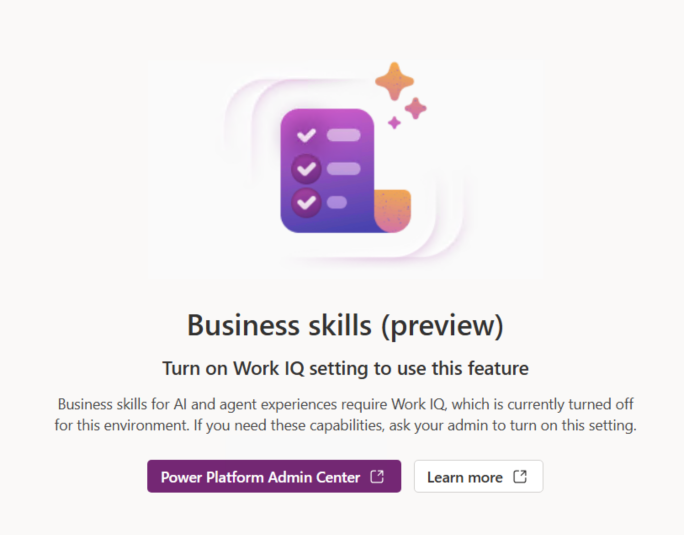
please follow these steps:
   1. Select **Power Platform Admin Center**.
   2. In environment settings, open **Work IQ**.
   3. Turn on **Turn on Business Applications in Work IQ**.
      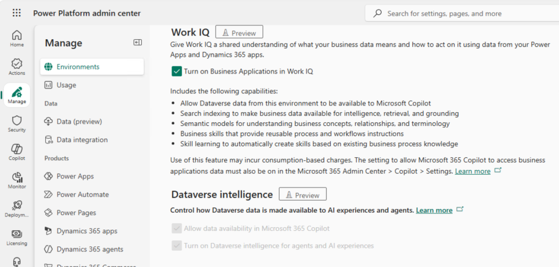
   5. Select **Apply**.
   6. Return to your maker tab and open **Business skills** again.
6. Select **Create skill**.
7. Set:

   | Field | Value |
   | --- | --- |
   | Name | `ppcc-order-disruption-triage` |
   | Description | `Use this skill when a supplier delay, inventory shortage, or shipment risk may affect open Northwind customer orders.` |

8. Open
   [`./prompts/module4/ppcc-order-disruption-triage.md`](./prompts/module4/ppcc-order-disruption-triage.md).
9. Copy from `# Order disruption triage` through the end of the file. Do not
   copy the YAML metadata above the heading.
10. Paste the copied content into **Instructions**.
11. Select **Preview**.
12. Confirm the preview contains:
    - Policy version `lab-1`
    - Evidence to gather
    - Prioritization
    - Recovery policy
    - Completion and audit
13. Select **Save**.

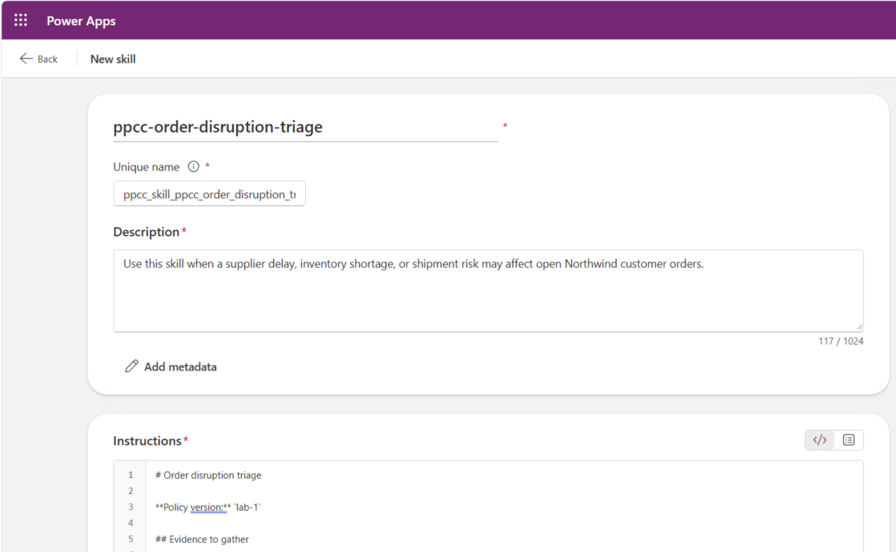

## Add the skill to the solution (Recommended)

1. Return to **Solutions**.
2. Select **PPCC Agentic Control Tower Starter**.
3. Select **Add existing** > **Business skill**.
4. Select `ppcc-order-disruption-triage`.
5. Select **Add**.
6. Under **Objects**, select **Business Skill**.
7. Confirm the skill is listed.

The current Business Skills preview editor has no skill-specific Publish/Test control. Saving
the skill and adding it to the solution are the only participant actions. 

## Create Disruption Commander agent

1. Open **Copilot Studio** in the lab environment.
   - If you are on the Make.PowerApps.com in your browser,
     select **Power Platform** on the bottom-left, then select **Copilot Studio**.

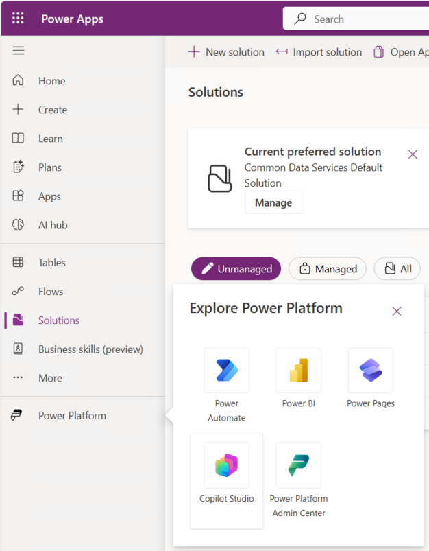
2. Verify that Copilot Studio is set to your workshop **Dev-USER-<UserId>**
   environment. If needed, use the environment picker and switch to your assigned
   Dev environment before continuing.

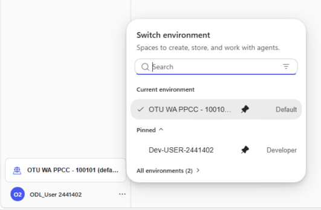
3. Select **Other ways to build**.

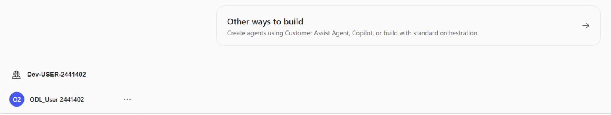
4. Select **Agent (Standard)**.

5. Name "Disruption Commander" expand the **Agent Settings (Optional)** select **PPCC Agentic Operataions Control Tower**.

6. Once created, click **Edit** with pencil icon on the main section to update Description.

7. Enter data to match this:

   | Field | Value |
   | --- | --- |
   | Name | `Disruption Commander` |
   | Description | `Explains persisted disruption evidence, policy, alternatives, and the next permitted step without executing consequential actions.` |

8. Select **Save**.
9. On **Overview**, find **Instructions** and select **Edit**.
10. Open
   [`./prompts/module4/disruption-commander.md`](./prompts/module4/disruption-commander.md).
11. Copy the raw text below the heading into **Instructions**.
12. Select **Save**.

> [!IMPORTANT]
> Use **Other ways to build** > **Agent (Standard)** for both agents in this
> module. The newer lightweight/custom agent creation path can hide the
> **Triggers** UI, which prevents the Handoff agent from running autonomously
> from a Dataverse row change.

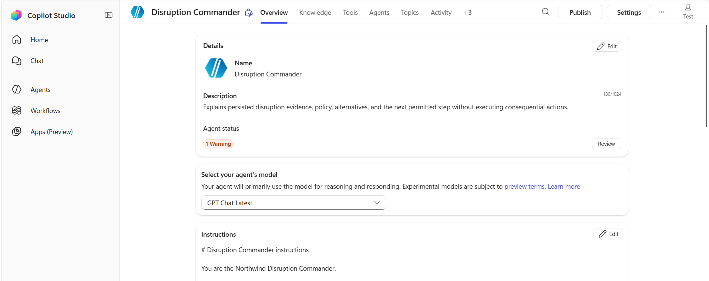

## Add read-only Dataverse MCP to the agent

1. Select **Tools**.
2. Select **Add a tool**.
3. Select **Model Context Protocol**.
4. Search for `Microsoft Dataverse MCP Server`.
5. Select **Microsoft Dataverse MCP Server**. If you see multiple results,
   hover with mouse to make sure you are you are selecting the one without preview text in the name.
   
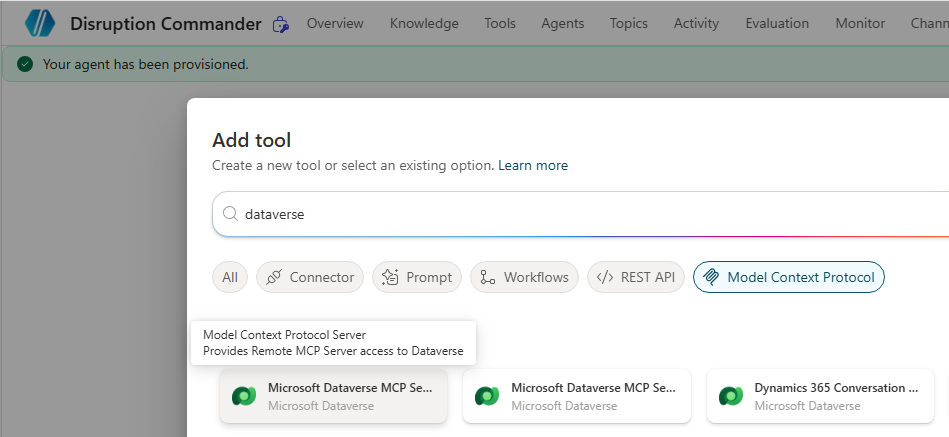

7. Select **Add**.
8. If prompted for a connection:
   1. select the facilitator-provided,
   2. set authentication mode to **Maker**,
   3. do not create a second connection if one is available. Note that you had this issue.
9. Open the added Dataverse MCP tool.
10. In the **Tool** section, turn off the main toggle on top of the table section that allows all.
11. Leave Enabled only:
    - `read_query`
    - `search`
    - `describe`
12. Confirm every other operation is off.
13. Select **Save**.

## Disable web and code capabilities of the agent

1. Select **Settings** from the top right corner.
2. Select **Generative AI** it should be the first tab.
3. In the Generative AI tab body, scroll down to the **Knowledge** section. 
The scrolling in this section can be tricky, click inside of the section then scroll down. 
4. Under **Knowledge**, turn **Use information from the Web** off.
5. Under **File processing capabilities**, turn **Code interpreter** off.

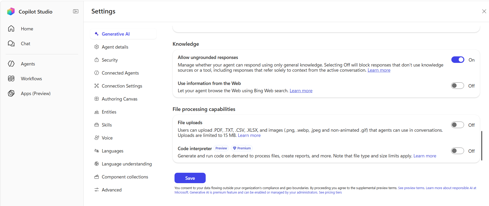

6. Select **Save**.
7. Return to **Overview**, by using the X on the top right to close out of Settings.
8. Select **Publish**.
9. Wait for publication to succeed.

## Test Commander agent 

1. Select **Test** from top right of the Copilot Studio screen.
2. Select **New conversation** if prompted.
3. Enter (Adjusting for your disruption case number as needed):

   ```text
   For disruption case DC-01000, explain the evidence, recommendation, alternatives, and next permitted step. 
   ```

4. Confirm the response contains:
   - cites three affected orders item for total of `USD 868.50`,
   - names policy `lab-1`,
   - recommends Split Shipment,
   - gives at least two alternatives,
   - refuses execution because approval is Pending.
     
5. Ask:

   ```text
   To answer this which skill did you apply, and which policy version did it specify?
   ```

6. Confirm the response names `ppcc-order-disruption-triage` and policy version `lab-1`.
7. If the agent answers only from the case rationale or cannot name the skill,
   stop. Ask the facilitator to inspect the Dataverse MCP tool and saved
   Business Skill, or restore `impact-policy-complete`.

## Create Disruption Approval Handoff Agent

1. Return to **Copilot Studio** home, click on Home on left menu (don't click Agents).
2. Select **Other ways to build**.
3. Select **Agent (Standard)**.

> [!IMPORTANT]
> Use **Other ways to build** > **Agent (Standard)** for this Handoff agent.
> Do not use the default **New agent** / autonomous-agent creation path. The
> default path can create a lightweight agent without the **Triggers** UI, and
> this module requires a Dataverse trigger to create the Agent Feed item.

4. Name it 'Disruption Approval Handoff Agent'
5. Expand **Agent settings** and select Solution **PPCC Agentic Operations Control Tower**.
6. Select **Create**.
7.  Once created, click **Edit** with pencil icon on the main section to update Description.

   | Field | Value |
   | --- | --- |
   | Name | `Disruption Approval Handoff Agent` |
   | Description | `Creates one visible Agent Feed task for a pending recovery decision, summarizes the evidence, and never approves or executes the action.` |

8. Click **Save**.
9. On **Overview**, edit **Instructions**.
10. Open
   [`./prompts/module4/disruption-handoff.md`](./prompts/module4/disruption-handoff.md).
11. Copy the text below the heading into **Instructions**.
12. Review and note that text instructions include:
   - `exactly once per autonomous trigger run`
   - `connected Disruption Commander`
   - `related Dataverse record link`
   - `end the conversation immediately`
   - `Never retry`
   - language that creates one Agent Feed task for human review
12. Select **Save**.

## Connect Handoff to Disruption Commander agent

The Handoff agent should not recreate the evidence reasoning itself. It uses the
connected **Disruption Commander** agent to prepare the evidence summary, then
creates the human-assistance item in Agent Feed.

1. On the Handoff agent **Overview** page, find **Agents** section.
2. Select **Add Agent**.
3. Select for **Disruption Commander** from the list.
4. Select **Disruption Commander**.
5. Update the **Description** with this purpose:

   ```text
   Summarize disruption evidence, policy version, recommendation, alternatives,
   and approval boundary for the related Disruption Case so this agent can create
   one Agent Feed task for human review. Do not execute actions or modify data.
   ```

6. Save the connected agent **Add and configure**.
7. Return to the Handoff agent **Overview** page. Click on the Overview tab on the top menu.
8. Scroll down on the Overview and check **Agents** list shows **Disruption Commander**.

## Add and restrict Power Apps MCP tool

1. Select **Tools**.
2. Select **Add a tool** > **Model Context Protocol**.
3. Search for and add **Power Apps MCP Server**.

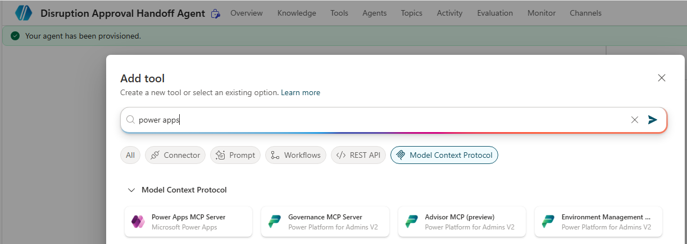

4. When prompted, select New Connection and use **Azure AD** with the lab Entra login.
5. Open **Power Apps MCP Server**.
6. Expand **Additional details** and set **Credentials to use** to
   **Maker-provided credentials**. Do not use **End user account** for this lab;
   end-user credentials can create standalone Agent Task rows that do not surface
   as Agent Feed cards in the running model-driven app.
7. Scroll to the **Tools** tab.
8. Turn **Allow all** off from the table heading.
9. Set:

   | Operation | State |
   | --- | --- |
   | `log_for_review` | Off |
   | `request_assistance` | On |
   | `invoke_data_entry` | Off |

10. Select **Save**.

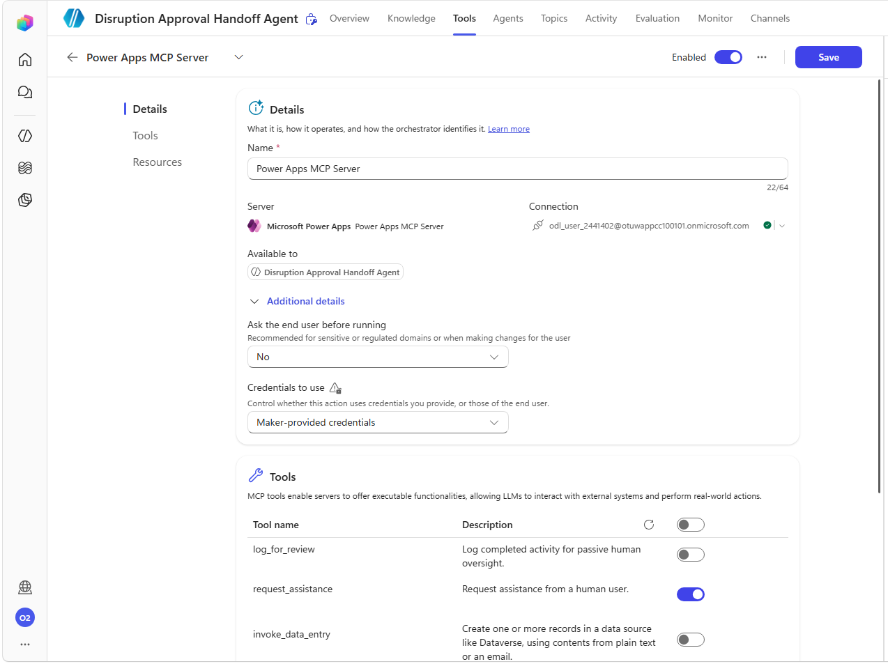

## Add the autonomous Trigger to the agent

Agent Feed cards must be created through an autonomous trigger path that uses
the Power Apps MCP `request_assistance` tool. The agent must create a visible
Agent Feed task for the disruption case: a **Needs attention** item in the
model-driven app Agent Feed, not just a backend task record. The item must also
include a related Dataverse record link that opens the Disruption Case record.
Do not use **Test** > **New conversation** to create the handoff item; preview
chat can invoke the tool, but it might only create a standalone Agent Task that
does not appear in the running model-driven app. Do not write `agenttask` or
`agentfeeditem` rows directly.

1. On the Handoff agent Overview page, scroll down to **Triggers**, select **Add trigger**.
2. Search `Dataverse`.

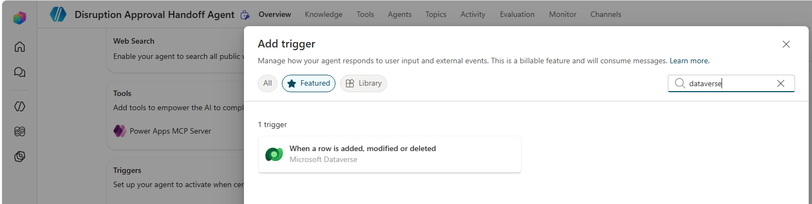

3. Select **When a row is added, modified, or deleted** and select **Next**.
4. On the next step, keep authentication defaults. (Suggested) Rename the trigger to `Update of a Recovery Decision`.
6. Configure:

   | Field | Value |
   | --- | --- |
   | Change type | `Modified` |
   | Table name | `Recovery Decisions` |
   | Scope | `Organization` |
   | Selected columns  | `ppcc_recommendationrationale` |
   | Filter rows | `ppcc_approvalstate eq 100000000` |

7. Note about **Selected columns** (or monitored columns, depending on business
   or UI changes over time) we use `ppcc_recommendationrationale`, which is
   the field this lab will ask you to update in the app to trigger the agent.

8.  Note about **Filter rows** As your policies evolve above in the filter rows you could use a more specific filter like `ppcc_decisionnumber eq 'RD-01000' and ppcc_approvalstate eq 100000000` you can add more approval statuses by looking up their state code values in Power Apps maker experience. This would be an area to troubleshoot by clearing the Filter to blank value, if trigger is not working.

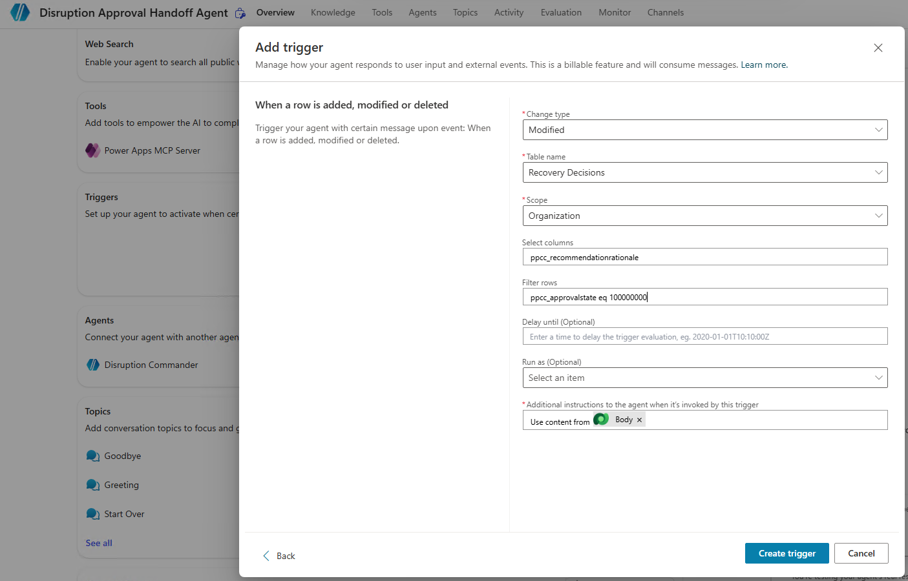

8. Save with **Create trigger** and close the pop-up when prompted.
9. Confirm you are returned to the Handoff agent **Overview** tab.
10. Select **Publish**.
11. Wait for publication to succeed.

## Add Handoff agent to Agent Feed

1. Return to Power Apps.
2. Select **Apps**.
3. Find **PPCC Agentic Operations Control Tower**.
4. Select **...** > **Edit**.
5. In the app designer, select **Agents**.
6. Under **In your environment**, find
   **Disruption Approval Handoff Agent**.
7. Select its **...** menu.
8. Select **Add to feed**.
9. Confirm it appears under **Agent feed** and shows
   **Ready to generate tasks**.
10. Select **Save and Publish** icon on top right screen next to play icon (you will click that Play icon after the publish completes).

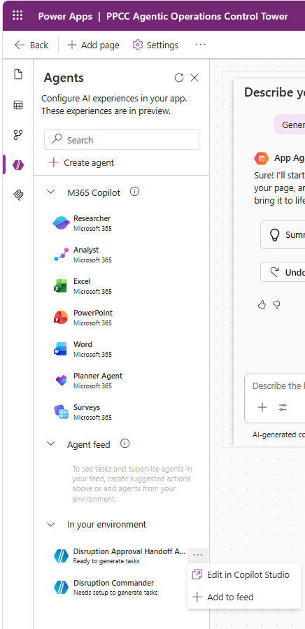

## Create triggering event for the Handoff to human

1. Open **PPCC Agentic Operations Control Tower** from App list in Power Apps (or hit play if you are still on the previous edit screen).
2. Open **Control Tower Home** menu item (should be opened by default).
3. Search for the disruption case created earlier in your lab, such as
   `Supplier delay -Northwind Traders Clam Chowder` or `DC-01000` (equivalent case in
   your dataset), then select **Open case form**.

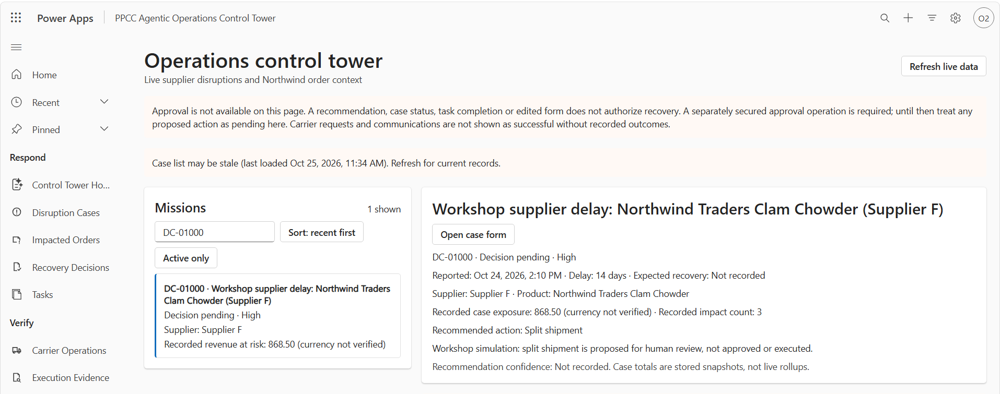

4. On the case form, open **Related** > **Recovery Decision** and select the
   current Pending decision for that case (for example, `RD-01001`).

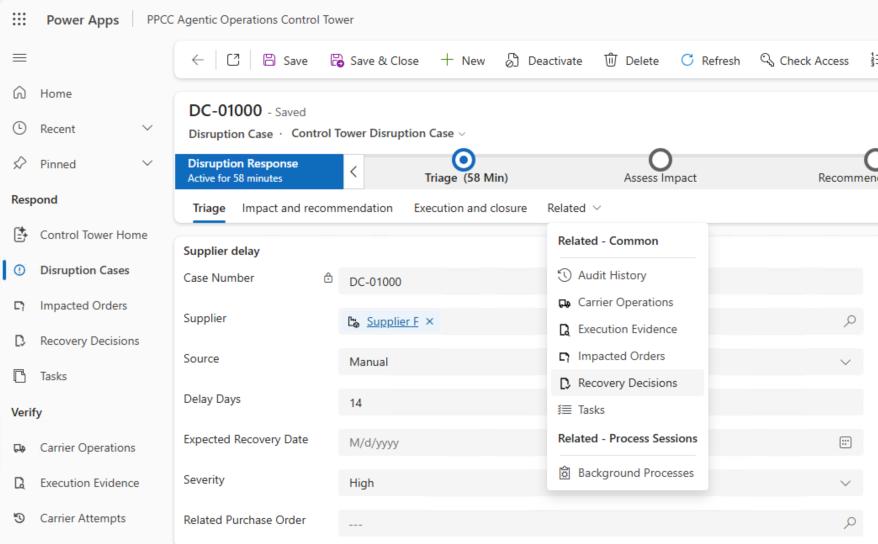

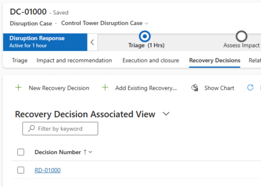

5. Update any text **Recommendation Rationale** you could just add a exra . or space
6. In the **Human decision** tab - confirm **Approval State** remains **Pending**.
7. Select **Save** button once.
8. Do not save the row again or modify another field to retry. 
9. Wait for the autonomous Handoff agent run to complete, we will switch apps - you don't need to wait on this screen.
 
## Verify Agent Feed alert

1. Open **PPCC Agentic Operations Control Tower** (if you closed it).
2. Select **Agent feed**. You can filter by **Needs attention** tab. (If you do not see Agent Feed - please refresh the browser.)
3. This might take a bit for an item to show up here. 
Leave this open and go back to Agent in Copilot Studio and see the **Activity** tab where you can see running items reviewing exact steps the agent is taking. If you run into issues, check Power Apps MCP authentication, and whether `request_assistance` created a visible Agent Feed task, double check the correct Agent was added in the App - know that Disruption Commander agent does not work you need Disruption Handoff agent, an easy mistake to make.
4. Confirm exactly one new item appears for the same case/decision you updated.
   The title may vary by environment (for example, it might use a case number
   like `DC-01001` instead of the case title text).
5. Open the item and confirm it includes:
   - supplier-delay evidence context (3 impacted orders, USD 868.50),
   - recovery remains Pending / requires human review,
   - a clear boundary that completion of the Agent Feed item is not business approval.
6. Scroll down in the item and open the related Disruption Case link (or open the
   item directly).
7. Confirm it opens the linked Disruption Case record for your lab data and the
   **Decision Status** remains **Pending**.
8. You can also review the **Activity** tab in the agent in Copilot Studio to
   troubleshoot or review exact steps the agent took.
9. Leave the task open for Module 6.

## Checkpoint

The module passes when the participant created:

- one Business Skill in the solution,
- one published read-only Commander,
- Handoff connected to Disruption Commander,
- one published Handoff agent with only `request_assistance`,
- one autonomous Dataverse trigger on the Handoff agent,
- one app association,
- exactly one Needs attention item that opens the Control Tower,
- no approved decision or execution record.

If one Handoff trigger creates multiple tasks, stop. Do not invoke it again.
