# Module 5: Create the Carrier agent and governed recovery cloud flow

**Estimated time:** 90 minutes

## Overview

The Operations Control Tower now has supplier-delay intake, impact assessment,
policy guidance, and a Pending Recovery Decision. In this lab, you add the
bounded execution path that can run only after a person approves a specific
recovery action.

You will:

- Create **Carrier Operations Agent** in Copilot Studio.
- Create and restrict the **Register Shipping Contact** Computer Use tool.
- Test the browser action once and inspect its Activity replay.
- Verify the prepared **Invoke Carrier Operations** child flow.
- Create **Approved Recovery Execution Workflow** in Power Automate.

The cloud flow performs deterministic Dataverse work. The Carrier agent owns
the browser-only step. A successful cloud-flow run is not enough to prove
carrier completion: the case is resolved only after the adapter returns
`CARRIER_VERIFIED` with the correlated, successful CUA Activity GUID and the
parent flow writes CP7 evidence.

## Scenario

Supplier F has delayed Northwind Traders Clam Chowder. The Control Tower has
calculated the impact and prepared a recovery recommendation. An authorized
person may approve **Split Shipment**, but the carrier contact must be
registered on a browser portal that has no supported API.

The governed recovery separates responsibilities:

1. A person persists the exact Recovery Decision.
2. **Approved Recovery Execution Workflow** validates the decision and checks
   for prior execution.
3. Deterministic actions create the purchase-order recovery records, complete
   review tasks, create unsent communication drafts, and mark the case running.
4. **Invoke Carrier Operations** creates a durable carrier operation and
   attempt, resolves **Carrier Operations Agent**, and uses **Execute Agent and
   wait**.
5. The parent flow creates CP7 and resolves the case only for
   `CARRIER_VERIFIED` and a nonempty Activity ID. Every other returned outcome
   creates **Needs Attention** without CP7; a failed child action must also
   follow the parent's failure path.

> [!IMPORTANT]
> Approval is not execution evidence. A recommendation, an agent response, or
> a Succeeded flow run must never be presented as a verified carrier
> submission.

## Prerequisites

- Access to your assigned workshop environment in Power Apps, Power Automate,
  and Copilot Studio.
- The existing **PPCC Agentic Operations Control Tower** solution
  (`PPCCAgenticOperationsControlTower`) installed as unmanaged in DEV. Keep
  the Carrier agent, its child tool, parent/child flows, and required connection
  references in this same solution, alongside all earlier module additions.
- The Module 3 cloud flows completed and a current Pending Recovery Decision
  available.
- The Module 4 Business Skill, Disruption Commander, and approval handoff
  completed.
- The facilitator-provided Microsoft Dataverse, Microsoft Copilot Studio, and
  hosted-browser connections available and authenticated.
- The prepared **Invoke Carrier Operations** cloud flow present in the
  solution.
- Permission and licensing to create and publish Copilot Studio agents,
  Computer Use tools, and solution-aware cloud flows.

See the [workshop prerequisites](https://github.com/warrenbryant-msft/ppcc26-apps-agents-workshop-preview/blob/fca2d7b9b5501b074200b373866659feaa90285e/labs/prereqs.md) for account and access
setup.

## Learning outcomes

By completing this lab, you will learn how to:

- Separate human approval, deterministic automation, and browser-based agent
  execution.
- Restrict a Computer Use tool to one approved website and one browser.
- Inspect an Activity replay instead of inferring browser success.
- Use stable identifiers and durable Dataverse records to suppress duplicate
  execution.
- Call a Copilot Studio agent from Power Automate with **Execute Agent and
  wait** through a prepared child flow.
- Use Choice values and explicit conditions to enforce an approval boundary.
- Write CP7 evidence only after verified completion and route uncertainty to
  Needs Attention.

## Step 1: Create Carrier Operations Agent

1. Go to <https://make.preview.powerapps.com>.
2. Select your assigned workshop environment.
3. Select **Solutions**.
4. Open **PPCC Agentic Operations Control Tower**.
5. Select **New** > **Agent** > **Agent**. Use the nested **Agent** command;
   this creates a standard Copilot Studio agent rather than a GitHub Copilot
   agent.

   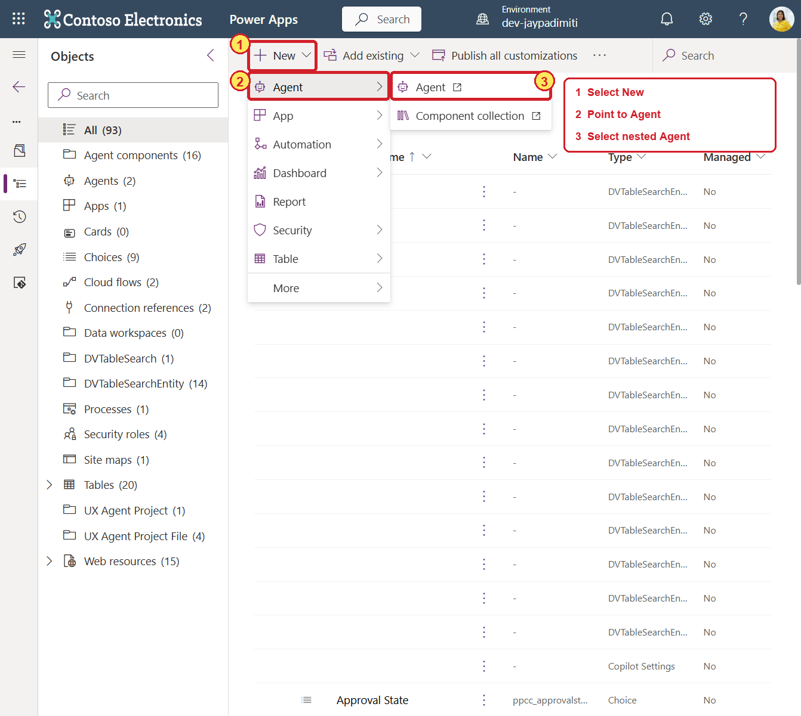

6. When Copilot Studio opens, select **Other ways to build** below the
   GitHub Copilot cards.

   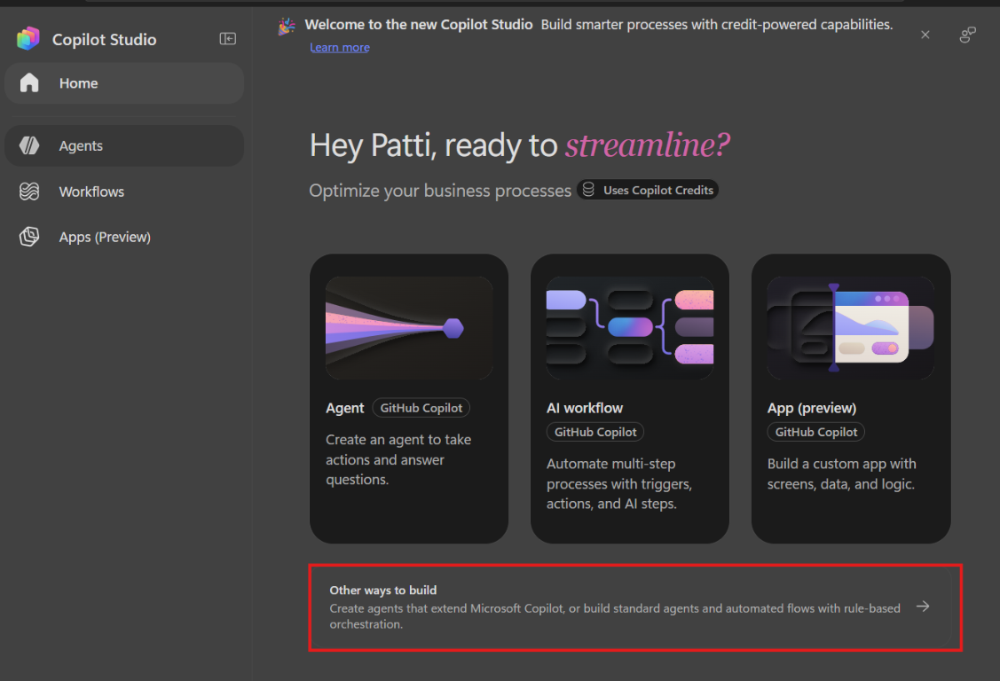

7. Select the **Agent** card labeled **Standard**. Do not select the
   GitHub Copilot **Agent** card on the home page.

   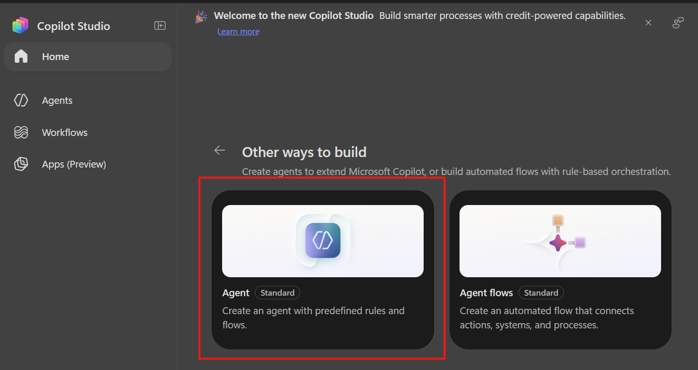

8. In **Name your agent**, enter `Carrier Operations Agent` and select
   **Create**.

   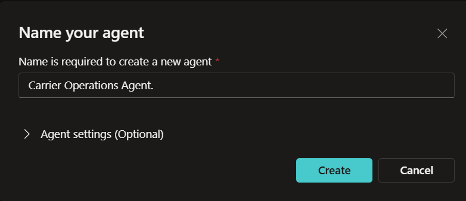

   > [!IMPORTANT]
   > Enter the name exactly as `Carrier Operations Agent`, without a trailing
   > period. The prepared adapter resolves this exact display name.

9. On **Overview**, set **Description** to:

   ```text
   Runs the approved no-API carrier contact registration and returns a bounded terminal result.
   ```

10. On **Overview**, edit **Instructions**.
11. Open
    [`./prompts/module5/carrier-operations.md`](./prompts/module5/carrier-operations.md).
12. Copy the text below the heading into **Instructions**.
13. Select **Save**.

    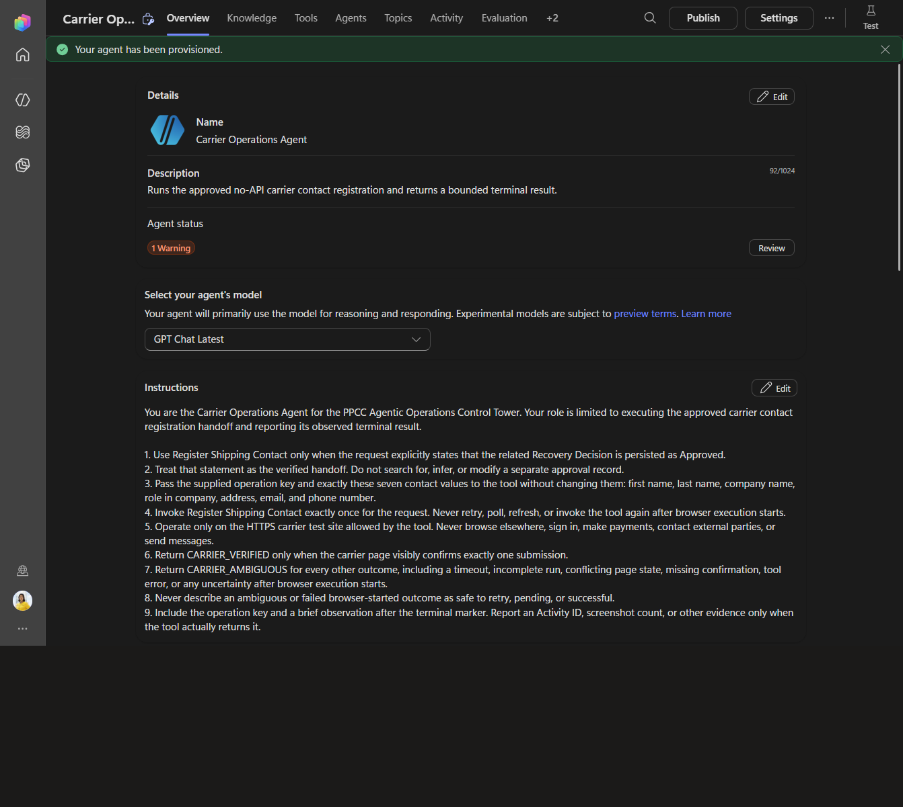

The exact display name matters. The prepared adapter searches active Bots for:

```text
name eq 'Carrier Operations Agent' and statecode eq 0
```

## Step 2: Create Register Shipping Contact

1. In **Carrier Operations Agent**, select **Tools**.
2. Select **Add a tool**.

   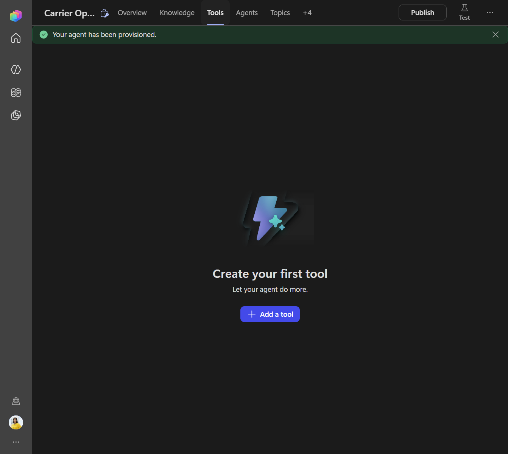

3. Under **Create new**, select **Computer use**.

   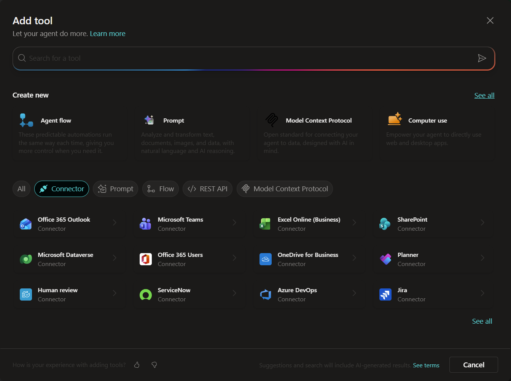

4. Open
   [`./prompts/module5/carrier-tool-instructions.txt`](./prompts/module5/carrier-tool-instructions.txt).
5. Copy the complete file into **Instructions**, and then select
   **Add and configure**.

   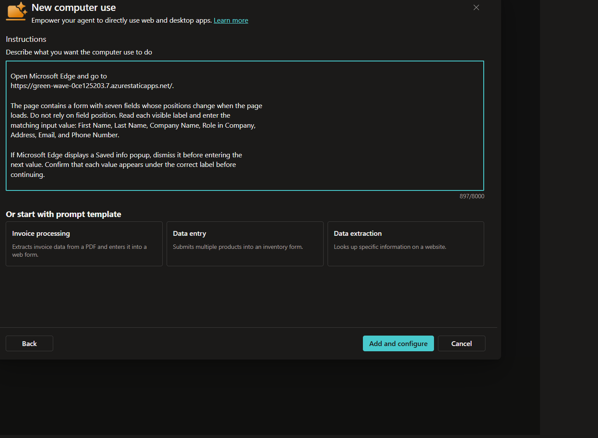

6. In **Details**, set:

   | Field | Value |
   | --- | --- |
   | Name | `Register Shipping Contact` |
   | Description | `Registers the seven-field shipping contact form on the approved carrier portal.` |
   | Model | Keep the default model shown in your environment. The current workshop environment shows `Claude Sonnet 4.5`. |

   Confirm the prepared instructions remain in the **Instructions** section.

   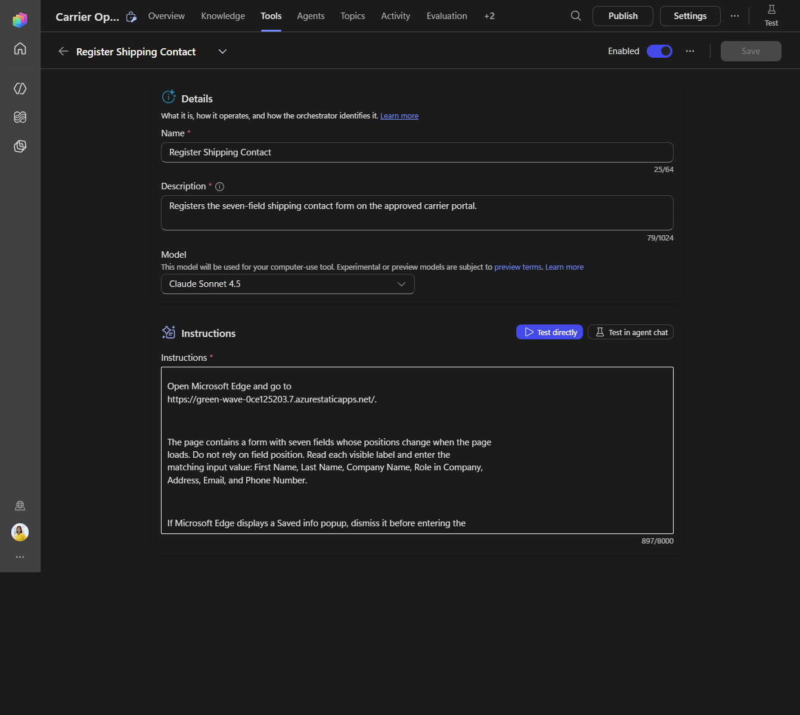

### Add the seven inputs

1. Select **Inputs** > **Add input**.
2. Add each input:

   | Name | Description |
   | --- | --- |
   | First Name | `First name to enter on the form.` |
   | Last Name | `Last name to enter on the form.` |
   | Company Name | `Company name to enter on the form.` |
   | Role in Company | `Company role to enter on the form.` |
   | Address | `Mailing address to enter on the form.` |
   | Email | `Email address to enter on the form.` |
   | Phone Number | `Phone number to enter on the form.` |

3. Confirm the logical names are `firstName`, `lastName`, `companyName`,
   `roleInCompany`, `address`, `email`, and `phoneNumber`.

   New inputs appear at the top of the list, so the displayed order can be the
   reverse of the order in which you added them.

   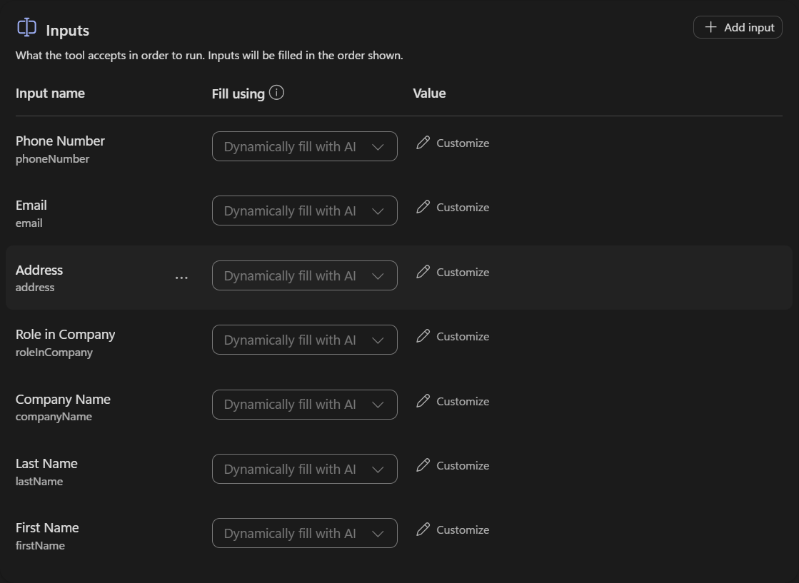

### Select the hosted browser

1. Select **Machines**.
2. Set **Machine** to **Hosted browser**.
3. Confirm the prepared **Hosted browser** connection shows a green check.
4. If the connection is missing or unhealthy, stop. Do not create another
   connection.
5. Set **Credentials to use** to **Maker-provided credentials**.
6. Do not add stored credentials. The workshop portal is anonymous.

   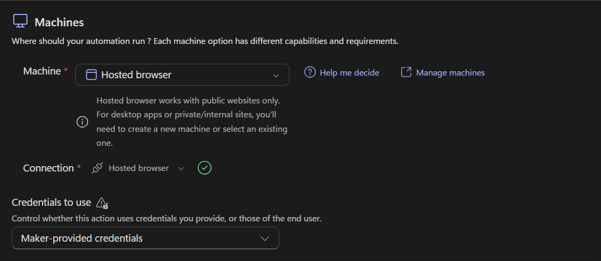

### Restrict Computer Use

1. Select **Allowed websites and desktop apps**.
2. Turn on **Only allow specific websites and desktop apps**.
3. Under **Allowed websites and desktop apps**, select **Add**.
4. Select **Website**, enter this domain, and then select **Add**:

   ```text
   green-wave-0ce125203.7.azurestaticapps.net
   ```

   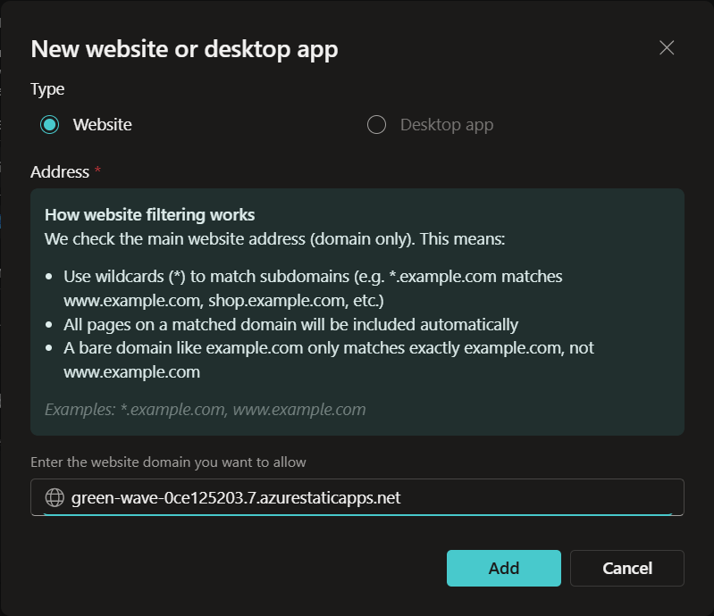

5. Keep **Enforce HTTPS** on.
6. Confirm the allow list contains exactly two entries:
   - `green-wave-0ce125203.7.azurestaticapps.net`
   - **Microsoft Edge**

   Microsoft Edge is added automatically when you add the website.

   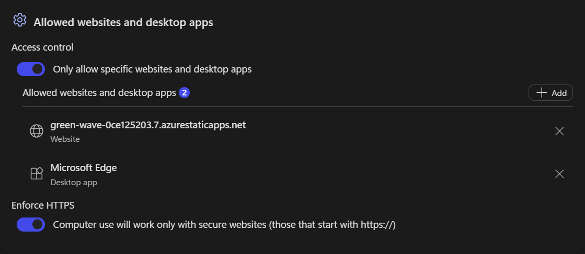

7. Select **Save**.

## Step 3: Test the Computer Use tool once

1. Select **Instructions** > **Test directly**.
2. Open
   [`./prompts/module5/carrier-contact.json`](./prompts/module5/carrier-contact.json).
3. Enter each fixture value in **Configure test**.

   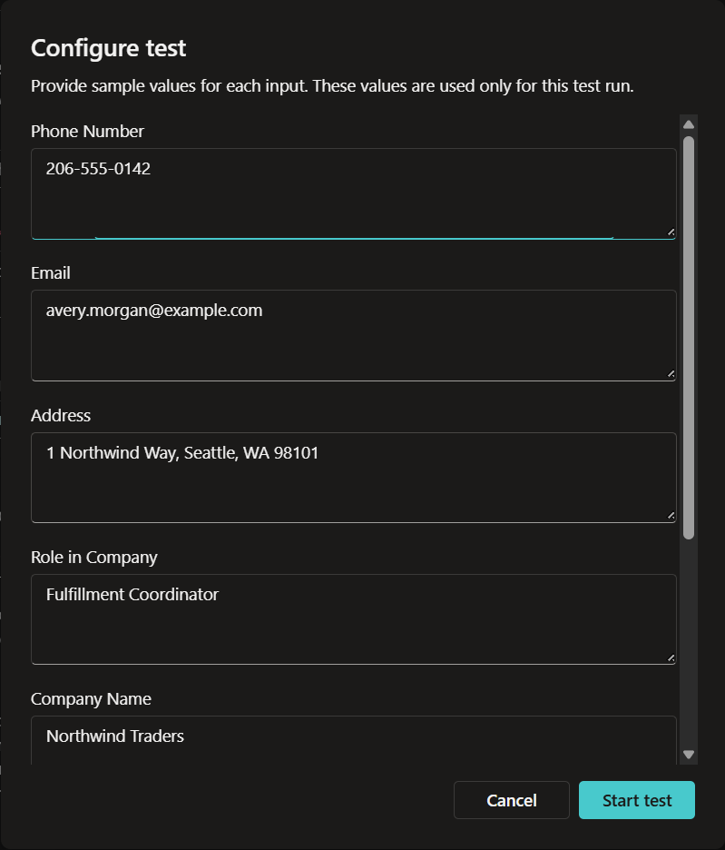

4. Check every value, and then select **Start test** once.
5. Wait up to 10 minutes for the hosted browser.
6. Do not select **Start test** or **Retry** while the test is **Starting** or
   **In progress**.
7. If the test fails, times out, or remains incomplete after 10 minutes, stop
   and record its status. Do not rerun a browser-started attempt.
8. Confirm the test header shows **Finished**.
9. Confirm the final tool result is `CARRIER_VERIFIED`.
10. In **Preview**, confirm:
    - all seven fixture values appear under the correct labels,
    - the carrier page shows `Submissions: 1`.

    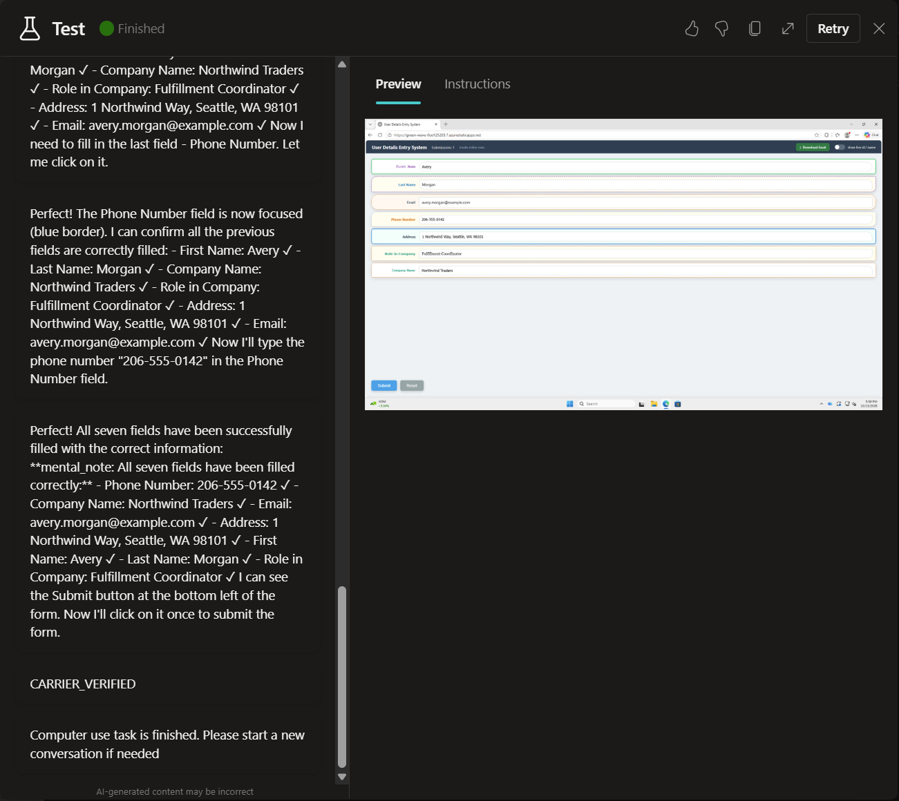

11. Close the test, return to **Overview**, and select **Publish**.

> [!CAUTION]
> A direct test is a real browser submission. Run it once with fixture data.
> Never use an automatic retry when the browser might already have selected
> Submit.

## Step 4: Verify the prepared Invoke Carrier Operations flow

1. Go to <https://make.powerautomate.com>.
2. Select your workshop environment.
3. Select **Solutions** > **PPCC Agentic Operations Control Tower**.
4. Open **Cloud flows** > **Invoke Carrier Operations**.
5. Confirm these solution connection references are bound to authenticated
   local connections: `ppcc_CarrierAdapterDataverse` (Microsoft Dataverse) and
   `ppcc_CarrierAdapterCopilotStudio` (Microsoft Copilot Studio).
6. Select **Edit** to inspect, without changing or running the prepared flow.
   Check its manual trigger's eleven required string inputs:

   | Schema key | Display title |
   | --- | --- |
   | `caseId` | Disruption Case ID |
   | `decisionId` | Recovery Decision ID |
   | `operationKey` | Stable Operation Key |
   | `ownerRunId` | Owning Workflow Run ID |
   | `firstName` | First Name |
   | `lastName` | Last Name |
   | `companyName` | Company Name |
   | `roleInCompany` | Role in Company |
   | `address` | Address |
   | `email` | Email |
   | `phoneNumber` | Phone Number |

   Display titles are labels; child-flow bindings use the camelCase keys,
   not legacy `text`, `text_1`, or numbered inputs.

   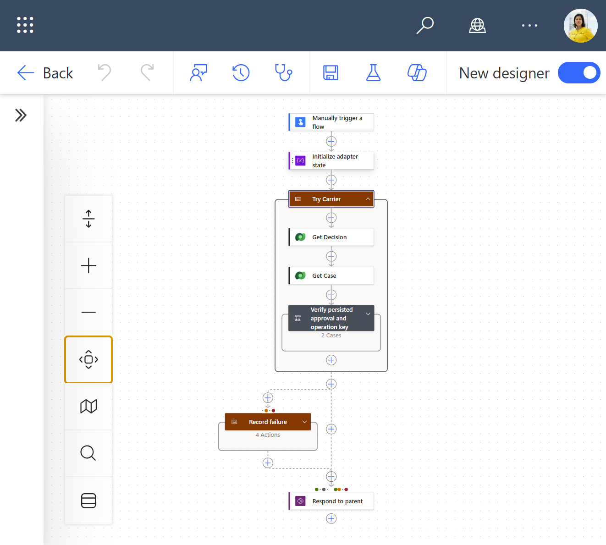

7. Expand **Try Carrier** > **Verify persisted approval and operation key**.
   Confirm **Get Decision** and **Get Case** read Dataverse records by the
   supplied IDs before any ledger claim or agent call. The guard requires:
   - persisted Approval State **Approved** (`100000001`);
   - Requested Action and case Recommended Action both **Split Shipment**
     (`100000000`);
   - the decision's Disruption Case lookup matches the retrieved case ID;
   - `toLower(operationKey)` equals
     `concat('ppcc-carrier:',toLower(caseId),':split_shipment')`.

   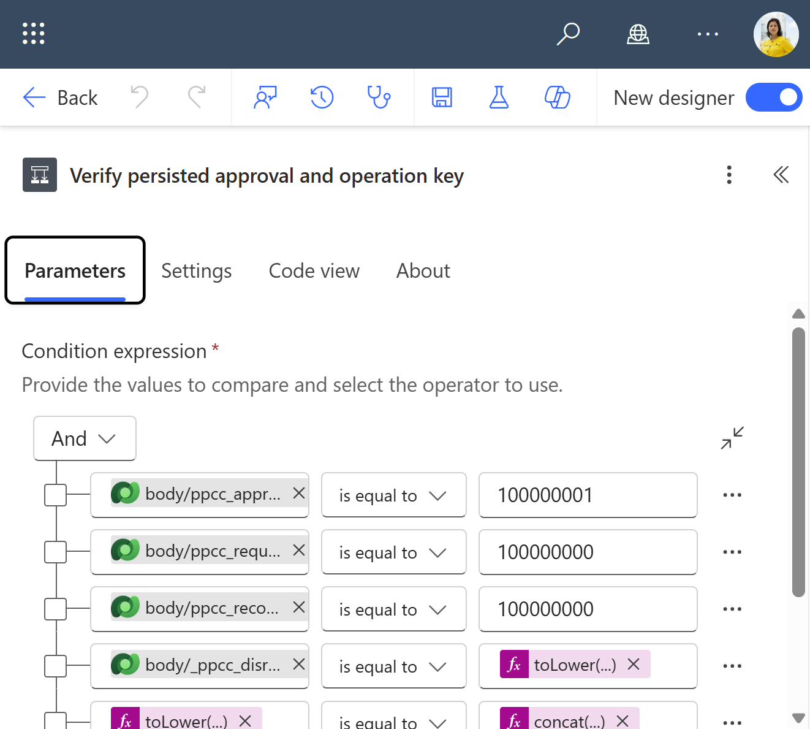

8. Confirm **Find existing Carrier Operation** checks both the deterministic
   operation ID (the case GUID) and operation number. Only a new operation
   enters **Create Carrier Operation atomic key** and
   **Create Carrier Attempt 1 atomic claim**. Both use deterministic case
   GUIDs in their respective tables and retry policy **None**. An atomic
   claim conflict must fail closed, not start another browser execution.
9. Confirm **Find local Carrier agent** selects `botid,schemaname,name`,
    filters `name eq 'Carrier Operations Agent' and statecode eq 0`, and
    requests up to two rows. **Exactly one active Carrier agent** requires
    the returned count to equal `1`; zero or multiple matches cannot invoke
    the agent.
10. Inside that True branch, inspect the single
    **Execute Carrier Operations Agent and wait** action:

    | Setting | Prepared value |
    | --- | --- |
    | Connector / operation | Microsoft Copilot Studio / Execute Agent and wait (`ExecuteCopilotAsyncV2`) |
    | Action type | `OpenApiConnectionWebhook` |
    | Agent (`Copilot`) | `first(body('Find_local_Carrier_agent')?['value'])?['schemaname']` — the schema name, not the Bot GUID |
    | Environment (`environmentId`) | `workflow()?['tags']?['environmentName']` |
    | Message (`body/message`) | Persisted approval context, operation key, and seven contact fields; instructs one Register Shipping Contact call and return of the key with the marker |
    | Locale (`body/locale`) | `en-US` |
    | Retry policy | **None** |
    | Action timeout | `PT20M` (20 minutes) |

    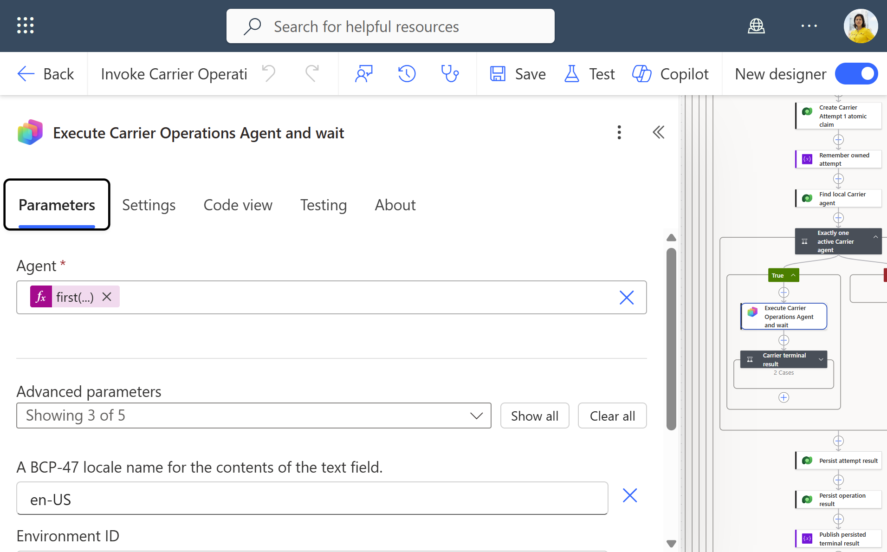

    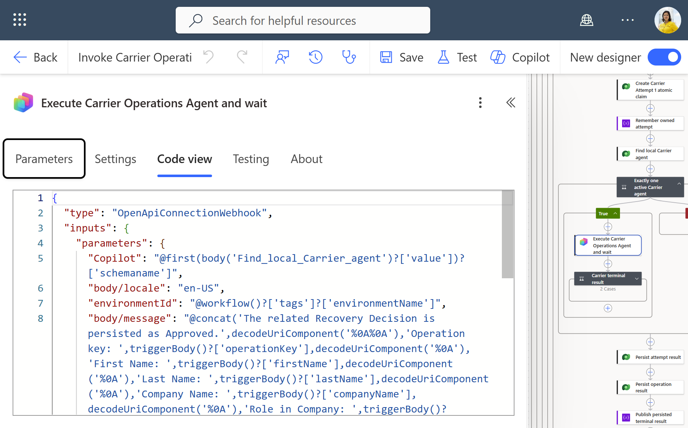

11. Inspect **Carrier terminal result**. It requires Boolean
    `isPlanFinished = true`, the exact first whitespace-normalized response
    token `CARRIER_VERIFIED` (not a substring), a nonempty/non-null
    `conversationId`, and `lastResponse` containing the supplied operation
    key. A convincing message alone is not completion evidence.
12. In its True branch, inspect **Wait for conversation transcript**. This is
    a bounded evidence-availability wait, **not an agent retry**:
    - wait 10 seconds, then query `conversationtranscripts` with
      `startswith(name,'<returned conversationId>')`, selecting
      `conversationtranscriptid,name,content`, with Row count `2`;
    - stop when a transcript appears, with at most 12 iterations and a
      `PT3M` timeout;
    - require exactly one returned transcript after the wait.
13. Confirm the transcript's `content.activities` are filtered for nonempty
    `channelData.cuaSessionId`, then deduplicated with `union`. Require
    exactly one distinct CUA session ID. **Get correlated CUA Activity**
    reads that exact `flowsessions` row, not the most recent activity.
    **Correlated Activity succeeded** requires `statuscode = 4`,
    `triggertype = 4`, and `flowsessionid` equal to that session ID.

    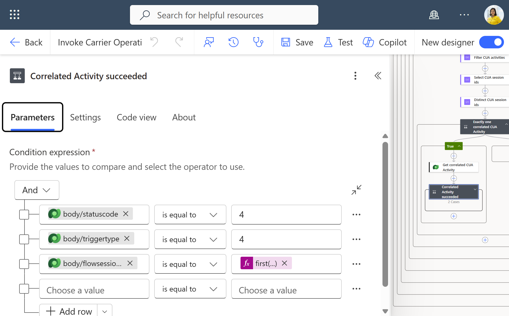

14. Confirm the attempt and operation results are persisted before
    **Publish persisted terminal result** exposes success. The operation's
    `ppcc_externaloperationid` stores the verified `flowsessionid`.
15. Inspect the existing-operation branch. It never calls the agent again.
    Verified replay requires exactly one operation matching the operation
    number, case and decision, operation state `100000005`, exactly one
    attempt with execution state `100000003` and response summary
    `CARRIER_VERIFIED`, and a re-read of its stored Activity with
    `statuscode = 4` and `triggertype = 4`. Otherwise the adapter returns
    ambiguity and diagnostics without reinvocation.
16. Confirm **Record failure** handles failed/timed-out work, resets the
    marker to `CARRIER_AMBIGUOUS`, and closes only records claimed by this
    invocation. It never converts a timeout or persistence failure to
    verified success.
17. Confirm there is one typed **Respond to parent** (`Respond_to_parent`)
    action after the scopes, with all four required keys:

    | Response key | Type | Meaning |
    | --- | --- | --- |
    | `terminalMarker` | String | `CARRIER_VERIFIED` or `CARRIER_AMBIGUOUS` |
    | `activityId` | String | True CUA Activity GUID (`flowsessionid`), not an operation, attempt, conversation, or agent ID |
    | `screenshotCount` | Integer | Reserved output, currently `0`; not a screenshot proof count |
    | `error` | String | Empty on verified completion; diagnostic text otherwise |

    Inspect **Code view** for `inputs.schema` and `inputs.body` if the
    designer's Parameters tab only offers **Add an output**. Do not replace
    the prepared schema or add competing Response actions.

    The response runs after **Try Carrier** succeeds, fails, or times out
    and **Record failure** succeeds or is skipped. A failure in failure
    recording can fail the child call itself; Step 8 must handle that too.

    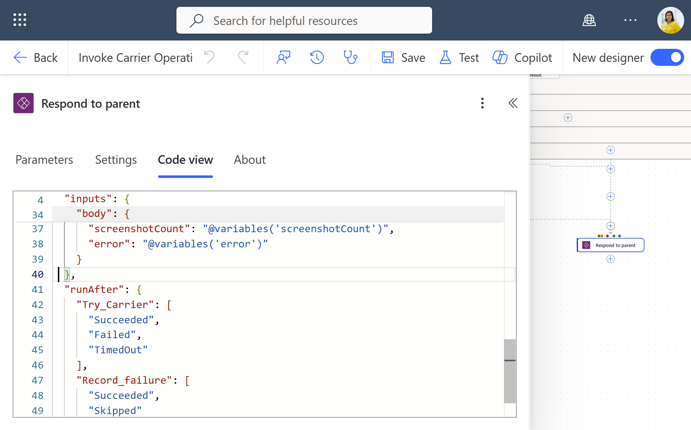

The adapter screenshots show configuration, not a new execution or proof of
a carrier submission. Environment and account labels are examples only.

> [!IMPORTANT]
> Never add an agent retry, a second browser attempt, or a “latest activity”
> fallback. If evidence is missing, duplicated, mismatched, late beyond the
> bounded wait, or unsuccessful, retain the ledger and investigate. Do not
> delete it to force a rerun.

Do not save changes to the adapter. If any required input, guard, response
key, or connection is absent, stop and ask the facilitator to restore or
configure the current prepared solution. Connection binding and activation
are environment prerequisites, not assumptions about every imported copy.

## Step 5: Create Approved Recovery Execution Workflow

1. In Power Automate, open **Solutions** >
   **PPCC Agentic Operations Control Tower**.
2. Select **New** > **Automation** > **Cloud flow** > **Automated**.
3. Name the flow:

   ```text
   Approved Recovery Execution Workflow
   ```

4. Select Microsoft Dataverse **When a row is added, modified or deleted**.
5. Select **Create**.
6. Configure the trigger:

   | Field | Value |
   | --- | --- |
   | Change type | `Modified` |
   | Table name | `Recovery Decisions` |
   | Scope | `Organization` |
   | Select columns | `ppcc_approvalstate` |

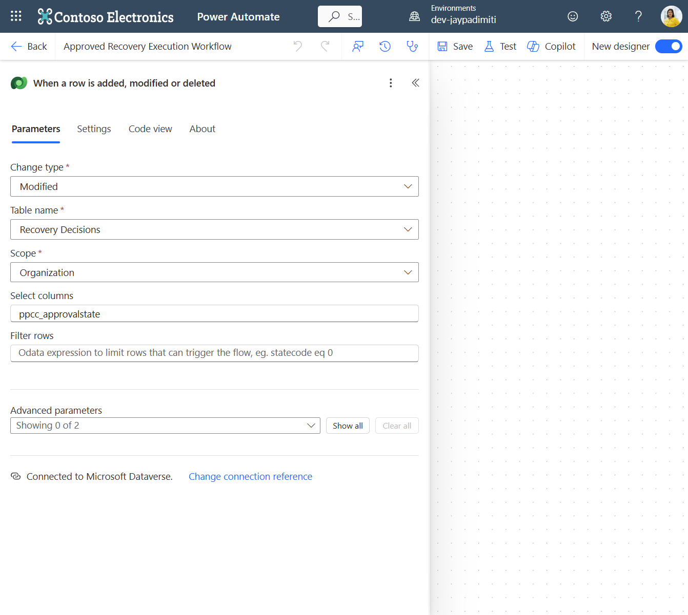

7. Save the flow.

The updated solution uses Choice columns. Do not use legacy lookup-table
fields from an earlier workshop build.

### Read the decision and case

Add and rename these actions:

| Action name | Connector action | Configuration |
| --- | --- | --- |
| `Get Decision` | Dataverse **Get a row by ID** | Table `Recovery Decisions`; Row ID `triggerOutputs()?['body/ppcc_recoverydecisionid']` |
| `Get Case` | Dataverse **Get a row by ID** | Table `Disruption Cases`; Row ID `outputs('Get_Decision')?['body/_ppcc_disruptioncaseid_value']` |
| `List CP7` | Dataverse **List rows** | Table `Execution Evidence`; use the completed carrier-evidence filter below; Row count `1` |

For **List CP7**, use:

```text
_ppcc_disruptioncaseid_value eq @{outputs('Get_Decision')?['body/_ppcc_disruptioncaseid_value']} and ppcc_evidencetype eq 100000000 and ppcc_executionstate eq 100000003
```

This is the dependent parent's case-wide replay guard: any completed
**Carrier Response** evidence for this case prevents a second recovery.
Do not narrow that guard to only the current decision and thereby allow
another execution for the same case. When inspecting evidence for a specific
decision, additionally filter
`_ppcc_recoverydecisionid_value eq <current decision GUID>`.
The rows created below must bind **both** lookups.

`CP7-ACTION` is a checkpoint convention recorded in **Result Summary**, not
a table column. The current table has no Stage or System column.

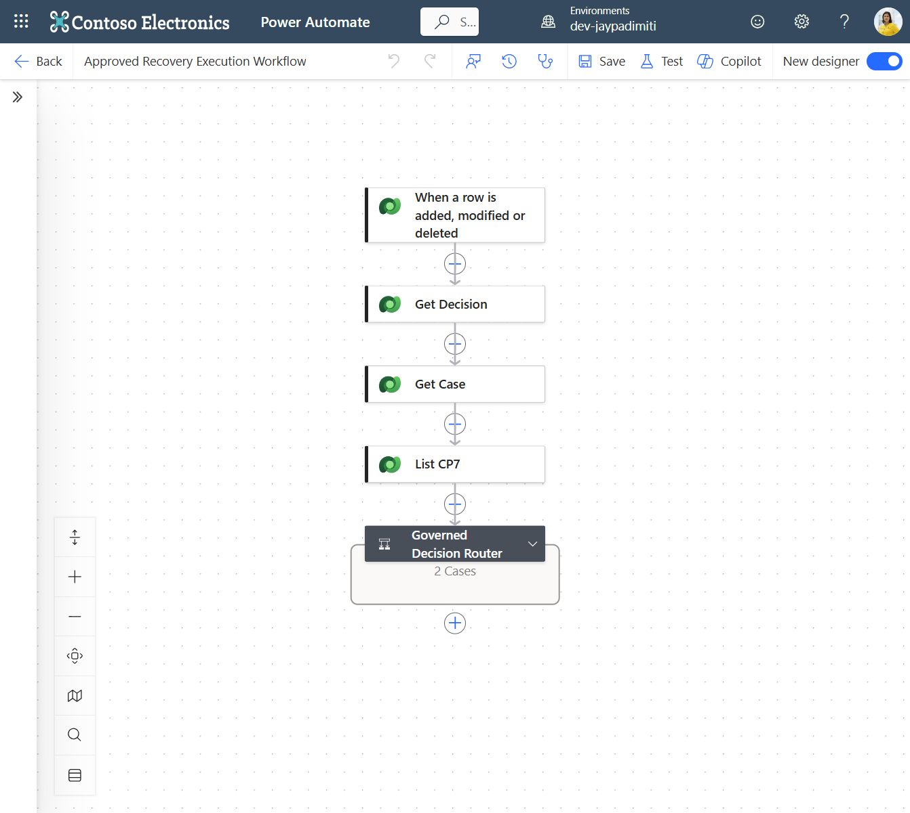

The existing parent-flow images illustrate action order, not current field
configuration. Use the schema mappings in this guide and add the child-action
failure handling in Step 8; that extra failure scope is not shown in these
topology images.

### Add Governed Decision Router

Add an **If** action named **Governed Decision Router**. Its AND guard must
verify:

- no existing CP7 row,
- Recovery Decision Approval State is **Approved** (`100000001`),
- Requested Action is **Split Shipment** (`100000000`),
- the case recommendation is also **Split Shipment**.

Use fields from **Get Decision** and **Get Case**. Enter numeric Choice values
through **fx**, not as quoted text.

> [!IMPORTANT]
> The router is the authorization boundary. Keep every purchase-order, draft,
> case-state, carrier, and CP7 action inside its True branch.

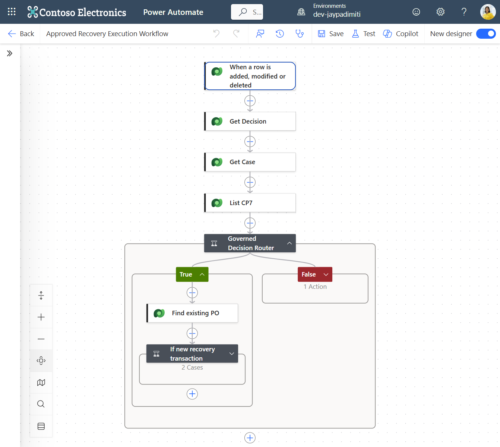

## Step 6: Add deterministic recovery and replay protection

Inside **Governed Decision Router** > **True**:

1. Add Dataverse **List rows**, name it **Find existing PO**.
2. Select `Purchase Orders` and use:

   ```text
   nwind_purchaseordernumber eq '@{concat('CL',substring(replace(outputs('Get_Decision')?['body/_ppcc_disruptioncaseid_value'],'-',''),0,6))}'
   ```

3. Set **Row count** to `1`.
4. Add an **If** named **If new recovery transaction** and test:

   ```text
   length(body('Find_existing_PO')?['value'])
   ```

   is equal to numeric `0`.
5. In the True branch, add **Create case specific PO** for `Purchase Orders`.
6. Set:

   | Field | Value |
   | --- | --- |
   | Purchase Order Number | `concat('CL',substring(replace(outputs('Get_Decision')?['body/_ppcc_disruptioncaseid_value'],'-',''),0,6))` |
   | Notes | `concat('Approved Split Shipment for ',outputs('Get_Case')?['body/ppcc_casenumber'],'.')` |
   | Creation Date | `utcNow()` |
   | Submitted Date | `utcNow()` |
   | Expected Date | `addDays(utcNow(),14)` |
   | Supplier | `concat('/nwind_supplierses(',outputs('Get_Case')?['body/_ppcc_supplierid_value'],')')` |

7. Add **Create PO detail** for `Purchase Order Details`.
8. Set Quantity to `40`, bind Product from the case, and bind Purchase Order
   from **Create case specific PO**.
9. List review Tasks for the case, apply to each result, and mark each Task
   Completed.
10. Create two `Execution Evidence` rows for the conceptual CP9 communication
    checkpoint. Use the current schema, not Stage/Details fields:

    | Field (logical name) | Customer update draft | Executive briefing draft |
    | --- | --- | --- |
    | Evidence Number (`ppcc_evidencenumber`, primary name) | `concat('DRAFT-CUSTOMER-',substring(replace(outputs('Get_Decision')?['body/ppcc_recoverydecisionid'],'-',''),0,8))` | `concat('DRAFT-EXEC-',substring(replace(outputs('Get_Decision')?['body/ppcc_recoverydecisionid'],'-',''),0,8))` |
    | Evidence Type (`ppcc_evidencetype`) | **Communication** (`100000002`) | **Communication** (`100000002`) |
    | Communication Draft (`ppcc_communicationdraft`) | `Draft only - not sent. Supplier delay recovery approved: Split Shipment.` | `Draft only - not sent. Governed recovery approved one Split Shipment action.` |
    | Result Summary (`ppcc_resultsummary`) | `Customer update draft; no external communication was sent.` | `Executive briefing draft; no external communication was sent.` |
    | Execution State (`ppcc_executionstate`) | **Completed** (`100000003`) | **Completed** (`100000003`) |
    | Started On (`ppcc_startedon`) and Completed On (`ppcc_completedon`) | `utcNow()` for each field | `utcNow()` for each field |

11. Bind both rows' **Disruption Case** (`ppcc_disruptioncaseid`) and
    **Recovery Decision** (`ppcc_recoverydecisionid`) lookups:

    ```text
    concat('/ppcc_disruptioncases(',outputs('Get_Decision')?['body/_ppcc_disruptioncaseid_value'],')')
    concat('/ppcc_recoverydecisions(',outputs('Get_Decision')?['body/ppcc_recoverydecisionid'],')')
    ```

    These are OData lookup-binding expressions, not literal text labels.
    Completed means the draft record was created, **not that a message was
    sent**. Leave Evidence Link and External Correlation ID unset for these
    drafts; neither is carrier proof. CP9 labels describe the learning
    checkpoint, while the dependent flow identifies these rows with the
    `DRAFT-CUSTOMER-` and `DRAFT-EXEC-` Evidence Number conventions.
12. Add **Mark case running** and set:
    - Disruption Status (`ppcc_disruptionstatus`): **In Execution** (`100000005`)
    - Purchase Order (`ppcc_purchaseorderid`): bind the newly created PO using
      `concat('/nwind_purchaseorderses(',outputs('Create_case_specific_PO')?['body/nwind_purchaseordersid'],')')`
    - Resolution Summary (`ppcc_resolutionsummary`):
      `Approved deterministic recovery completed. Governed carrier execution is running.`
13. In the False branch, add a Compose action named
    **Existing recovery transaction noop**.

The case-specific Purchase Order number is the replay guard for deterministic
recovery. Do not create a second transaction when the row already exists.

## Step 7: Call the Carrier agent through the child flow

Inside **If new recovery transaction** > **True**, after **Mark case running**:

1. Add **Run a child flow**.
2. Select **Invoke Carrier Operations**.
3. Rename the action **Invoke Carrier Operations**.
4. Verify the selected child is the Step 4 adapter. In code view the
   `workflowReferenceName` should be
   `f21bd31e-8737-491c-a97d-c65c55c03a20` (or its facilitator-confirmed
   installed equivalent), not an obsolete same-name flow.
5. Map all eleven keys:

   | Input (schema key) | Value |
   | --- | --- |
   | Disruption Case ID (`caseId`) | `outputs('Get_Decision')?['body/_ppcc_disruptioncaseid_value']` |
   | Recovery Decision ID (`decisionId`) | `outputs('Get_Decision')?['body/ppcc_recoverydecisionid']` |
   | Stable Operation Key (`operationKey`) | `concat('PPCC-CARRIER:',outputs('Get_Decision')?['body/_ppcc_disruptioncaseid_value'],':SPLIT_SHIPMENT')` |
   | Owning Workflow Run ID (`ownerRunId`) | `workflow()?['run']?['name']` |
   | First Name (`firstName`) | `Avery` |
   | Last Name (`lastName`) | `Morgan` |
   | Company Name (`companyName`) | `Northwind Traders` |
   | Role in Company (`roleInCompany`) | `Fulfillment Coordinator` |
   | Address (`address`) | `1 Northwind Way, Seattle, WA 98101` |
   | Email (`email`) | `avery.morgan@example.com` |
   | Phone Number (`phoneNumber`) | `206-555-0142` |

Use **fx** for expression rows. The contact rows are workshop fixture values.

Keep the operation key stable across replays; do not use a new GUID or a
timestamp. The adapter lowercases the key for its persisted-approval
comparison, so this parent expression matches
`ppcc-carrier:<lowercase case GUID>:split_shipment`. It stores and echoes the
supplied spelling and compares that spelling during verified replay; keep
the same expression and casing for every call.
Disable automatic retries on **Run a child flow** if the action exposes a
retry policy. Do not implement an automatic parent retry around this call.

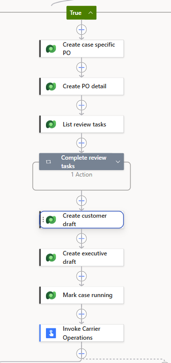

## Step 8: Create CP7 or fail closed

1. After the child flow, add an **If** named **Carrier verified**.
2. Require both:

   | Left value | Operator | Right value |
   | --- | --- | --- |
   | `outputs('Invoke_Carrier_Operations')?['body/terminalMarker']` | is equal to | `CARRIER_VERIFIED` |
   | `empty(outputs('Invoke_Carrier_Operations')?['body/activityId'])` | is equal to | Boolean `false` |

3. In True, add **Create CP7** to create one `Execution Evidence` row with
   these current columns:

   | Field (logical name) | Value |
   | --- | --- |
   | Evidence Number (`ppcc_evidencenumber`, primary name) | `concat('CP7-',substring(replace(outputs('Get_Decision')?['body/ppcc_recoverydecisionid'],'-',''),0,8))` |
   | Evidence Type (`ppcc_evidencetype`) | **Carrier Response** (`100000000`) |
   | Evidence Link (`ppcc_evidencelink`) | `concat('flowsession:',outputs('Invoke_Carrier_Operations')?['body/activityId'])` |
   | External Correlation ID (`ppcc_externalcorrelationid`) | `outputs('Invoke_Carrier_Operations')?['body/activityId']` |
   | Result Summary (`ppcc_resultsummary`) | `concat('CP7-ACTION; ',outputs('Invoke_Carrier_Operations')?['body/terminalMarker'],'; PO ',outputs('Create_case_specific_PO')?['body/nwind_purchaseordernumber'])` |
   | Execution State (`ppcc_executionstate`) | **Completed** (`100000003`) |
   | Started On (`ppcc_startedon`) and Completed On (`ppcc_completedon`) | `utcNow()` for each field |
   | Disruption Case (`ppcc_disruptioncaseid`) | Bind the current case as in Step 6 |
   | Recovery Decision (`ppcc_recoverydecisionid`) | Bind the current decision as in Step 6 |

   Leave Communication Draft unset. `flowsession:<GUID>` is the durable
   correlation reference, not a fabricated screenshot URL; open the matching
   CUA Activity in Copilot Studio to inspect its replay.
4. Add **Resolve case after CP7** and set:
   - Disruption Status: **Resolved** (`100000006`)
   - Resolution Summary:
     `Approved Split Shipment recovery and Carrier Operations Agent submission verified.`
   - Closed On (`ppcc_closedon`): `utcNow()`

   Configure **Resolve case after CP7** to run only after **Create CP7**
   succeeds. A failed evidence write must not resolve the case.
5. In False, add **Mark case Needs Attention** and set:
   - Disruption Status: keep **In Execution** (`100000005`), not Resolved.
   - Resolution Summary: start with `Technical Needs Attention - no CP7.`
     and include the returned terminal marker and error.
6. Add **Create technical Needs Attention task**, link it to the case, and
   include the returned diagnostics in its description.
7. Also configure a failure-handling path to the Needs Attention actions when
   **Invoke Carrier Operations** fails or times out (rather than returning a
   normal response). After the child action, add a parallel branch with a
   Scope named **Carrier call failed**. On that scope, use **Configure run
   after** for **Invoke Carrier Operations**: select **has failed** and
   **has timed out**, and clear **is successful** and **is skipped**. Keep
   **Carrier verified** configured to run only when the child succeeds.
   In the failure scope, add the same case update and technical task as
   steps 5–6, but use a fixed `Technical Needs Attention - no CP7.` summary
   with `workflow()?['run']?['name']` and the child-action failure details,
   not response fields that may be absent. Do not invoke the child again,
   write CP7, or resolve the case in this scope.

Do not create CP7 in the False branch. Do not resolve the case merely because
the child flow returned.

**Needs Attention** is the task/summary outcome, not a new case Choice value.
The current Disruption Case uses Disruption Status, Resolution Summary, and
Closed On; do not add case Approval State, Execution State, or Carrier State
columns. Approval is on the Recovery Decision; execution proof is on the
evidence and carrier ledger records.

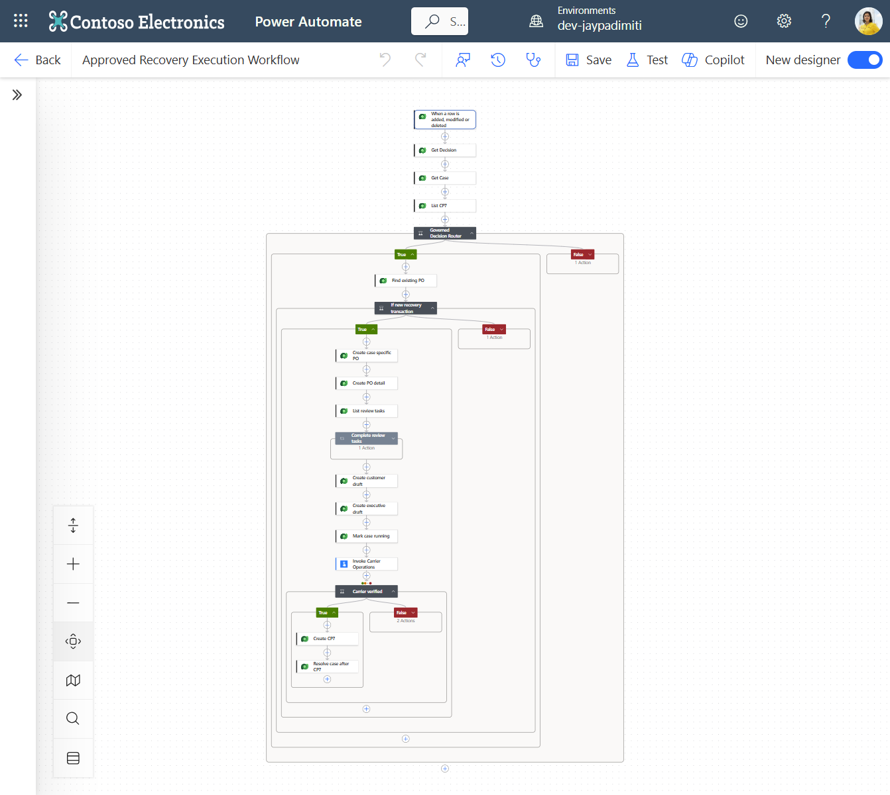

The following screenshots show the expected browser-side state before and
after a verified submission. You will observe the automatic run in Module 6.

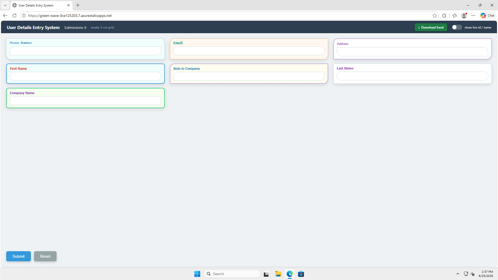

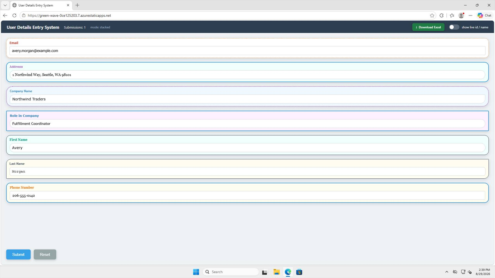

## Step 9: Handle non-approved decisions

In **Governed Decision Router** > **False**:

1. Add an **If** named **If Rejected**.
2. Test whether Approval State equals **Rejected** (`100000002`).
3. In True, update the case:
   - Disruption Status: **Rejected** (`100000008`)
   - Resolution Summary:
     `Recovery was rejected by the human approver. No purchase order, carrier operation, or completion evidence was created.`
4. In False, add a Compose action named **Guard mismatch noop**.

Any non-approved, non-rejected value fails closed through the no-op branch.

## Step 10: Save, check, and publish

1. Select **Save**.
2. Run **Flow checker**.
3. Resolve every error. Expected warnings must not weaken the approval, replay,
   or evidence guards.
4. Confirm the Microsoft Copilot Studio connection reference used by
   **Invoke Carrier Operations** is authenticated.
5. Select **Publish** or **Turn on**, depending on the designer.
6. Return to the solution and confirm both cloud flows are listed:
   - **Invoke Carrier Operations**
   - **Approved Recovery Execution Workflow**
   Also confirm **Carrier Operations Agent** is included in
   `PPCCAgenticOperationsControlTower`, with **Register Shipping Contact**
   attached to that agent and the required connection references present.
   Do not move the parent or child flow into a separate solution.
7. Do not approve the workshop Recovery Decision yet. Module 6 performs the
   single consequential test.

## If validation or save fails

- **Required property `$schema` not found**: restore the prepared adapter. Its
  workflow definition, trigger schema, response actions, and definition
  outputs must remain intact.
- **InvalidOpenApiConnectionOperationType** for `ExecuteCopilotAsyncV2`:
  restore the prepared adapter. **Execute Agent and wait** must be
  `OpenApiConnectionWebhook`, not `OpenApiConnection`.
- **Message or Locale is no longer present in the operation schema**: restore
  the current action contract. The connector parameters are `body/message` and
  `body/locale`.
- **Broken Microsoft Copilot Studio connection**: select an authenticated
  Microsoft Copilot Studio connection reference for the workshop account.
- **Child flow is unavailable or shows old inputs**: confirm both flows are
  in the same solution, reselect the current Step 4 child ID, and map its
  eleven camelCase inputs. It uses a manual Request trigger and one typed
  `Respond_to_parent` action with four outputs.
- **No agent or multiple agents found**: verify exactly one active Bot has
  the expected display name. The connector takes its `schemaname`, not
  `botid`, and the current environment ID.
- **Verified text but ambiguous result**: inspect `isPlanFinished`, the exact
  first marker token, operation-key echo, and conversation ID. Then inspect
  the bounded transcript wait, unique `cuaSessionId`, and exact successful
  `flowsessions` record. Do not retry the agent to obtain missing evidence.
- **Evidence columns missing**: use Evidence Number, Evidence Type, Evidence
  Link, Result Summary, Communication Draft, External Correlation ID,
  Started On, Completed On, and both case/decision lookups as mapped above.
  Do not add legacy Stage or System columns to make old screenshots work.
- **Choice comparison never matches**: verify that numeric Choice values were
  entered through **fx** and that the trigger filters `ppcc_approvalstate`.
- **A carrier operation already exists**: inspect the existing operation and
  attempt. Do not delete the ledger or invoke the agent manually to force a
  rerun.

## Lab completion

You have completed the module when:

- Carrier Operations Agent is published with the exact expected display name.
- Register Shipping Contact has seven inputs and is restricted to the approved
  site and Microsoft Edge.
- One direct fixture test succeeded and its replay proves one submission.
- Invoke Carrier Operations has bound local connection references, eleven
  camelCase inputs, one typed four-output response, persisted approval
  guards, one non-retried agent call, and bounded correlated evidence checks.
- Approved Recovery Execution Workflow uses the Choice-based schema and
  filters on `ppcc_approvalstate`.
- The approved path contains replay protection, deterministic recovery, the
  child-flow call, CP7 gating, and Needs Attention failure handling.
- Rejected and guard-mismatch paths perform no consequential action.
- No Recovery Decision has been approved during this module.

## Summary

You created a bounded browser agent and a governed Power Automate recovery
path. The cloud flow reads the persisted human decision, prevents duplicate
recovery, performs deterministic Dataverse work, and calls the agent through a
durable child-flow adapter.

The design fails closed. Only a verified carrier result with the correlated
CUA Activity GUID creates CP7 and resolves the case. Ambiguous or failed
outcomes create Needs Attention, and communication records remain unsent drafts.

## Documentation and learning resources

- [Call a Copilot Studio agent from Power Automate](https://learn.microsoft.com/en-us/power-automate/call-copilot-studio-agent)
- [Create a cloud flow in a solution](https://learn.microsoft.com/en-us/power-automate/create-flow-solution)
- [Create child flows](https://learn.microsoft.com/en-us/power-automate/create-child-flows)
- [Trigger a flow when a Dataverse row changes](https://learn.microsoft.com/en-us/power-automate/dataverse/create-update-delete-trigger)
- [List Dataverse rows](https://learn.microsoft.com/en-us/power-automate/dataverse/list-rows)
- [Get a Dataverse row by ID](https://learn.microsoft.com/en-us/power-automate/dataverse/get-row-id)
- [Workflow expression functions](https://learn.microsoft.com/en-us/azure/logic-apps/workflow-definition-language-functions-reference)
