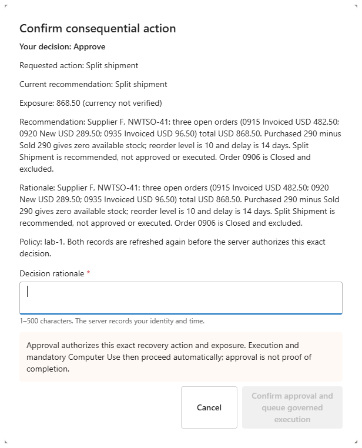
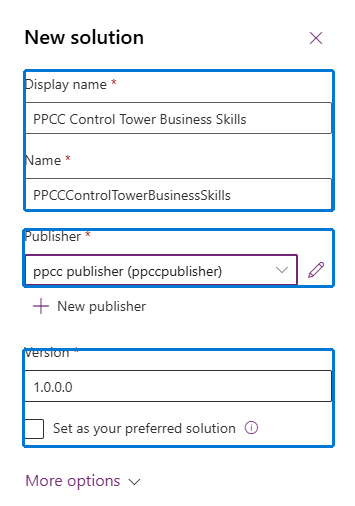
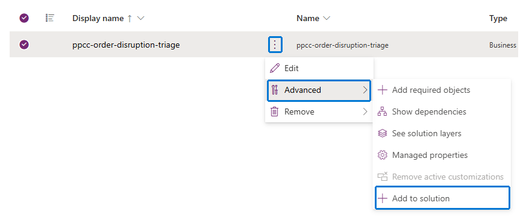
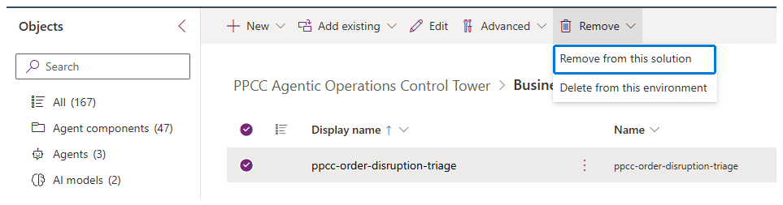
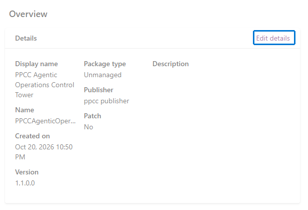
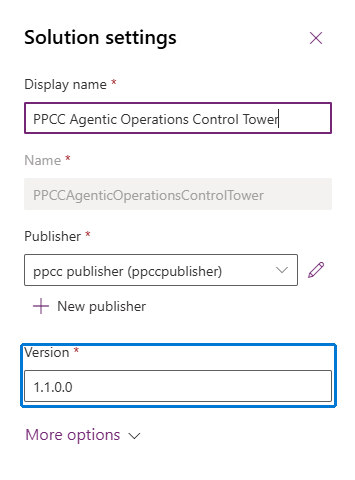

# Module 6: Approve, deploy, and replay

**Estimated time:** 90 minutes, plus deployment and recovery time.

Screenshots show examples. Use your assigned environments, mission, and solution versions.

## Before you start

- Your facilitator has released this exercise after Modules 1–5.
- You have your DEV mission number, assigned demo mailbox, and demo account.
- Your access card identifies DEV, TARGET, and the assigned pipeline/stage.
- TARGET has no workshop solutions, sample data, or pre-created connections.

The page may say **“(currency not verified)”**. Ask the facilitator to confirm USD on the exact case and decision before each approval.

**One approval, then observe only until Resolved or failure.** Never rerun recovery, submit the carrier form, change statuses, or send communications.

## Task 1: Review the DEV recommendation

1. Open **PPCC Agentic Operations Control Tower** in DEV.
2. Select **Agent feed**.
3. Select **Needs attention**.
4. Open the item for your DEV mission.
5. Check **Split Shipment**, three affected orders, and **868.50**.
6. Select the item's related **Disruption Case** link.
7. Confirm that the linked case is your DEV mission.
8. Select **Control Tower Home** in the app navigation.
9. Select your DEV mission.
10. Check that its current decision is **Pending** and assigned to you.

**Expected result:** the Feed item matches your case. If review is blocked or the case is wrong, stop before approving.

## Task 2: Approve once

1. Select **Review and approve recovery plan**.
2. Enter your reason in **Decision rationale**; use 1–500 characters.

   

   *Layout example only. Use your assigned mission; confirmation becomes available after you enter a reason.*

3. Review the case, **Split Shipment** request, and **868.50** in
   **Confirm consequential action**.
4. Select **Confirm approval and queue governed execution** once.
5. Wait for the decision to show **Approved**.

**Expected result:** recovery starts automatically. If approval reports an
error or changed data, stop for your facilitator rather than clicking again.
Completing a Feed item is not business approval.

## Task 3: Observe the DEV recovery

1. Leave your mission open on **Control Tower Home**.
2. Wait for automatic recovery to finish.
3. Check that the case reaches **Resolved**.
4. Find **Execution evidence and communications** on the selected case.
5. Check that its **Carrier response** row shows **Recorded state: Succeeded**.
6. Select **Open evidence form** for that row.
7. In a new tab, open <https://copilotstudio.preview.microsoft.com>.
8. Select DEV in the environment picker.
9. Select **Agents**.
10. Open **Carrier Operations Agent**.
11. Select **Activity**.
12. Open the **Automated** row your facilitator identifies for this case.
13. Select **Register Shipping Contact**.
14. Select **ExecuteCUA**.
15. Find the **Session replay** section.
16. Compare its screenshots: **Submissions: 0** before and **Submissions: 1**
    after, in this same Activity.
17. Confirm **Submit** occurred once.
18. Return to **Execution evidence and communications** in the app.
19. Check that the customer-update and executive-briefing summaries describe
    drafts only, with no external communication sent.

**Expected result:** one carrier submission, matching case evidence, two
unsent drafts, and **Resolved**. Allow up to 20 minutes. A **Completed** row
alone is not Computer Use success: **Session replay** must show the actual
submission. If screenshots are missing or recovery fails, stop for your
facilitator; do not repeat approval or submission.

## Task 4: Create the Skill library

The Skill is a prerequisite, so its library must arrive before the app and
agents that use it. Solution membership changes what ships, not which policy
your DEV agents use.

Select **Solutions** whenever you switch between the two solutions below.

1. Open <https://make.preview.powerapps.com> in DEV.
2. Select **Solutions**.
3. Open **PPCC Agentic Operations Control Tower**.
4. Find its **Publisher** on **Overview**.
5. Return to **Solutions**.
6. Select **New solution**.
7. Enter these values:

   | Field | Value |
   | --- | --- |
   | Display name | `PPCC Control Tower Business Skills` |
   | Name | `PPCCControlTowerBusinessSkills` |
   | Publisher | The same existing publisher as the main solution |
   | Version | `1.0.0.0` |
   | Set as your preferred solution | Off |

   

8. Select **Create**.
9. Open **PPCC Agentic Operations Control Tower**.
10. Select **Objects**.
11. Select **Business Skill**.
12. Open **More commands** on the existing `ppcc-order-disruption-triage` row.
13. Point to **Advanced**.
14. Select **Add to solution**.

    

15. In **Select where you want to add the component**, choose
    **PPCC Control Tower Business Skills**.
16. Select **Save**.
17. Open **PPCC Control Tower Business Skills**.
18. Select **Objects**.
19. Select **Business Skill**.
20. Confirm the original Skill is listed before continuing.
21. Open **PPCC Agentic Operations Control Tower**.
22. Select **Objects**.
23. Select **Business Skill**.
24. Select that same original Skill row.
25. Select **Remove**.
26. Select **Remove from this solution**, never **Delete from this environment**.

    

27. Confirm that the Skill no longer appears in main.
28. Open the DEV **PPCC Agentic Operations Control Tower** app.
29. Select **Agent feed** to confirm it is still present.

**Expected result:** the same Skill is in the library, not main; DEV Feed remains.
If a required row or control is unavailable, stop—do not delete the Skill
or disconnect Feed.

## Task 5: Increase both solution versions

1. Open **PPCC Control Tower Business Skills** in DEV **Solutions**.
2. Select **Overview**.
3. Select **Edit details**.
4. In **Solution settings**, change **Version** to `1.0.0.1`.
5. Select **Update**.
6. Open **PPCC Agentic Operations Control Tower**.
7. Select **Overview**.
8. Select **Edit details**.

   

9. Increase the last number in **Version** by one, for example `1.1.0.0` to `1.1.0.1`.

   

10. Select **Update**.

**Expected result:** both versions increased; they do not need to match.

## Task 6: Deploy the Skill library FIRST

1. Open **PPCC Control Tower Business Skills** in DEV.
2. Select **Pipelines**.
3. Select the assigned pipeline.
4. Select **Deploy here** on your assigned TARGET stage.
5. Check DEV, TARGET, and **Now** on **Destination**.
6. Select **Next**.
7. Wait for validation to finish.
8. Select **Next** if an empty **Connections** page appears.
9. Check the library name and new version on **Summary**.
10. Select **Deploy** once.
11. Open **Run history**.
12. Wait for this deployment to show **Succeeded**.
13. Switch the maker portal to TARGET.
14. Open **Solutions**.
15. Confirm **PPCC Control Tower Business Skills** is **Managed**.

**Expected result:** the Skill library is installed; main is not installed yet.

## Task 7: Deploy main SECOND through the SAME pipeline

1. Switch the maker portal back to DEV.
2. Open **PPCC Agentic Operations Control Tower**.
3. Select **Pipelines**.
4. Select the same assigned pipeline.
5. Select **Deploy here** on the same TARGET stage.
6. Check the destination on **Destination**.
7. Select **Next**.
8. Wait for validation.
9. On **Connections**, open the first connector's selector.
10. Select **New connection** / **Create new** from this deployment wizard.
11. Confirm TARGET in the connection window, then sign in with your assigned demo account.
12. Return to the wizard.
13. Select the connection you just created.
14. Repeat steps 9–13 for each connector family:

    | Connector family | Connection to create here |
    | --- | --- |
    | Microsoft Dataverse | Your TARGET connection |
    | Microsoft Copilot Studio | Your TARGET connection |
    | Power Apps MCP Server | Your TARGET connection |
    | Office 365 Outlook | Your assigned demo mailbox connection |
    | Computer use | **Connect to hosted browser** |

15. Map the second Dataverse binding to the Dataverse connection just created.
16. Confirm all **six bindings** across the **five connector families** are mapped.
17. Select **Next**.
18. On **Environment variables**, find **PPCC Intake Subject Prefix**.
19. Enter **PPCC-TARGET** as its TARGET value.
20. Select **Next**.
21. Check main's name, new version, TARGET, and prefix on **Summary**.
22. Select **Deploy** once.
23. Open **Run history**.
24. Wait for this deployment to show **Succeeded**.

**Expected result:** main follows the library through the same pipeline.
Create connections only inside this deployment; reuse only one created earlier
in this same attempt. Complete MFA attended if requested. Never choose
**Connect to machine** or enter a machine password. If the wizard cannot
create a required connection, stop—do not create one elsewhere.

## Task 8: Open the managed TARGET app

1. Switch the maker portal to TARGET.
2. Select **Solutions**.
3. Confirm both library and main show **Managed**.
4. Select **Apps**.
5. Select **Play** for **PPCC Agentic Operations Control Tower**.
6. Confirm **Control Tower Home** opens.
7. Confirm **Agent feed** is present.

**Expected result:** the transported app and Feed work without TARGET app
**Edit**, **Add to feed**, or **Save and Publish**.

**Facilitator checkpoint:** after both deployments, ask your facilitator to
load the workshop sample data and confirm your approver access and mailbox
readiness. Continue only when the three eligible orders total **868.50** and
the app is ready for a new TARGET mission.

## Task 9: Send one TARGET disruption notice

1. Open Outlook with your assigned demo account.
2. Select **New mail**.
3. Enter the assigned workshop demo mailbox in **To**.
   Select the matching recipient from the suggestions.
4. Enter this **Subject**, replacing the reference with your new unique value:

   ```text
   PPCC-TARGET - Supplier delay [REF:<your-new-target-reference>]
   ```

5. Paste this message into the body:

   ```text
   Workshop simulation only.

   Supplier F reports a 14-day delivery delay for:

   Product name: Northwind Traders Clam Chowder
   Product code: NWTSO-41

   Please assess the impact on eligible orders.
   No recovery action has been approved.
   ```

6. Select **Send** once.
7. Open **Control Tower Home** in TARGET.
8. Wait for the new case matching your reference.
9. Open that case.
10. Check three impacted orders, **868.50**, and a current **Pending** decision.

**Expected result:** a new TARGET case, not the DEV case. Do not send the notice
to a real supplier or customer, or send it again while waiting.

## Task 10: Request and review TARGET supervision

1. Select **Recovery Decisions** in the TARGET app.
2. Open the current **Pending** decision for your new case.
3. Append this sentence to **Recommendation Rationale**:
   `Human review requested for the current Split Shipment recommendation`
4. Select **Save** once.
5. Open **Agent feed**.
6. Select **Needs attention**.
7. Wait for the one item matching your new TARGET case.
8. Open the item.
9. Check the recovery recommendation and affected-order values.
10. Select its related **Disruption Case** link.
11. Confirm it opens the same TARGET case.

**Expected result:** one TARGET review item linked to the correct case.
Do not complete the Feed item as a substitute for approval.

## Task 11: Approve and observe the TARGET recovery

1. Select the new TARGET mission on **Control Tower Home**.
2. Select **Review and approve recovery plan**.
3. Enter your reason in **Decision rationale**.
4. Review **Split Shipment** and **868.50** in **Confirm consequential action**.
5. Select **Confirm approval and queue governed execution** once.
6. Observe only until the case is **Resolved**.
7. In Copilot Studio, select TARGET in the environment picker.
8. Open **Agents** > **Carrier Operations Agent** > **Activity**.
9. Open the **Automated** row identified for this TARGET case, not the DEV row.
10. Select **Register Shipping Contact** > **ExecuteCUA**.
11. Find **Session replay** and use Task 3's screenshot checks to confirm one submission.
12. Return to the TARGET case and check its carrier evidence and two unsent drafts.

**Expected result:** the TARGET mission finishes independently, with its own
successful Activity and **Submissions: 0 → 1** in that same session.

## Completion checkpoint

- DEV and TARGET each finished after one exact approval and automatic recovery.
- Both missions have successful matching Computer Use and two unsent drafts.
- The original Skill and DEV Feed were preserved.
- The library deployed managed FIRST, then main managed SECOND on the same pipeline.
- TARGET connections were created in that deployment, without app repairs.

# Congratulations on completion of the Agentic Control Tower!
